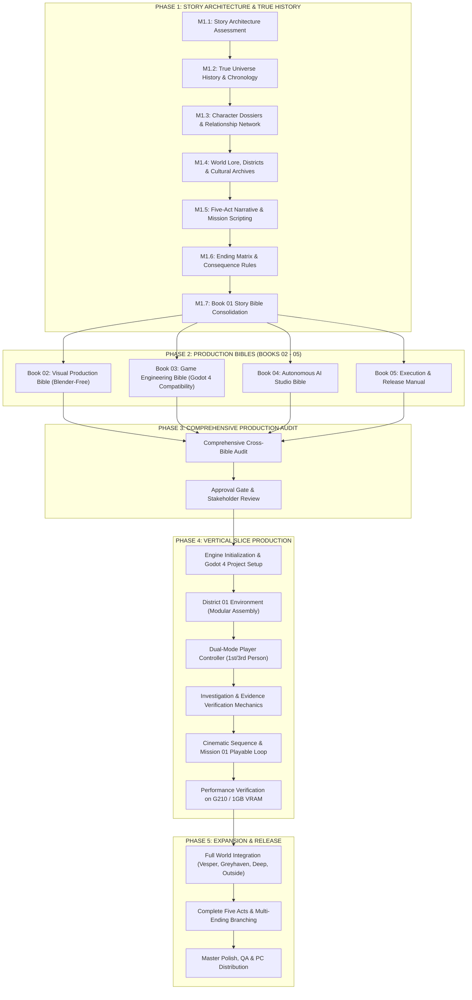

# PROJECT NULL — MASTER PRODUCTION ROADMAP

---

## PRODUCTION PHASE BREAKDOWN

### Phase 1: Master Creative Direction & Narrative Architecture (CURRENT)
- **Goal:** Establish the deterministic, unshakeable truth of the universe, all character trajectories, all missions, and consolidate the authoritative `BOOK 01 — STORY BIBLE`.
- **Primary Rule:** Do not begin code or map assets until narrative truth is locked and audited.

### Phase 2: Production Bibles
- **Goal:** Draft Books 02, 03, 04, and 05 with complete, production-grade specifications.
- **Primary Rule:** Every system must be detailed down to interfaces, data contracts, polygon/texture limits, and autonomous agent workflows.

### Phase 3: Project Audit & Approval Gate
- **Goal:** Audit narrative consistency, technical feasibility, asset budgets against measured hardware (G210 1GB VRAM, Compatibility renderer), and obtain formal approval.

### Phase 4: Vertical Slice (Vesper — District 01)
- **Goal:** Deliver a playable, verified slice showcasing the full gameplay loop, investigation mechanics, dual-perspective camera, and atmospheric tension.

### Phase 5: World Expansion & Final Release
- **Goal:** Scale across Vesper, Greyhaven, The Deep, and The Outside to deliver the complete cinematic experience.
