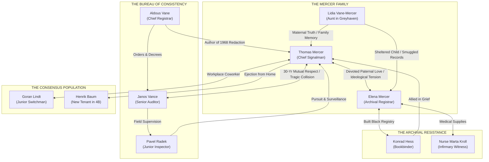

# PROJECT NULL — BOOK 01: THE STORY BIBLE
## PART II: CHARACTER DOSSIERS & RELATIONSHIP NETWORK
**Document ID:** PNL-STORY-CHAR-001  
**Classification:** Canonical Character Bibles  
**Version:** 1.0.0  
**Date:** 2026-11-05  
**Author:** Master Creative Director & Lead Narrative Designer  

---

## 1. CHARACTER DESIGN PRINCIPLES & GUARDRAILS

To preserve narrative realism and emotional weight, every character in PROJECT NULL is governed by four strict design rules:
1. **The Principle of Independent Agency:** No character exists merely to hand Thomas a key or explain the plot. Every individual has their own life, mortgages, grief, debts, and conflicting moral loyalties.
2. **The Principle of Restricted Knowledge:** Characters only know what their social position, job duties, and physical location permit them to know. Nobody has an omniscient view of the "conspiracy."
3. **The Banality of Complicity:** The antagonists are not comic-book monsters. They are tired civil servants, engineers, and neighbors convinced that forgetting the past is the only way to prevent another civil war.
4. **Dialogue Specificity:** Dialogue reflects specific vocational backgrounds: railway mechanical jargon, bureaucratic legalism, medical clinical precision, or working-class understatement.

---

## 2. PRIMARY CHARACTER DOSSIERS

```
┌─────────────────────────────────────────────────────────────────────────────┐
│                       PRIMARY CHARACTER REGISTER                            │
├─────────────────┬──────────┬──────────────────────┬─────────────────────────┤
│ ID              │ Name     │ Role                 │ Archetype               │
├─────────────────┼──────────┼──────────────────────┼─────────────────────────┤
│ CHAR-MERC-001   │ Thomas   │ Chief Signalman      │ The Returning Man       │
│ CHAR-MERC-002   │ Elena    │ Senior Registrar     │ The Absence             │
│ CHAR-VANC-003   │ Janos    │ Consistency Auditor  │ The Weary Shepherd      │
│ CHAR-VANE-004   │ Aldous   │ Chief Registrar      │ The Architect of Record │
│ CHAR-HESS-005   │ Konrad   │ Master Bookbinder    │ The Keeper of the Ash   │
└─────────────────┴──────────┴──────────────────────┴─────────────────────────┘
```

---

### CHAR-MERC-001: THOMAS ARTHUR MERCER (THE RETURNING MAN)

#### 1. Identity & Overview
- **Role:** Chief Railway Signalman & Station Clockwork Mechanic (Vesper West Junction).
- **Date of Birth:** March 12, 1948. **Age at Opening:** 56 years, 7 months (October 19, 2004).
- **Physical Profile:** Height 182 cm; heavy-set, broad-shouldered with a habitual stoop acquired from inspecting low track clearances. Steel-grey hair cut close; deep crow's-feet around observant grey eyes. Hands calloused and permanently stained with black machine lubricant and metal polish.
- **Costume:** Heavy charcoal wool rail inspector's double-breasted overcoat with dull pewter buttons; dark brown corduroy trousers tucked into scuffed, oil-treated lace-up work boots; a hand-knitted olive wool scarf; and an oiled canvas courier satchel containing his pocket tools.

#### 2. Psychological Architecture
- **Core Motivation:** To maintain order, protect the living, and atone for an unspoken crime by ensuring nothing under his care fails or breaks down.
- **Psychological Flaw:** Extreme emotional avoidance. When confronted with unbearable emotional pain, Thomas retreats into mechanical routine. He cleans clock escapements, checks track voltages, and polishes brass rather than addressing human conflict.
- **The Core Trauma:** On November 20, 1968, as an apprentice switchman, Thomas followed written municipal orders and manually threw Ground Lever #14 at West Junction, diverting the sealed cattle cars carrying 800 interned District 09 civilians into the dark subterranean tunnels of The Deep. He was told they were being relocated to a temporary transit camp; they were never brought back up.
- **Mnemonic Condition:** Thomas suffers from self-protective autobiographical amnesia. He has buried the memories of 1968 beneath thirty-six years of train timetables. When anomalies appear, his instinct is to doubt himself: *"I'm working too many night shifts; my eyes are playing tricks."*

#### 3. Voice & Performance Direction
- **Vocal Quality:** Low, gravelly, quiet baritone. Speaks only when necessary. Pauses before speaking, as if mentally drafting the sentence.
- **Key Dialogue Mannerisms:** Uses railway and mechanical metaphors ("The line is fouled," "Check the clearance," "Keep the spring tension even"). Never raises his voice; when terrified or furious, his tone drops lower and becomes colder.

#### 4. Story Progression & Potential Outcomes
- **Act I:** Total bewilderment and defensive denial. He believes an administrative filing error occurred at Krupp Street.
- **Act II:** Active investigator. Using his railway access and mechanical skills, he uncovers the trail of Elena's hidden caches.
- **Act III:** Confrontation with institutional reality in The Deep.
- **Act IV:** Crushing psychological collapse upon reading his own 1968 dispatch signature in The Black Registry.
- **Act V (Branching Outcomes):**
  - *Preservation:* Accepts the sedative of amnesia, submitting his key to the Bureau to live out his days in quiet oblivion.
  - *Recognition:* Drives the lead-shielded archive train into Central Station, shattering the consensus at the cost of his own life or freedom.
  - *Release:* Steps beyond the boundary of Vesper into The Outside, abandoning the corrupted ledger forever.

---

### CHAR-MERC-002: ELENA MARTHA MERCER (THE ABSENCE)

#### 1. Identity & Overview
- **Role:** Senior Archival Registrar (Central Hall of Records, Cadastral De-Registration Division).
- **Date of Birth:** August 19, 1978. **Age at Opening:** 26 years, 2 months (October 19, 2004).
- **Physical Profile:** Height 168 cm; slender, athletic build. Dark brown hair cut bluntly at the jawline; high cheekbones; sharp, penetrating grey eyes identical to her father's. Her left forearm bears a faint 4cm scar from a broken microfiche viewer bulb.
- **Costume:** Tailored charcoal wool clerk's jacket with mother-of-pearl buttons; pleated dark skirt; sturdy lace-up leather oxford shoes; and a signature plum-colored heavy wool overcoat tailored with reinforced interior pockets designed to conceal stolen folio sheets.

#### 2. Psychological Architecture & Agency
- **Core Motivation:** To dismantle the lie of Vesper and restore the names and lives of the erased to the physical record.
- **Psychological Flaw:** Ruthless moral absolutism. Elena has little patience for human weakness, compromise, or fear. She deeply loves her father but viewed his compliance with the Bureau as moral cowardice, failing to understand the paralyzing terror that gripped the survivors of the 1968 war.
- **Her Independent Operation:** Elena was not captured by surprise. For two years, she operated an underground resistance cell from within the Hall of Records:
  - She systematically stole 1,418 duplicate carbon-copy registration slips before they reached the incinerator.
  - She recruited bookbinder Konrad Hess to create the lead-bound *Black Registry*.
  - She mapped the forgotten drainage passages between District 01 and The Deep.
- **Her Current State:** On September 28, 2004, facing imminent arrest by Bureau security, Elena retreated into The Deep and sealed herself inside Vault 04. She has limited rations, a hand-cranked air scrubber, and an acoustic listening pipe, waiting for her father to follow the mechanical trail she left behind.

#### 3. Voice & Audio Logs Direction
- **Vocal Quality:** Crisp, clear, measured alto. Highly articulate, dryly witty, but possessing a deep undercurrent of fierce moral passion.
- **Key Dialogue Mannerisms:** Speaks with legal and archival precision ("Documentary evidence," "Cadastral discrepancy," "Trace residue"). In audio recordings, she records observations with clinical detachment until speaking directly to Thomas, where her voice softens with sorrow and hope.

---

### CHAR-VANC-003: INSPECTOR JANOS VANCE (THE WEARY SHEPHERD)

#### 1. Identity & Overview
- **Role:** Chief Field Auditor (Bureau of Municipal Consistency, District 01 Enforcement Division).
- **Date of Birth:** January 4, 1943. **Age at Opening:** 61 years old.
- **Physical Profile:** Height 175 cm; slightly stooped, thinning white hair combed back. Wears thick tortoise-shell reading spectacles that constantly slip down his nose. Pale, tired skin; reeking of cheap chicory coffee, throat lozenges, and pipe tobacco.
- **Costume:** Rumpled heavy grey tweed three-piece suit; a stained beige gabardine trench coat; scuffed leather galoshes; always carries a heavy vulcanized-fiber clipboard and an inked brass municipal cancellation stamp.

#### 2. Psychological Architecture
- **Core Motivation:** To prevent another civil war at all costs. Janos fought in the Winter of Ashes as a 23-year-old militia conscript and personally witnessed his younger brother burn to death in a District 09 tenement.
- **The Philosophy:** Janos is not malicious or sadistic. He is a deeply exhausted man who views his job as a tragic, necessary mercy: *"You think we do this because we enjoy erasing people, Mercer? We do it because if those people come back, the shooting starts again tomorrow. Ignorance is the only mortar holding this city together."*
- **Relationship to Thomas:** Known Thomas for thirty years through municipal coordination. Respects Thomas as an honest worker, but is horrified when Thomas begins digging into Elena's disappearance. Janos repeatedly offers Thomas "an honorable retirement with clean papers" to save his life.

#### 3. Voice & Performance Direction
- **Vocal Quality:** Husky, raspy, tired tenor. Heavy smoker's wheeze. Speaks in a calm, grandfatherly, bureaucratic cadence.
- **Key Dialogue Mannerisms:** Sighs deeply before delivering devastating ultimatums. Uses euphemisms for horror ("A routine cadastral balancing," "Administrative closure," "Settling an open ledger").

---

### CHAR-VANE-004: CHIEF REGISTRAR ALDOUS VANE (THE ARCHITECT OF RECORD)

#### 1. Identity & Overview
- **Role:** Executive Director of the Vesper Central Hall of Records; Signatory to the 1968 Great Settlement.
- **Date of Birth:** June 22, 1936. **Age at Opening:** 68 years old.
- **Physical Profile:** Height 185 cm; tall, rail-thin, aristocratic posture. Stark white hair parted down the center; pale, icy blue eyes; impeccably manicured hands. Wears pristine, custom-tailored dark navy wool suits that look thirty years out of date.
- **Costume:** Severe dark suits, starched white wing-collars, a platinum pocket watch on an Albert chain, and a heavy gold signet ring bearing the 1912 municipal seal.

#### 2. Psychological Architecture
- **Core Motivation:** The preservation of institutional order, cadastral perfection, and state authority above all human consideration.
- **Psychological Flaw:** Total emotional detachment. To Aldous Vane, human beings are merely temporary annotations on parchment. If the parchment says a person never existed, their physical presence is an offensive clerical error that must be corrected.
- **Historical Role:** Vane drafted the exact legal terminology of the 1968 Settlement. He invented the legal concept of "Cadastral Redaction." He has lived in the fortified upper floors of the Hall of Records for thirty years, insulated from the street.

#### 3. Voice & Performance Direction
- **Vocal Quality:** Cold, resonant, aristocratic baritone. Perfect diction, devoid of colloquialisms or emotional fluctuation.
- **Key Dialogue Mannerisms:** Never interrupts; lets opponents speak until they exhaust themselves, then responds with devastating administrative statutes. Refers to citizens exclusively by their file registration numbers.

---

### CHAR-HESS-005: KONRAD HESS (THE KEEPER OF THE ASH)

#### 1. Identity & Overview
- **Role:** Master Bookbinder, Letterpress Printer, and Archival Restorer (Old Canal District).
- **Date of Birth:** September 14, 1932. **Age at Opening:** 72 years old.
- **Physical Profile:** Height 165 cm; diminutive, bent spine from sixty years over a binding press. Gnarled, ink-stained fingers; thick magnifying loupe perched on his forehead. Wears an oilcloth printer's apron over a faded woolen sweater.

#### 2. Psychological Architecture & Agency
- **Core Motivation:** Revenge through preservation. Konrad lost his wife, two daughters, and his original letterpress shop in the 1967 District 09 firestorm. When the 1968 Settlement erased his family's names, Konrad vowed to outlive the regime and preserve the truth in materials that could not burn.
- **His Role in The Black Registry:** Konrad was Elena Mercer’s technical mentor and conspirator. He designed the lead-bound covers, forged the brass lock clasps, and taught Elena how to use carbon-transfer paper that resists chemical bleaching.
- **His Personality:** Cynical, darkly humorous, fearless because he has nothing left to lose. He views the Bureau with bitter contempt.

#### 3. Voice & Performance Direction
- **Vocal Quality:** Dry, crackling, sharp baritone with a rasping smoker's laugh.
- **Key Dialogue Mannerisms:** Speaks in blunt, working-class printer's terms ("Ink bites into paper," "Lead stops the rot," "They can burn the flesh, but they choke on the type").

---

## 3. THE WITNESS NETWORK (SUPPORTING CAST)

```
┌─────────────────────────────────────────────────────────────────────────────┐
│                          WITNESS NETWORK MATRIX                             │
├─────────────────┬──────────┬────────────────────────┬───────────────────────┤
│ ID              │ Name     │ Location               │ Narrative Function    │
├─────────────────┼──────────┼────────────────────────┼───────────────────────┤
│ CHAR-KROL-006   │ Marta    │ St. Jude's Infirmary   │ Medical Witness       │
│ CHAR-LIND-007   │ Goran    │ West Junction Yards    │ Working-Class Skeptic │
│ CHAR-AUNT-008   │ Lidia    │ Greyhaven Village      │ Generational Memory   │
│ CHAR-RADE-009   │ Pavel    │ Bureau Field Unit      │ Zealous Junior Officer│
│ CHAR-BAUM-010   │ Henrik   │ 14 Krupp St., Apt 4B   │ The Innocent Usurper  │
└─────────────────┴──────────┴────────────────────────┴───────────────────────┘
```

---

### CHAR-KROL-006: NURSE MARTA KROLL
- **Age:** 52. Head Nurse at St. Jude’s Public Infirmary (District 01).
- **Motivation:** To provide medical comfort to patients whom the municipal authorities refuse to treat.
- **Knowledge Boundary:** She does not understand the politics or the physics of Inscriptional Materialism, but she maintains a secret handwritten admissions ledger in her locker. She knows that every month, two or three patients in the terminal ward have their medical charts removed by Bureau men and are carried out the back door in unmarked ambulances.
- **Interaction with Thomas:** Thomas visits her to investigate the prescription bottle found in Elena’s apartment. Marta confirms Elena visited her secretly in August 2004 to obtain high-grade water purification tablets and medical dressings—supplies for a long underground stay.

### CHAR-LIND-007: GORAN LINDT
- **Age:** 47. Assistant Switchman and Track Inspector at West Junction (Thomas’s junior colleague).
- **Motivation:** To keep his pension, avoid trouble, and support his family.
- **Knowledge Boundary:** Knows the rail network intimately. Has noticed the 03:14 AM relay anomaly for six months. He was terrified to mention it to Thomas because he thought he was losing his mind or would be reported to the Bureau.
- **Interaction with Thomas:** When Thomas presses him about the night of October 18, Goran breaks down, confessing that two Consistency inspectors were inside the tower while Thomas was away, copying switch logs and rewiring the relay interlocks.

### CHAR-AUNT-008: LIDIA VANE-MERCER
- **Age:** 75. Elena’s maternal aunt (widow of Martha Mercer’s older brother), living in the remote coastal village of Greyhaven.
- **Motivation:** To guard the physical remnants of the Mercer and Vane family histories.
- **Knowledge Boundary:** Living beyond the reach of the city’s subterranean turbines, Lidia is entirely immune to the cognitive dampening. She remembers the Winter of Ashes with razor-sharp clarity.
- **Interaction with Thomas:** In Act II, when Thomas travels to Greyhaven, Lidia confronts him with brutal honesty. She presents Elena’s childhood drawings and a hidden chest of family heirlooms, forcing Thomas to face the reality of who his daughter was and what she was fighting against.

### CHAR-RADE-009: JUNIOR INSPECTOR PAVEL RADEK
- **Age:** 34. Field Officer, Bureau of Municipal Consistency (Janos Vance’s ambitious deputy).
- **Motivation:** Career advancement. Pavel is a true believer in the modern, clean, orderly Vesper. He has no personal memory of the 1968 war; to him, the Bureau is an objective scientific agency eradicating chaotic social errors.
- **Narrative Role:** The active physical antagonist in Acts I and II. He leads the search teams searching for Elena's missing caches and pursues Thomas through the condemned areas of District 01.

### CHAR-BAUM-010: HENRIK BAUM (THE MAN IN 4B)
- **Age:** 42. Schoolbook typesetter and father of two.
- **Motivation:** To live peacefully in his new home.
- **Narrative Role:** **An innocent civilian.** When Thomas arrives at his Krupp Street apartment in Act I, Henrik opens the door in his pajamas, holding a baby. Henrik is not a conspirator or an actor; he genuinely believes he bought the apartment six years ago. He has utility receipts, family portraits on the mantelpiece, and tax stamps to prove it.
- **Thematic Function:** Shows the horrific banality of the phenomenon: the consensus does not leave empty ghost houses; it seamlessly inserts innocent people into the excised space.

---

## 4. MASTER CHARACTER RELATIONSHIP NETWORK


