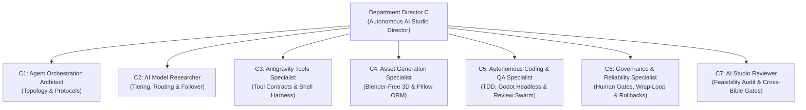

# PROJECT NULL — DEPARTMENT C: AUTONOMOUS AI STUDIO CHARTER
**Document ID:** PNL-CHARTER-DEP-C  
**Version:** 1.0.0 (Wave 1 Operational Charter)  
**Author:** Department Director C (Autonomous AI Studio Director)  
**Authority:** Production Director / Central Project Control  
**Effective Date:** 2026-11-05  
**Target Book:** Book 04: Autonomous AI Studio Bible (`04_AUTONOMOUS_AI_STUDIO_BIBLE.md`)  
**Status:** ACTIVE / MANDATE CODIFIED  

---

## 1. EXECUTIVE MISSION & PURPOSE

Department C (Autonomous AI Studio) functions as the autonomic nervous system, industrial automation plant, and quality enforcement engine of PROJECT NULL. 

In conventional game development studios, multi-disciplinary production requires massive human coordination overhead, disparate toolchains, inconsistent coding standards, and manual asset conversion pipelines. For PROJECT NULL, Department C establishes an entirely autonomous, multi-agent AI development studio operating under strict mathematical, technical, and governance constraints.

### The Autonomous AI Studio Mission:
> **"To architect, govern, and operate an end-to-end, multi-agent software and asset production studio that autonomously transforms narrative canon into fully verified, high-performance Godot 4 game code and 3D assets without human micro-management, without speculative code bloat, and with zero Blender dependencies."**

---

## 2. DEPARTMENT SCOPE & BOUNDARIES

### 2.1 In-Scope Responsibilities
1. **Multi-Agent Orchestration Architecture:**
   - Codifying the hierarchical multi-agent structure: Production Director $\to$ Department Directors $\to$ Domain Specialists $\to$ Independent Reviewers.
   - Establishing context-isolated task delegation protocols (`subagent-driven-development`).
   - Implementing wave-based parallel execution schedules (`dispatching-parallel-agents`).
   - Standardizing inter-agent messaging topology, schemas, and state handoffs (`send_message`).
2. **Model Routing, Tiering & Failover (`zoo-code`):**
   - Routing tasks across a multi-model zoo (Fast/Light, Deep Reasoning, Heavy Context, Local/Offline).
   - Dynamic rate-limit interception (HTTP 429 / Resource Exhausted) and seamless failover execution.
   - Context window economy and token conservation protocols.
3. **Agent Tools & Execution Environment:**
   - Formal specification of Antigravity native tools (`invoke_subagent`, `run_command`, `write_file`, `edit_file`, `read_file`, `search_marketplace`).
   - Standardizing headless CLI integrations: Windows PowerShell, Godot 4.7.2 headless console (`--headless`), Python 3.10+ execution, and Git CLI.
   - MCP server integration protocols (Chrome DevTools, Playwright, Godot automation bridges).
4. **Strict Blender-Free Asset Subsystems (`asset-pipeline-blender-free`):**
   - Automated 3D mesh sourcing (Poly Haven CC0) and generative 3D APIs (Meshy API, Tripo AI API).
   - Python-based binary GLB inspection (`inspect_glb.py`) enforcing vertex/triangle/material budgets.
   - Python-based automated PBR texture channel packing (`pack_orm.py` using Pillow) into combined Ambient Occlusion / Roughness / Metallic (ORM) maps.
   - Godot CSG modular blockout generation and static mesh export protocols.
5. **Autonomous GDScript Engineering & QA Swarm (`godot-compatibility-dev`, `coderabbit`, `code-review-agents`):**
   - Strict GDScript 2.0 static typing, architecture contracts, and decoupling rules.
   - Test-Driven Development (TDD) enforcement using headless Godot execution (`tests/run_tests.gd`).
   - Pre-commit static audits via automated CodeRabbit gates.
   - 5-Perspective code review swarms (Bug Hunter, Security Auditor, Git History Reviewer, Docs Verifier, Confidence Synthesizer with $\ge 85\%$ cutoff).
6. **Governance, Reliability & Self-Healing (`wrap-loop`, `ponytail`, `verification-before-completion`):**
   - Hard operational boundaries: What agents may execute autonomously vs. mandatory human approval gates.
   - Crash-resistant task execution loops (`wrap-loop`) with persistent checkpoints (`.wrap/checkpoint.json`).
   - The Negative Diff Gate (`ponytail`): strict YAGNI, standard library re-use, minimal surgical diffs.
   - Verification Before Claims: zero completion claims without fresh, documented execution evidence.
7. **Systemic Production Feasibility Audit:**
   - Independent verification that all agent tools, orchestration pipelines, and generation scripts produce real, working game systems in Godot 4 rather than synthetic markdown documentation.

### 2.2 Out-of-Scope Boundaries (Strictly Prohibited or Delegated)
- **Creative / Narrative Revision:** Department C does not alter the canonical history, characters, or dialogue established in Book 01 (`BOOK_01_STORY_BIBLE.md`). All story logic is binding.
- **Visual Style Ownership:** Department C designs the *subsystem and pipeline* for asset ingestion and optimization; the *artistic direction, color theory, and aesthetic mood* are owned by Department A (Book 02: Visual Production Bible).
- **Manual 3D Asset DCC Authoring:** Any workflow requiring interactive Blender, Maya, 3ds Max, or manual polygon pushing is strictly banned per **DEC-0002**.
- **Premature Production Implementation:** Zero production game assets, scenes, or gameplay scripts may be committed to `06_GAME_PROJECT/` until all five Master Bibles receive formal Human Director approval.

---

## 3. SPECIALIST ROSTER & WORK PACKAGES (C1 THROUGH C7)

Department C organizes its technical mandates into seven specialized roles. Each specialist owns a dedicated domain, strict technical constraints, and concrete deliverables for Book 04:



### 3.1 Specialist C1: Agent Orchestration Architect
- **Role Title:** Lead Agent Orchestration Architect
- **Domain:** Multi-agent hierarchy, communication topology, and execution lifecycle.
- **Installed Skill Anchors:** `dispatching-parallel-agents`, `subagent-driven-development`.
- **Mandate:**
  1. Define the 4-tier studio hierarchy:
     - Tier 0: Executive / Human Director (Final approval gates, strategic pivots).
     - Tier 1: Production Director (Cross-department sync, master roadmap, priority arbitration).
     - Tier 2: Department Directors (Scope owners: A-Visual, B-Engineering, C-Studio, D-Release).
     - Tier 3: Domain Specialists (Task implementers, context-isolated execution).
     - Tier 4: Quality Reviewers & Synthesizers (Adversarial auditors, pre-commit gates).
  2. Codify the task delegation protocol:
     - Context isolation rule: Subagents receive only the minimal, self-contained prompt and file references needed for their task. Subagents must never inherit parent conversational bloat.
     - Wave-based parallel dispatch: Group independent tasks into concurrent waves (`dispatching-parallel-agents`), synchronize on completion, and review as a single integrated package.
  3. Formalize inter-agent messaging contracts:
     - JSON-structured message envelopes for `send_message`.
     - Explicit task states: `DISPATCHED`, `IN_PROGRESS`, `BLOCKED`, `VERIFIED`, `REJECTED`.
  4. Conflict Resolution & Rulings Engine:
     - Clear priority ordering when specialist recommendations clash.
     - "Rulings, not stalls" principle: Technical rulings documented in the project ledger (`Ruling: <decision> — <rationale> — <cost if wrong>`) rather than parking runs on human prompts for non-critical ambiguities.

### 3.2 Specialist C2: AI Model Researcher
- **Role Title:** Multi-Model Infrastructure & Routing Specialist
- **Domain:** Model zoo classification, latency/cost tiering, quota failover, and token optimization.
- **Installed Skill Anchors:** `zoo-code`.
- **Mandate:**
  1. Construct the 4-Tier Model Matrix for PROJECT NULL:
     - **Tier 1 (Fast / Light):** Low latency, zero-shot edits, static analysis, log parsing, JSON validation (e.g., Gemini 2.5 Flash, Gemini 3 Flash, Claude 3.5 Haiku).
     - **Tier 2 (Deep Reasoning):** Algorithmic implementation, Godot architecture, dual-camera math, 5-agent code review, root-cause debugging (e.g., Claude 3.7 Sonnet Thinking, Gemini 3 Pro, OpenAI o3-mini).
     - **Tier 3 (Massive Context):** Global cross-bible audits, full repository dependency graphs, master storyline verification across 5 acts (e.g., Gemini 1.5/2.5 Pro 2M tokens).
     - **Tier 4 (Local / Air-Gapped):** Offline fallback, sensitive configuration parsing, deterministic linting (e.g., Qwen 2.5 Coder 32B via Ollama).
  2. Design the Zoo Code Failover Protocol:
     - Automatic detection of HTTP 429 (`RESOURCE_EXHAUSTED`), HTTP 503, and socket timeouts.
     - Immediate state snapshotting: dirty file paths, active objective, last verified command.
     - Automated provider failover cascade (e.g., Gemini Pro $\to$ Claude Sonnet $\to$ OpenAI o3-mini $\to$ Local Qwen).
  3. Implement Token Economy Policies:
     - Enforce line-range reads (`StartLine`/`EndLine`) over full-file dumps.
     - Prohibit re-emitting unchanged files in responses.
     - Mandatory context compaction intervals (`/compact` triggers).

### 3.3 Specialist C3: Antigravity Tools Specialist
- **Role Title:** Agent Environment & Tooling Engineer
- **Domain:** Native agent tool contracts, subagent lifecycle, MCP tools, and host CLI execution.
- **Installed Skill Anchors:** Native Antigravity tools, `chrome-devtools`, `playwright`.
- **Mandate:**
  1. Audit and standardize Native Agent Tool usage:
     - `invoke_subagent`: Asynchronous invocation, model selection, workspace isolation modes (`inherit`, `branch`, `share`).
     - `run_command`: Subprocess execution rules under Windows PowerShell, wait timeout budgets (`WaitMsBeforeAsync`), background task monitoring, exit code verification.
     - `write_file` vs. `edit_file`: Mandatory usage of surgical search-and-replace (`edit_file`) for existing code; `write_file` restricted to new file creation.
     - `read_file`: Line-bounded reads for token preservation.
     - `search_marketplace` & plugin integration boundaries.
  2. Define MCP Server Architecture:
     - Chrome DevTools MCP & Playwright MCP integration for automated UI verification, documentation rendering, and web scraping.
     - Design of a custom Godot Engine MCP bridge (evaluating feasibility of a headless Godot JSON-RPC bridge for live scene tree inspection).
  3. Establish Host OS Subprocess Contracts:
     - Execution environment: Windows 11, PowerShell 5.1/7.x.
     - Tooling binaries: `Godot_v4.7.2-stable_win64_console.exe`, Python 3.10+ (Pillow, NumPy, Trimesh), Git 2.40+.
     - Environment isolation and working directory persistence rules.

### 3.4 Specialist C4: Asset Generation Specialist
- **Role Title:** Blender-Free 3D Asset & Optimization Engineer
- **Domain:** Generative 3D mesh sourcing, automated inspection, texture packing, and CSG integration.
- **Installed Skill Anchors:** `asset-pipeline-blender-free`.
- **Mandate:**
  1. Enforce the Absolute Blender-Free Mandate (**DEC-0002**):
     - Zero reliance on Blender installations, `.blend` files, or Python-Blender headless scripts.
     - Pure standard library Python + Pillow + Trimesh pipelines for all geometry and texture processing.
  2. Codify Asset Sourcing Protocols:
     - **Poly Haven API Integration:** Automated pulling of CC0 PBR textures (cobblestones, weathered brick, corrugated iron, tarnished brass). Texture downsampling to $512\times 512$ or $1024\times 1024$.
     - **Generative AI Mesh APIs:** REST API contract for Meshy API (`v2/text-to-3d`, `v2/image-to-3d`) and Tripo AI API for hero props (vintage railway lanterns, dispatch punch clocks, dial telephones, telegraph keys).
  3. Automated GLB/glTF Binary Inspection (`inspect_glb.py`):
     - Direct binary parsing of GLB headers (magic `glTF`, version, chunks).
     - Automated validation of polygon budgets: Hero Props $\le 1,500$ triangles; Micro-props $\le 500$ triangles; Modular structural units $\le 800$ triangles.
     - Automated verification of material counts ($\le 1$ material per prop) and texture dimensions.
  4. PBR Texture Optimization & Channel Packing (`pack_orm.py`):
     - Pillow-based extraction and channel packing: Red = Ambient Occlusion, Green = Roughness, Blue = Metallic.
     - Enforcing single ORM texture per asset $\to$ eliminates 2 texture sampler bindings per draw call and saves 66% texture memory.
  5. Godot CSG Architectural Pipeline:
     - Modular blockout protocols for Vesper District 01 using `CSGBox3D`, `CSGCylinder3D`, `CSGPolygon3D`.
     - Automated conversion from CSG assemblies to unified static meshes for maximum runtime efficiency on NVIDIA GeForce G210.

### 3.5 Specialist C5: Autonomous Coding and QA Specialist
- **Role Title:** Lead Autonomous Systems & Testing Engineer
- **Domain:** GDScript code generation, TDD test harnesses, headless engine execution, and code review gates.
- **Installed Skill Anchors:** `godot-compatibility-dev`, `coderabbit`, `code-review-agents`.
- **Mandate:**
  1. Codify GDScript 2.0 Architectural & Coding Standards:
     - 100% static typing (`var speed: float = 5.0`, `func get_evidence() -> Array[EvidenceItem]:`).
     - Decoupled signal architecture via `event_bus.gd`.
     - Zero untyped dictionaries for core game state; use typed `Resource` or lightweight data classes.
  2. Implement Test-Driven Development (TDD) Protocol:
     - Red-Green-Refactor enforcement: Write headless unit tests first, verify failure, implement minimum code, verify pass.
     - Regression testing iron law: Any bug fix must include an automated regression test reproducing the failure.
  3. Headless Godot Test Execution Harness:
     - Command-line runner: `& "Godot_v4.7.2-stable_win64_console.exe" --headless --path "res://" -s "tests/run_tests.gd"`
     - Exit code contract: 0 for all pass, non-zero for test failures.
     - Unit test coverage for core systems: Camera Rig mode switching, Interaction Raycast detection, Evidence Registry cross-referencing, Game State persistence.
  4. Real-Time Pre-Commit Gate (`coderabbit`):
     - Automated pre-commit audit checking for: logic bugs, unhandled null references, performance bottlenecks (avoiding allocations inside `_process`), and dead code.
  5. 5-Perspective Code Review Swarm (`code-review-agents`):
     - Swarm execution: Agent 1 (Bug Hunter), Agent 2 (Security Auditor), Agent 3 (Git History & Context Reviewer), Agent 4 (Comment & Doc Verifier), Agent 5 (Confidence Synthesizer).
     - Confidence Scoring Gate: Findings strictly evaluated by formula:
       $$\text{Confidence Score} = \frac{\text{Severity} \times 0.4 + \text{Reproducibility} \times 0.4 + \text{Context Match} \times 0.2}{1.0}$$
     - Hard filter: Any finding below **85% confidence is discarded** to prevent hallucinated nitpicks.

### 3.6 Specialist C6: Governance and Reliability Specialist
- **Role Title:** Studio Governance & Reliability Officer
- **Domain:** Autonomous execution boundaries, human approval gates, audit trails, and self-healing loops.
- **Installed Skill Anchors:** `wrap-loop`, `ponytail`, `verification-before-completion`.
- **Mandate:**
  1. Define Autonomous Boundaries vs. Mandatory Human Approval Gates:
     - **Autonomous Execution Permitted:** Subagent dispatch, file creation/editing in designated bible and test folders, running headless tests, running Python inspection scripts, reading files, formatting, branch commits.
     - **Mandatory Human Approval Gate Required:**
       1. Any destructive disk operation (recursive deletion, force push, branch destruction).
       2. Any external API call incurring real financial cost (commercial Tripo/Meshy API tiers).
       3. Modifying project root governance files (`DECISION_LOG.md`, `MASTER_ROADMAP.md`).
       4. Transitioning between Production Phases (e.g., Phase 2 Bible Drafting $\to$ Phase 3 Audit $\to$ Phase 4 Code Implementation).
  2. Codify the Wrap Loop Engine (`wrap-loop`):
     - Autonomous self-healing execution cycle with state checkpointing (`.wrap/checkpoint.json`).
     - Circuit breakers: 15-iteration hard cap, oscillation detector (detecting cyclic edits across 3 iterations), and zero phantom progress enforcement.
  3. Enforce the Ponytail Negative Diff Gate (`ponytail`):
     - 5-point pre-code evaluation: Can this be solved with zero code? Does codebase already have this? Can we delete code? What is the minimum surgical diff? Token economy check.
     - Elimination of speculative abstractions, premature generalizations, and boilerplate factories.
  4. Enforce Verification Before Completion:
     - The Iron Law: "NO COMPLETION CLAIMS WITHOUT FRESH VERIFICATION EVIDENCE."
     - Zero assertions of passing tests or successful builds without providing the full command output and exit code in the same message.
  5. Version Control Conventions & Rollback Procedures:
     - Atomic conventional commit format: `feat:`, `fix:`, `refactor:`, `test:`, `docs:`, `chore:`.
     - Git tag releases per production milestone (`v0.1.0-bible-draft`, `v0.2.0-vertical-slice`).
     - Automated rollback runbook in case of corrupt scenes or broken dependencies.

### 3.7 Specialist C7: AI Studio Reviewer
- **Role Title:** Principal Systems & Feasibility Auditor
- **Domain:** Independent adversarial audit of studio orchestration, tool feasibility, and cross-bible contracts.
- **Installed Skill Anchors:** Independent verification, cross-domain systems analysis.
- **Mandate:**
  1. Autonomous Feasibility Audit:
     - Conduct a rigorous critique of the entire Autonomous AI Studio Bible outline.
     - Prevent the "Paper Studio" syndrome: Verify that agent toolchains, scripts, and orchestration protocols translate into functional Godot game binaries and assets rather than remaining hypothetical markdown essays.
  2. Technical Cross-Bible Contract Verification:
     - Audit Tool Contracts against Department A (Visual Production Bible): Are Python GLB inspection rules and Pillow ORM packing scripts completely compatible with Department A's visual style, modular kits, and lighting requirements?
     - Audit Tool Contracts against Department B (Game Engineering Bible): Are the headless Godot test runner, camera rig interfaces, and static typing standards 100% compliant with Department B's architecture?
  3. Hardware Feasibility Verification:
     - Audit all automation pipelines against the physical reality of the target hardware: Intel Core i5-12400F, 16GB RAM, NVIDIA GeForce G210 (1GB VRAM, OpenGL 3.3).
     - Ensure that no agent generates code or assets that exceed 250 draw calls, 1024 MB VRAM, or require compute shaders / Vulkan features.

---

## 4. CROSS-DEPARTMENT TOOL CONTRACTS & INTERFACES

Department C provides shared automation infrastructure across all production departments. The following formal contracts govern inter-department integration:

### 4.1 Interface Contract C $\to$ A (Visual Production Department)
- **Asset Intake Protocol:** All 3D assets generated by or sourced for Department A must pass through the automated Python validation gate:
  - Input: `.glb` binary file.
  - Script: `python 07_ASSETS/scripts/inspect_glb.py <model.glb> --max-tris 1500 --max-textures 3`
  - Output: Exit code 0 if compliant; JSON report with vertex/triangle count and texture dimensions.
- **Texture ORM Packing Protocol:**
  - Input: Individual grayscale maps for AO, Roughness, Metallic.
  - Script: `python 07_ASSETS/scripts/pack_orm.py --ao <ao.png> --rough <rough.png> --metal <metal.png> --out <packed_orm.png> --size 512`
  - Output: Single 3-channel RGB image saving 66% sampler bandwidth on the NVIDIA G210.
- **AI Mesh Generation Envelope:**
  - Standard JSON schema for dispatching generative 3D requests to Meshy/Tripo API.
  - Enforced parameters: topology `quad/tri`, polycount budget $\le 1,500$, PBR texture generation enabled at $512\times 512$.

### 4.2 Interface Contract C $\to$ B (Game Engineering Department)
- **Headless Test Runner Contract:**
  - Script: `08_TESTING/run_headless_tests.ps1` wrapping Godot console runner.
  - Contract: Standardized test report output format (`08_TESTING/test_results.json`).
  - Signal decoupling: Unit tests execute without requiring physical monitor displays or audio devices.
- **Pre-Commit Code Quality Gate:**
  - Staged GDScript files evaluated against CodeRabbit and 5-agent PR review filters.
  - Zero-warning requirement on static type hints: any untyped variable or function return triggers a pre-commit block.
- **Performance Budget Profiler Contract:**
  - Automated headless benchmark script measuring draw calls, node counts, and frame execution times for target test scenes.

### 4.3 Interface Contract C $\to$ D (Execution & Release Department)
- **Deployment & Packaging Runbook:**
  - Automated PowerShell build scripts exporting Godot release binaries for Windows x86_64.
  - Checksum verification (`SHA-256`) for all distributed game binaries.
- **Autonomous Release Rollback Runbook:**
  - Automated git worktree isolation and revert scripts to recover from failed release builds or corrupt binary merges.

---

## 5. REVENUE, HARDWARE & ENVIRONMENT PROFILE

```
┌─────────────────────────────────────────────────────────────────────────────┐
│                   DEPARTMENT C OPERATING ENVIRONMENT PROFILE                │
├─────────────────────────┬───────────────────────────────────────────────────┤
│ Target Engine           │ Godot Engine 4.7.2 Stable (win64 console)         │
│ Target Renderer         │ gl_compatibility (OpenGL 3.3)                    │
│ Target GPU Hardware     │ NVIDIA GeForce G210 (1024 MB DDR3 VRAM)           │
│ Target CPU Hardware     │ 12th Gen Intel Core i5-12400F (6C / 12T)          │
│ Host OS & Shell         │ Windows 11 / Windows PowerShell (5.1 & 7.x)       │
│ Python Environment      │ Python 3.10+ (Pillow, Trimesh, NumPy)             │
│ Agent Host Platform     │ Google Antigravity 2.0 / Native Agent Harness     │
│ 3D Modeling Software    │ STRICTLY NONE (Zero Blender Allowed)             │
│ Generative 3D APIs      │ Meshy API v2 / Tripo AI API (Official REST)       │
│ Source Control          │ Git 2.40+ (Worktrees, Conventional Commits)       │
└─────────────────────────┴───────────────────────────────────────────────────┘
```

---

## 6. DEPARTMENT C WAVE 1 DELIVERABLES & SUCCESS METRICS

During Wave 1, Department C produces two core governance artifacts:
1. `04_AI_STUDIO/00_AI_STUDIO_DEPARTMENT_CHARTER.md` (This document)
2. `04_AI_STUDIO/04_AUTONOMOUS_AI_STUDIO_BIBLE_OUTLINE.md` (Comprehensive 8-Chapter Outline for Book 04)

### Wave 1 Success Criteria:
- Complete alignment with the Master Story Bible (`BOOK_01_STORY_BIBLE.md`) and Master Decision Log (`DECISION_LOG.md`).
- Strict enforcement of the Blender-Free constraint (**DEC-0002**) and G210 Compatibility constraint (**DEC-0001**).
- Exhaustive specification of all 7 specialist roles (C1 through C7) with clear inputs, outputs, and validation metrics.
- Unambiguous tool contracts established for cross-department integration with Department A (Visuals) and Department B (Engineering).
- Complete Wave 1 Director Report delivered to the Production Director via formal inter-agent messaging.

---
**Approved by:**  
*Department Director C (Autonomous AI Studio)*  
*PROJECT NULL — Central Production Directorate*