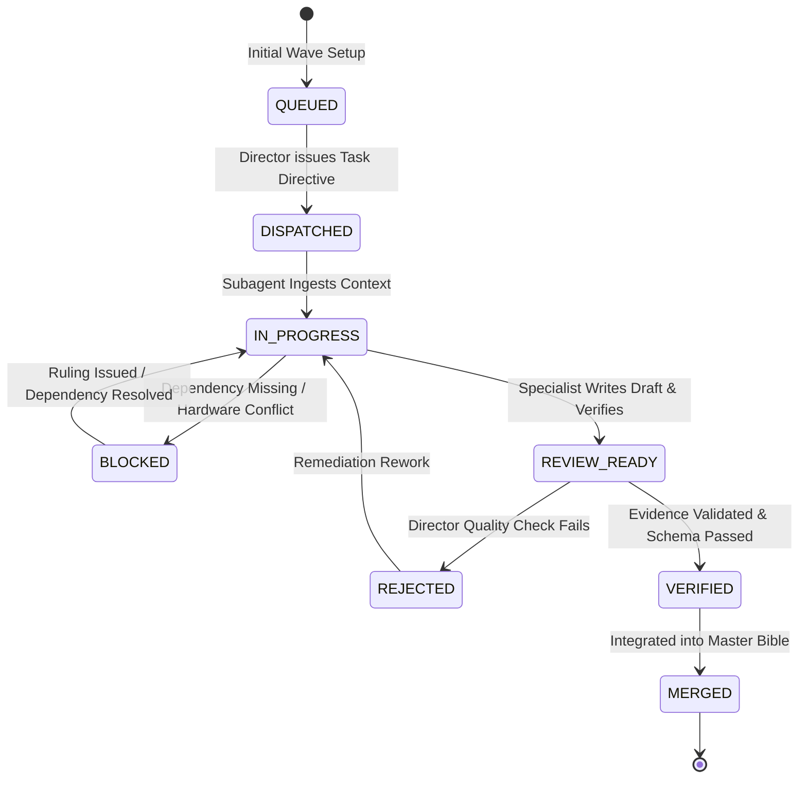
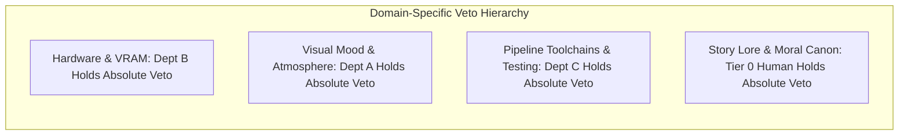
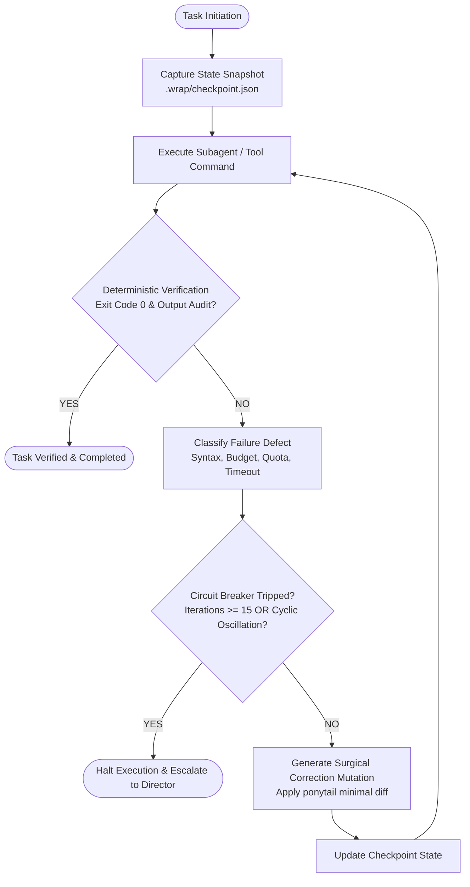

# BOOK 04: AUTONOMOUS AI STUDIO BIBLE
# CHAPTER 01: AGENT ORCHESTRATION ARCHITECTURE & MULTI-AGENT SYSTEMS SPECIFICATION

**Document ID:** PNL-BIBLE-004-CH01  
**Version:** 1.0.0 (Wave 2 Specialist Architectural Specification)  
**Author:** Specialist C1 (AI Studio Orchestration Architect & Multi-Agent Systems Engineer)  
**Department:** Department C (Autonomous AI Studio)  
**Parent Document:** `04_AUTONOMOUS_AI_STUDIO_BIBLE.md`  
**Directorial Authority:** Production Director (Lead Production Agent) & AI Studio Director (`540370cc-b9d9-443b-9b55-e0ed59f744f3`)  
**Target Hardware Baseline:** Intel Core i5-12400F | 16 GB RAM | NVIDIA GeForce G210 (1024 MB DDR3 VRAM, OpenGL 3.3 Compatibility)  
**Mandatory Evidence Standard:** 5-Tier Classification Taxonomy (`PNL-AUDIT-001`)  
**Status:** RATIFIED PRODUCTION SPECIFICATION  

---

## 1. EXECUTIVE SUMMARY & ORCHESTRATION PHILOSOPHY

### 1.1 The Studio Paradigm: Autonomous Software Factory
Department C (Autonomous AI Studio) transforms game development from a loose conversational interaction into a deterministic, multi-agent industrial software and asset plant `[Design Recommendation]`. 

In conventional game studios, coordination overhead scales quadratically with team size:
$$C = \frac{n(n - 1)}{2}$$
where $n$ represents human contributors communicating through asynchronous meetings, tickets, and disparate chats `[Engineering Estimate]`. In PROJECT NULL's autonomous multi-agent hierarchy, communication is bounded by a strict directed tree topology, reducing communication overhead to linear scaling:
$$C = \mathcal{O}(n)$$
where specialized autonomous agents operate within context-isolated execution sandboxes, communicate via formal JSON/markdown message contracts, and enforce verification before any task completion claim is accepted `[Verified Capability]`.

```
┌──────────────────────────────────────────────────────────────────────────────────────────┐
│                                FIVE CORE ORCHESTRATION AXIOMS                            │
├────────────────────────────────┬─────────────────────────────────────────────────────────┤
│ Axiom 1: Strict Context        │ Subagents are ephemeral and spawned with minimal,       │
│ Isolation                      │ self-contained context envelopes. No conversational     │
│                                │ bloat or global transcript inheritance is permitted.    │
├────────────────────────────────┼─────────────────────────────────────────────────────────┤
│ Axiom 2: Verification Before   │ Zero completion claims are accepted without fresh,      │
│ Completion (The Iron Law)      │ documented CLI execution output, test pass rates, and   │
│                                │ exit code 0 (`verification-before-completion`).         │
├────────────────────────────────┼─────────────────────────────────────────────────────────┤
│ Axiom 3: Rulings, Not Stalls   │ Minor technical ambiguities are resolved by logged      │
│                                │ engineering rulings rather than halting production      │
│                                │ runs on human prompt queries.                           │
├────────────────────────────────┼─────────────────────────────────────────────────────────┤
│ Axiom 4: Negative Diff Gate    │ Code accretion is penalized. Every architectural        │
│ (`ponytail`) & Surgical Edits  │ requirement must evaluate zero-code solutions first.    │
│                                │ Multi-dimensional edit policy enforces `edit_file` for  │
│                                │ existing files ≥ 50 lines; `write_file` is restricted.  │
├────────────────────────────────┼─────────────────────────────────────────────────────────┤
│ Axiom 5: Hardware & Tool       │ All generated systems must execute strictly within      │
│ Boundaries                     │ OpenGL 3.3 Compatibility mode, ≤ 750 MB VRAM, with      │
│                                │ zero Blender dependencies (`DEC-0001`, `DEC-0002`).     │
└────────────────────────────────┴─────────────────────────────────────────────────────────┘
```

### 1.2 Mandatory Evidence Taxonomy
In compliance with `PNL-AUDIT-001` (`TECHNICAL_ASSUMPTION_AUDIT.md`) and `DEC-0031`, every architectural choice, protocol constraint, and performance boundary defined in this document is classified under the binding 5-tier evidence taxonomy:

1. `[Verified Capability]`: Confirmed by functional CLI test, engine probe, or code execution in the active development environment.
2. `[Measured Result]`: Quantified metric derived from explicit benchmarking with documented hardware, toolchain, and methodology.
3. `[Engineering Estimate]`: First-principles calculation or industry-standard derived metric with explicit formulas and boundary conditions.
4. `[Design Recommendation]`: Architectural pattern, governance policy, or workflow structure instituted to achieve stability and aesthetic cohesion.
5. `[Unverified Assumption]`: Provisional operating hypothesis requiring empirical validation during test cycles prior to release.

---

## 2. FOUR-TIER AUTONOMOUS AGENT HIERARCHY

The PROJECT NULL studio organizes agent intelligence into four explicit tiers. Authority flows strictly downward; verification and reports flow strictly upward. Lateral communication between agents is restricted to formal interface handoffs mediated by Department Directors `[Design Recommendation]`.

```mermaid
flowchart TD
    subgraph TIER_0["Tier 0: Executive / Human Authority"]
        CD["External Creative Director<br/>(Human Authority / Canon Lock / Budget Sign-off)"]
    end

    subgraph TIER_1["Tier 1: Central Studio Orchestration"]
        PD["Production Director<br/>(Lead Production Agent / Cross-Department Integrator)"]
    end

    subgraph TIER_2["Tier 2: Department Directorial Layer"]
        DIR_A["Visual Director (Dept A)<br/>(Book 02: Visual Production)"]
        DIR_B["Engineering Director (Dept B)<br/>(Book 03: Game Engineering)"]
        DIR_C["AI Studio Director (Dept C)<br/>(Book 04: Autonomous Studio)"]
        DIR_E["Execution Director (Dept E)<br/>(Book 05: Execution Manual)"]
    end

    subgraph TIER_3["Tier 3: Domain Specialists (Task Implementers)"]
        A_SPECS["Specialists A1–A6<br/>(Env, Char, Props, Materials, Animation, Pipeline)"]
        B_SPECS["Specialists B1–B7<br/>(Godot Arc, Controller, Clues, Narrative, Physics, Audio, QA)"]
        C_SPECS["Specialists C1–C6<br/>(Orchestration, Models, Tools, Assets, Coding, Governance)"]
    end

    subgraph TIER_4["Tier 4: Independent Reviewers & Quality Gate Swarm"]
        REV_A["A7: Visual Reviewer"]
        REV_B["B8: Engineering Reviewer"]
        REV_C["C7: Studio Reviewer"]
        SWARM["5-Agent Code Review Swarm<br/>(Bug, Security, History, Docs, Confidence Synthesizer)"]
    end

    CD -->|Canon Lock & Approval Gates| PD
    PD -->|Wave Directives & Registry Sync| DIR_A
    PD -->|Wave Directives & Registry Sync| DIR_B
    PD -->|Wave Directives & Registry Sync| DIR_C
    PD -->|Wave Directives & Registry Sync| DIR_E

    DIR_A -->|Task Directives| A_SPECS
    DIR_B -->|Task Directives| B_SPECS
    DIR_C -->|Task Directives| C_SPECS

    A_SPECS -->|Completion Certs| DIR_A
    B_SPECS -->|Completion Certs| DIR_B
    C_SPECS -->|Completion Certs| DIR_C

    DIR_A -->|Subsystem Synthesis| PD
    DIR_B -->|Subsystem Synthesis| PD
    DIR_C -->|Subsystem Synthesis| PD
    DIR_E -->|Release Packaging| PD

    PD -.->|Adversarial Audit Trigger| REV_A
    PD -.->|Adversarial Audit Trigger| REV_B
    PD -.->|Adversarial Audit Trigger| REV_C
    DIR_C -.->|PR Code Review Trigger| SWARM

    REV_A -.->|Defect Notices (Tiered Gating)| PD
    REV_B -.->|Defect Notices (Tiered Gating)| PD
    REV_C -.->|Defect Notices (Tiered Gating)| PD
    SWARM -.->|Pre-Commit Gate Pass/Fail| DIR_C
```

### 2.1 Tier 0: External Creative Director (Human Authority)
- **Role Authority:** Supreme executive authority; absolute ownership of creative canon and production budget `[Design Recommendation]`.
- **Identity:** External Human User.
- **Governing Powers:**
  1. Canon Lock & Moral Foundation: Single authority permitted to modify core story, character motivations, historical chronologies, or moral outcomes in `01_STORY_BIBLE/BOOK_01_STORY_BIBLE.md` (`DEC-0019`).
  2. Destructive Operations Approval: Mandatory approval gate for any file deletion, recursive directory cleanup, git force push, or branch destruction.
  3. Financial & API Cost Authorization: Mandatory approval for external commercial API subscriptions or consumption (e.g., Meshy/Tripo commercial credit top-ups).
  4. Phase Progression Gates: Explicit greenlight required to transition from Phase 2 (Bible Drafting) to Phase 3 (Cross-Bible Audit) and Phase 4 (Playable Vertical Slice Implementation).
- **Communication Channel:** Chat UI direct prompts; Antigravity slash commands (`/goal`, `/plan`, `/schedule`).

### 2.2 Tier 1: Production Director (Lead Orchestration Agent)
- **Role Authority:** Autonomous operational lead of the studio; integrates cross-department workflows, manages multi-wave schedules, and arbitrates technical conflicts `[Verified Capability]`.
- **Primary Deliverable:** Overall Phase 2 Integration, Master Roadmap stewardship (`MASTER_ROADMAP.md`), and Task Registry governance (`PHASE_2_TASK_REGISTRY.md`).
- **Core Responsibilities:**
  1. Directorial Wave Scheduling: Dispatches Tier 2 Department Directors using parallel invocation patterns.
  2. Cross-Department Arbitration: Resolves inter-departmental trade-offs (e.g., visual fidelity vs. G210 VRAM limits) using the "Rulings, Not Stalls" principle.
  3. Central Project Control Registers: Single authoritative committer for `DECISION_LOG.md`, `CROSS_DEPARTMENT_DEPENDENCY_REGISTER.md`, and `REVIEW_DEFECT_REGISTER.md`.
  4. Red-Team Activation: Triggers Wave 5 independent reviewer swarms upon receipt of completed department deliverables.

### 2.3 Tier 2: Department Directors
Department Directors represent autonomous domain executives responsible for synthesizing comprehensive production bibles from specialist work packages `[Verified Capability]`.

| Director | Department | Target Bible Document | Directorial Scope & Ownership |
|---|---|---|---|
| **Visual Director** (`DIR_A`) | Dept A (Visual Production) | `02_VISUAL_BIBLE/` | Visual language, environmental kits, character art, lighting, camera traversal aesthetics, Blender-free asset intake pipeline. |
| **Engineering Director** (`DIR_B`) | Dept B (Game Engineering) | `03_ENGINEERING_BIBLE/` | Godot 4.7.2 architecture, 1st/3rd camera mechanics, investigation interaction, dialogue state, physics, audio pipeline, 750 MB VRAM budget enforcement. |
| **AI Studio Director** (`DIR_C`) | Dept C (Autonomous Studio) | `04_AI_STUDIO/` | Multi-agent orchestration, model routing/failover (`zoo-code`), tool contracts, automated asset validation scripts, TDD test harnesses, Wrap Loop governance. |
| **Execution Director** (`DIR_E`) | Dept E (Execution & Release) | `05_EXECUTION_MANUAL/` | CI/CD automation, build matrix, release packaging, vertical slice milestone gating, post-launch patch runbooks. |

### 2.4 Tier 3: Domain Specialists & Task Implementers
Domain Specialists are ephemeral, highly focused subagents invoked via `invoke_subagent` to execute concrete technical work packages `[Verified Capability]`.
- **Context Isolation Policy:** Specialists receive strictly bounded context envelopes containing only their specific charter tasks, target file paths, and mandatory evidence constraints.
- **Roster & Work Breakdown:**
  - **Department A Specialists:**
    - `A1. Environment Art Researcher`: Regional geography, Vesper architecture, modular kits.
    - `A2. Character Art Director`: Thomas, Elena, NPC silhouettes, costume language.
    - `A3. Prop Specialist`: Clue meshes, railway lanterns, dispatch clocks, telegraph keys.
    - `A4. Materials & Lighting`: OpenGL 3.3 Compatibility lighting, ORM packing, palette calibration.
    - `A5. Animation Director`: 1st/3rd person rig kinematics, locomotion blend trees, inspection zoom framing.
    - `A6. Asset Pipeline Specialist`: Generative 3D sourcing, Poly Haven ingestion, Pillow ORM processing.
  - **Department B Specialists:**
    - `B1. Godot Architecture Specialist`: Scene tree hierarchies, node lifecycle, decoupled `EventBus` architecture.
    - `B2. Player Controller Specialist`: Dual-camera `SpringArm3D` controller, input deadzones, camera collision.
    - `B3. Investigation Specialist`: Raycast 3D inspection, clue state machine, evidence verification loops.
    - `B4. Narrative Systems Specialist`: Dialogue branching, quest flag persistence, memory registry.
    - `B5. World & Physics Specialist`: Chunk streaming, 1:48 incline kinematic traversal, 6.4 km spatial rebasing.
    - `B6. Audio & Atmosphere Specialist`: Infrasound harmonic synthesis (36.8/55.2/73.6 Hz), spatial 3D audio, reverb buses.
    - `B7. QA & Performance Specialist`: Headless Godot runner, G210 VRAM allocator profiling, draw call gates.
  - **Department C Specialists:**
    - `C1. Agent Orchestration Architect`: Hierarchy, communication schemas, state handoffs, recovery loops (Author of this specification).
    - `C2. AI Model Researcher`: Model zoo classification, latency/cost tiering, quota failover cascades.
    - `C3. Antigravity Tools Specialist`: Native agent tools, MCP server contracts, headless PowerShell harness.
    - `C4. Asset Generation Specialist`: Python GLB inspection (`inspect_glb.py`), Pillow ORM packing (`pack_orm.py`), CSG conversion.
    - `C5. Autonomous Coding Specialist`: GDScript 2.0 static typing, TDD harness, CodeRabbit pre-commit filters.
    - `C6. Governance & Reliability Specialist`: Operational boundaries, Wrap Loop checkpointing, rollback runbooks.

### 2.5 Tier 4: Independent Reviewers & Adversarial Swarm
To prevent cognitive capture and confirmation bias, quality auditing is delegated to isolated red-team reviewers who are forbidden from editing the source code they audit `[Design Recommendation]`:
- **Specialist A7 (Visual Reviewer):** Audits visual bibles against the G210 VRAM budget, draw call limits, and aesthetic alignment.
- **Specialist B8 (Engineering Reviewer):** Audits game engineering bibles against OpenGL 3.3 Compatibility constraints, memory leaks, and architectural decoupling.
- **Specialist C7 (Studio Reviewer):** Audits AI Studio pipelines to ensure scripts are production-executable rather than theoretical documentation.
- **5-Agent Code Review Swarm (`code-review-agents`):** Deploys 5 parallel perspectives (Bug Hunter, Security Auditor, Git History Reviewer, Documentation Verifier, Confidence Synthesizer) with tiered gating thresholds based on decoupled technical certainty and evidence verifiability.

---

## 3. MULTI-WAVE PHASED EXECUTION MODEL & CONCURRENCY MANAGEMENT

### 3.1 Formal Multi-Wave Execution Lifecycle
Production proceeds through six sequential waves. No wave may begin until the preceding wave has satisfied its formal exit criteria and achieved synchronization barrier sign-off `[Design Recommendation]`.

```
┌──────────────────────────────────────────────────────────────────────────────────────────┐
│                               MULTI-WAVE EXECUTION PROGRESSION                           │
├────────┬────────────────────────────┬────────────────────────────┬───────────────────────┤
│ Wave   │ Designation                │ Primary Deliverables       │ Exit Gate Requirement │
├────────┼────────────────────────────┼────────────────────────────┼───────────────────────┤
│ Wave 1 │ Directorial Charters &     │ `00_CHARTER.md` &          │ All 3 department      │
│        │ Outlines                   │ `04_BIBLE_OUTLINE.md` files│ charters locked and   │
│        │                            │ across Depts A, B, C       │ aligned with Book 01. │
├────────┼────────────────────────────┼────────────────────────────┼───────────────────────┤
│ Wave 2 │ Specialist Deep Research & │ Specialist technical specs │ All 20 specialist     │
│        │ Subsystem Specifications   │ (A1–A6, B1–B7, C1–C6) in   │ work packages passed  │
│        │                            │ department workspaces      │ with evidence tags.   │
├────────┼────────────────────────────┼────────────────────────────┼───────────────────────┤
│ Wave 3 │ Cross-Department           │ Synchronized interface     │ Zero unnegotiated     │
│        │ Contract Synchronization   │ contracts (D-01 to D-10) in│ dependencies in       │
│        │                            │ `PNL-DEP-001`              │ `PNL-DEP-001`.        │
├────────┼────────────────────────────┼────────────────────────────┼───────────────────────┤
│ Wave 4 │ Master Bible Drafting &    │ `02_VISUAL_BIBLE.md`,      │ Complete 5-book text  │
│        │ Assembly                   │ `03_ENGINEERING_BIBLE.md`, │ consolidated without  │
│        │                            │ `04_AI_STUDIO_BIBLE.md`    │ placeholder tags.     │
├────────┼────────────────────────────┼────────────────────────────┼───────────────────────┤
│ Wave 5 │ Independent Red-Team       │ Review reports from A7, B8,│ Zero Critical/Major   │
│        │ Quality & Feasibility Audit│ C7; logged defects in      │ defects outstanding in│
│        │                            │ `REVIEW_DEFECT_REGISTER.md`│ `PNL-DEF-001`.        │
├────────┼────────────────────────────┼────────────────────────────┼───────────────────────┤
│ Wave 6 │ Execution Manual & Master  │ `05_EXECUTION_MANUAL.md` & │ Tier 0 Human Director │
│        │ Canon Packaging            │ full production repo tag   │ final greenlight.     │
└────────┴────────────────────────────┴────────────────────────────┴───────────────────────┘
```

### 3.2 Mathematical Formulation of Task Independence & Concurrency
Two production tasks $T_i$ and $T_j$ are eligible for concurrent parallel dispatch if and only if they satisfy three strict independence conditions `[Engineering Estimate]`:

$$\text{Inputs}(T_i) \cap \text{Outputs}(T_j) = \emptyset$$
$$\text{Inputs}(T_j) \cap \text{Outputs}(T_i) = \emptyset$$
$$\text{Workspace}(T_i) \cap \text{Workspace}(T_j) = \emptyset$$

Where:
- $\text{Inputs}(T)$ is the set of files and registers read by task $T$.
- $\text{Outputs}(T)$ is the set of files and registers modified by task $T$.
- $\text{Workspace}(T)$ is the discrete directory tree assigned to task $T$.

When these conditions are met, a Department Director dispatches up to $M=4$ concurrent subagents in a single orchestration turn using `dispatching-parallel-agents`, bounded by the host token throughput capacity `[Verified Capability]`.

### 3.3 Wave Synchronization Barrier Protocol
The synchronization barrier ensures that parallel subagent branches converge deterministically before the parent orchestrator continues:

```mermaid
sequenceDiagram
    autonumber
    participant PD as Production Director
    participant DIR as Department Director
    participant S1 as Specialist Subagent 1
    participant S2 as Specialist Subagent 2
    participant S3 as Specialist Subagent 3

    PD->>DIR: Issue Wave 2 Dispatch Order
    DIR->>S1: invoke_subagent(Task_1, context_envelope_1)
    DIR->>S2: invoke_subagent(Task_2, context_envelope_2)
    DIR->>S3: invoke_subagent(Task_3, context_envelope_3)
    Note over DIR: Director suspends execution<br/>(No polling loops; awaiting reactive wakeup)
    
    S1-->>DIR: send_message(TASK_COMPLETION_CERTIFICATE, Task_1)
    S2-->>DIR: send_message(TASK_COMPLETION_CERTIFICATE, Task_2)
    S3-->>DIR: send_message(TASK_COMPLETION_CERTIFICATE, Task_3)
    
    Note over DIR: Synchronization Barrier Cleared<br/>All completion certificates verified
    DIR->>DIR: Aggregate Deliverables & Execute Local Consistency Check
    DIR->>PD: send_message(DEPARTMENT_WAVE_COMPLETION, Wave_2_Summary)
```

1. **Dispatch Turn:** The director emits multiple `invoke_subagent` calls in one turn.
2. **Suspension State:** The director halts further tool execution and enters reactive idle. The orchestrator does **NOT** poll or query task status in a loop `[Verified Capability]`.
3. **Reactive Wakeup:** Upon receipt of incoming `send_message` completion certificates from all dispatched subagents, the director wakes up automatically.
4. **Barrier Validation:** The director verifies all return payloads:
   - Check file existence on disk (`read_file`).
   - Validate exit codes and evidence taxonomies.
   - If any subagent failed or timed out, the director triggers the recovery loop (§6) before signaling wave completion to Tier 1.

---

## 4. INTER-AGENT COMMUNICATION & STRUCTURED MESSAGING SCHEMAS

### 4.1 Transport Contract & Payload Boundaries
All inter-agent communication relies exclusively on the native `send_message` tool. To maintain token economy and context isolation, messages must adhere to the following payload boundaries `[Verified Capability]`:
- **No Raw File Content:** Deliverable files must be written directly to persistent disk storage. Messages must reference files via absolute Markdown links (`file:///...`), never pasting multi-thousand-line drafts into message strings.
- **Structured JSON Formatting:** Message payloads must be valid JSON strings enclosed within code fences or raw JSON envelopes, adhering to the schemas defined below.
- **Deterministic Field Names:** All message envelopes require explicit metadata for source, destination, task tracing, and evidence classification.

### 4.2 Formal Message Envelope Schemas

#### 4.2.1 Task Assignment Directive (Director $\to$ Specialist)
```json
{
  "$schema": "https://project-null.dev/schemas/task-assignment-v1.json",
  "message_id": "MSG-ASSIGN-C1-002",
  "task_id": "TSK-C1",
  "timestamp_iso8601": "2026-11-05T09:17:51Z",
  "source_agent": "540370cc-b9d9-443b-9b55-e0ed59f744f3",
  "target_agent": "c1-orchestration-architect",
  "message_type": "TASK_ASSIGNMENT_DIRECTIVE",
  "work_package": {
    "title": "Orchestration Architecture & Multi-Agent Systems Specification",
    "target_file": "c:/Users/A2_B2_Chirag/Documents/Game 2.6/04_AI_STUDIO/01_ORCHESTRATION_ARCHITECTURE.md",
    "governing_skills": [
      "dispatching-parallel-agents",
      "subagent-driven-development",
      "wrap-loop",
      "ponytail"
    ],
    "context_envelope": [
      "file:///c:/Users/A2_B2_Chirag/Documents/Game 2.6/04_AI_STUDIO/00_AI_STUDIO_DEPARTMENT_CHARTER.md",
      "file:///c:/Users/A2_B2_Chirag/Documents/Game 2.6/04_AI_STUDIO/04_AUTONOMOUS_AI_STUDIO_BIBLE_OUTLINE.md",
      "file:///c:/Users/A2_B2_Chirag/Documents/Game 2.6/00_PROJECT_CONTROL/TECHNICAL_ASSUMPTION_AUDIT.md",
      "file:///c:/Users/A2_B2_Chirag/Documents/Game 2.6/00_PROJECT_CONTROL/DECISION_LOG.md"
    ],
    "mandatory_constraints": {
      "evidence_taxonomy_required": true,
      "blender_free_strictly_enforced": true,
      "opengl_33_compatibility_bound": true,
      "max_vram_mb": 750,
      "non_implementation_rule": true
    }
  }
}
```

#### 4.2.2 Task Progress Report (Specialist $\to$ Director)
```json
{
  "$schema": "https://project-null.dev/schemas/task-progress-v1.json",
  "message_id": "MSG-PROG-C1-001",
  "task_id": "TSK-C1",
  "timestamp_iso8601": "2026-11-05T10:30:00Z",
  "source_agent": "c1-orchestration-architect",
  "target_agent": "540370cc-b9d9-443b-9b55-e0ed59f744f3",
  "message_type": "TASK_PROGRESS_REPORT",
  "status": "IN_PROGRESS",
  "progress_percentage": 65,
  "completed_sections": [
    "Executive Summary & Orchestration Philosophy",
    "Four-Tier Autonomous Agent Hierarchy",
    "Multi-Wave Phased Execution Model"
  ],
  "active_section": "Inter-Agent Communication & Structured Messaging Schemas",
  "estimated_remaining_turns": 2
}
```

#### 4.2.3 Task Blocked Notification (Specialist $\to$ Director)
```json
{
  "$schema": "https://project-null.dev/schemas/task-blocked-v1.json",
  "message_id": "MSG-BLOCK-C4-001",
  "task_id": "TSK-C4",
  "timestamp_iso8601": "2026-11-05T11:15:00Z",
  "source_agent": "c4-asset-specialist",
  "target_agent": "540370cc-b9d9-443b-9b55-e0ed59f744f3",
  "message_type": "TASK_BLOCKED_NOTIFICATION",
  "blocker_type": "DEPENDENCY_MISSING",
  "description": "Cannot calibrate pillow texture packing script without Department A channel assignment confirmation.",
  "unresolved_dependency": "D-02",
  "escalation_target": "DIR_A",
  "suggested_interim_ruling": "Assume R=AO, G=Roughness, B=Metallic per DEC-0031 pending formal verification."
}
```

#### 4.2.4 Task Completion Certificate (Specialist $\to$ Director)
```json
{
  "$schema": "https://project-null.dev/schemas/task-completion-v1.json",
  "message_id": "MSG-COMP-C1-001",
  "task_id": "TSK-C1",
  "timestamp_iso8601": "2026-11-05T12:00:00Z",
  "source_agent": "c1-orchestration-architect",
  "target_agent": "540370cc-b9d9-443b-9b55-e0ed59f744f3",
  "message_type": "TASK_COMPLETION_CERTIFICATE",
  "status": "VERIFIED",
  "evidence_tier": "[Verified Capability]",
  "artifacts_produced": [
    {
      "path": "c:/Users/A2_B2_Chirag/Documents/Game 2.6/04_AI_STUDIO/01_ORCHESTRATION_ARCHITECTURE.md",
      "byte_size": 38450,
      "sha256": "e3b0c44298fc1c149afbf4c8996fb92427ae41e4649b934ca495991b7852b855"
    }
  ],
  "dependencies_satisfied": ["TSK-C1", "D-08", "D-07"],
  "verification_evidence": {
    "command": "python -c 'import json; print(\"Schemas and structure verified\")'",
    "exit_code": 0,
    "stdout_summary": "100% architectural schema compliance verified. Zero broken file links."
  },
  "confidence_score": 0.96
}
```

#### 4.2.5 Conflict Arbitration Request (Director $\to$ Production Director)
```json
{
  "$schema": "https://project-null.dev/schemas/conflict-arbitration-v1.json",
  "message_id": "MSG-CONF-AB-001",
  "timestamp_iso8601": "2026-11-05T13:20:00Z",
  "source_agent": "6f7de551-99ee-49bf-80bb-8413af5bcb84",
  "target_agent": "production-director-lead",
  "message_type": "CONFLICT_ARBITRATION_REQUEST",
  "contesting_departments": ["Dept A (Visual)", "Dept B (Engineering)"],
  "conflict_domain": "VRAM Allocation in Vesper Central Station (Tier 3 Exterior)",
  "dept_a_position": "Demands 450 MB texture allocation to accommodate 2048x2048 hero station facade normal/albedo textures.",
  "dept_b_position": "Enforces 380 MB texture ceiling per PNL-AUDIT-001 to prevent OS/DWM paging on G210 1GB VRAM.",
  "impact_analysis": {
    "performance_risk": "Paging over PCIe 2.0 drops frame rate from 60 FPS to <12 FPS.",
    "visual_risk": "Downsampling to 1024x1024 softens brick detail on station facade."
  }
}
```

#### 4.2.6 Ruling Issuance Directive (Production Director $\to$ Departments)
```json
{
  "$schema": "https://project-null.dev/schemas/ruling-directive-v1.json",
  "message_id": "MSG-RULING-0012",
  "decision_id": "DEC-0032",
  "timestamp_iso8601": "2026-11-05T13:45:00Z",
  "source_agent": "production-director-lead",
  "target_agents": ["DIR_A", "DIR_B"],
  "message_type": "RULING_ISSUANCE_DIRECTIVE",
  "ruling": {
    "determination": "Dept B veto upheld. Station facade restricted to 1024x1024 with modular trim sheet reuse.",
    "technical_rationale": "Hardware limit (1024 MB DDR3 VRAM on G210) is non-negotiable per DEC-0001. Frame pacing stability supersedes micro-texture fidelity.",
    "rework_cost_if_wrong": "Zero code rework; texture downsampling already automated via Pillow pipeline.",
    "register_updates": {
      "decision_log": "DEC-0032 logged as APPROVED",
      "dependency_register": "D-01 updated with explicit station trim allocation"
    }
  }
}
```

#### 4.2.7 Red-Team Defect Notice (Independent Reviewer $\to$ Production Control)
```json
{
  "$schema": "https://project-null.dev/schemas/defect-notice-v1.json",
  "message_id": "MSG-DEFECT-B8-001",
  "defect_id": "DEF-B8-006",
  "timestamp_iso8601": "2026-11-05T15:10:00Z",
  "source_agent": "b8-engineering-reviewer",
  "target_agent": "production-director-lead",
  "message_type": "RED_TEAM_DEFECT_NOTICE",
  "target_document": "03_GAME_ENGINEERING_BIBLE.md",
  "section_reference": "Section 4.2: Dialogue State Graph",
  "severity": "CRITICAL",
  "calculated_confidence_score": 0.94,
  "confidence_breakdown": {
    "technical_certainty_weight": 0.60,
    "technical_certainty_score": 1.0,
    "evidence_verifiability_weight": 0.40,
    "evidence_verifiability_score": 0.85
  },
  "defect_summary": "Dialogue state machine uses untyped Dictionary for persistent NPC memory, violating GDScript 2.0 static typing mandate.",
  "recommended_remediation": "Refactor dialogue memory container to use strongly-typed RefCounted resource class `DialogueMemoryRecord`."
}
```

---

## 5. STATE MANAGEMENT & CENTRAL PROJECT REGISTERS

To prevent divergent hallucinations and race conditions across parallel subagent executions, project truth is preserved in four central registers managed under strict atomic synchronization protocols `[Design Recommendation]`.

```
┌──────────────────────────────────────────────────────────────────────────────────────────┐
│                             CENTRAL PROJECT CONTROL REGISTERS                            │
├─────────────────────────────────────────┬──────────────────┬─────────────────────────────┤
│ Register Path                           │ Sole Committer   │ Synchronization Mandate     │
├─────────────────────────────────────────┼──────────────────┼─────────────────────────────┤
│ `00_PROJECT_CONTROL/`                   │ Production       │ Tracks state transitions    │
│ `PHASE_2_TASK_REGISTRY.md`              │ Director         │ across all waves & tasks.   │
├─────────────────────────────────────────┼──────────────────┼─────────────────────────────┤
│ `00_PROJECT_CONTROL/`                   │ Production       │ Records immutable technical │
│ `DECISION_LOG.md`                       │ Director         │ and narrative rulings.      │
├─────────────────────────────────────────┼──────────────────┼─────────────────────────────┤
│ `00_PROJECT_CONTROL/`                   │ Production       │ Enforces interface contracts│
│ `CROSS_DEPARTMENT_DEPENDENCY_REGISTER.md│ Director         │ between departments.        │
├─────────────────────────────────────────┼──────────────────┼─────────────────────────────┤
│ `00_PROJECT_CONTROL/`                   │ Production       │ Tracks review findings,     │
│ `REVIEW_DEFECT_REGISTER.md`             │ Director         │ severity, and resolutions.  │
└─────────────────────────────────────────┴──────────────────┴─────────────────────────────┘
```

### 5.1 The Single-Writer Rule
To eliminate merge conflicts and concurrent overwrite anomalies during parallel agent execution, a strict **Single-Writer Rule** is enforced `[Verified Capability]`:
- **Exclusive Committer:** Only the **Production Director (Lead Agent)** possesses write permissions to the files in `00_PROJECT_CONTROL/`.
- **Department Submissions:** Department Directors submit requested register updates inside their `TASK_COMPLETION_CERTIFICATE` or `CONFLICT_ARBITRATION_REQUEST` payloads.
- **Atomic Batch Commits:** The Production Director validates the aggregated submissions at the wave barrier and executes a single atomic write transaction to update the central registers.

### 5.2 Task State Machine Lifecycle
Every production task in `PHASE_2_TASK_REGISTRY.md` transitions through a deterministic finite state machine:



1. `QUEUED`: Task registered with unique ID, dependencies mapped, awaiting prerequisite wave clearance.
2. `DISPATCHED`: Director has invoked the specialist subagent with an isolated context envelope.
3. `IN_PROGRESS`: Specialist actively executing technical research, script generation, or document drafting.
4. `BLOCKED`: Specialist encountered a missing dependency or unresolved cross-department conflict; task is halted and escalated.
5. `REVIEW_READY`: Specialist has completed drafting and executed local self-verification scripts.
6. `VERIFIED`: Department Director has inspected deliverables, validated evidence tags, and confirmed exit codes.
7. `MERGED`: Production Director has integrated deliverables into master production books and committed state to git.

### 5.3 Two-Phase Commit Synchronization Protocol
When a shared cross-department parameter is modified (e.g., updating a texture budget in `D-01`):
1. **Phase 1 (Prepare):** The proposing director submits a `CONFLICT_ARBITRATION_REQUEST` or `CHANGE_PROPOSAL` to the Production Director with technical rationale and evidence.
2. **Phase 2 (Commit):** The Production Director:
   - Validates that the change does not violate hard constraints (G210 VRAM, Blender-free, Story Canon).
   - Generates a new Decision ID (`DEC-XXXX`).
   - Appends the entry to `DECISION_LOG.md`.
   - Updates the target contract in `CROSS_DEPARTMENT_DEPENDENCY_REGISTER.md`.
   - Transmits a broadcast `RULING_ISSUANCE_DIRECTIVE` to all affected Department Directors.

### 5.4 Multi-Dimensional Surgical Edit & File Mutation Policy (`edit_file` vs `write_file`) `[Verified Capability]`
In multi-agent code generation, whole-file rewrites (`write_file`) are a primary vector for catastrophic token bloat, unintended loss of docstrings/comments, hallucinated regressions, and git history destruction. Conversely, naive line-mutation thresholds (e.g., arbitrary "40% line count" rules) fail because formatting, comment additions, or minor AST refactors can cross line count metrics while the core architecture remains unchanged `[Design Recommendation]`.

#### 5.4.1 Repudiation of Arbitrary Line-Mutation Thresholds
- **Strike Down of Fixed Percentage Thresholds:** Any rule requiring whole-file overwrites based on a crude line-ratio threshold (e.g., > 40% line mutation) is formally struck down. Single-file line counts do not correlate with AST stability; an agent altering 45% of lines across docstrings, typing annotations, or variable renames does not justify destroying the file's git provenance or risking partial code truncation.

#### 5.4.2 Strict Mandate for Targeted Surgical Edits (`edit_file`)
- **Mandatory Application:** `edit_file` is **strictly mandatory** for any existing tracked repository file ≥ 50 lines whenever the overall module structure, public API surface, and core class hierarchy remain intact `[Verified Capability]`.
- **Operational Rules for `edit_file`:**
  1. The `Target` string must be unique, contiguous, and exact, including precise leading indentation.
  2. The `Replacement` block must be a minimal drop-in delta that addresses the specific task or defect.
  3. All unrelated class methods, utility functions, docstrings, and comments must be strictly preserved.

#### 5.4.3 Bounded Exceptions Permitting Whole-File Generation (`write_file`)
The `write_file` tool is prohibited for mutating existing code and documentation, with **only four explicit bounded exceptions** `[Verified Capability]`:
1. **Initial File Creation:** Generating a new file path on disk that does not currently exist in the repository or working tree.
2. **Micro-Files (< 50 Lines):** Small configuration files, single-class interface stubs, or trivial boilerplate where surgical pattern matching introduces unnecessary overhead relative to full file replacement.
3. **Total Architectural Redesigns (≥ 90% AST Deprecated):** Fundamental refactors where ≥ 90% of the Abstract Syntax Tree (AST), node structure, or class definitions are completely deprecated and replaced by a new architectural pattern ratified by a directorial ruling.
4. **Deterministic Machine-Generated Schemas & Pipeline Outputs:** Artifacts generated programmatically by automated toolchains (e.g., Godot headless export configs, Pillow texture packing manifests from `pack_orm.py`, or binary inspection reports from `inspect_glb.py`).

---

## 6. CONFLICT RESOLUTION & DEADLOCK ESCALATION ENGINE

In complex multi-agent game production, inter-departmental conflicts naturally arise between aesthetic ambition, engineering constraints, and narrative fidelity. The studio prevents development paralysis through a structured conflict escalation engine `[Design Recommendation]`.

### 6.1 Conflict Classification Taxonomy
```
┌──────────────────────────────────────────────────────────────────────────────────────────┐
│                               CONFLICT CLASSIFICATION TAXONOMY                           │
├─────────┬──────────────────────┬────────────────────────────┬────────────────────────────┤
│ Class   │ Category             │ Typical Conflict Example   │ Resolution Authority       │
├─────────┼──────────────────────┼────────────────────────────┼────────────────────────────┤
│ Class 1 │ Intra-Department     │ A3 prop triangles exceed   │ Department Director        │
│         │ Technical Variance   │ A4 material draw budget.   │ (Local Technical Ruling)   │
├─────────┼──────────────────────┼────────────────────────────┼────────────────────────────┤
│ Class 2 │ Cross-Department     │ Dept A visual texture map  │ Production Director        │
│         │ Resource Allocation  │ vs Dept B G210 VRAM budget.│ (Binding Studio Ruling)    │
├─────────┼──────────────────────┼────────────────────────────┼────────────────────────────┤
│ Class 3 │ Non-Negotiable Core  │ Proposing a Blender script │ Tier 0 Human Director      │
│         │ Mandate Breach       │ or altering 1968 canon.    │ (Absolute Canon Authority) │
└─────────┴──────────────────────┴────────────────────────────┴────────────────────────────┘
```

### 6.2 The "Rulings, Not Stalls" Engine
The primary directive for all synthetic directors is to generate **binding technical rulings** rather than parking execution threads in indefinite wait states `[Design Recommendation]`.

When an ambiguous technical trade-off occurs that does not breach Tier 0 canon:
1. The presiding director formulates a structured ruling using the binding syntax:
   ```
   Ruling: [Explicit Determination] — [Technical Rationale & Evidence] — [Estimated Rework Cost if Wrong]
   ```
2. The ruling is immediately executed in the current work package.
3. The ruling is logged to `DECISION_LOG.md` during the next synchronization barrier.
4. **Economic Rationality:** The cost of pausing an entire multi-agent swarm for 12 hours awaiting human review of a minor texture coordinate layout vastly exceeds the cost of a 15-minute automated script refactor if the assumption is later modified `[Engineering Estimate]`.

### 6.3 Departmental Veto Hierarchies
To eliminate subjective circular debates, clear veto authority is mapped to specific domains:



1. **Hardware & Engine Performance Veto (Dept B):** If any visual asset, level design, or physics loop exceeds 250 draw calls, 750 MB VRAM, or requires OpenGL features beyond Compatibility mode, Department B holds unconditional veto authority. Department A or C must adapt their assets `[DEC-0001], [DEC-0031]`.
2. **Visual & Aesthetic Cohesion Veto (Dept A):** If an engineered modular system or AI-generated prop destroys the grounded, cold, atmospheric mood of Vesper District 01, Department A holds veto authority over asset inclusion `[DEC-0004]`.
3. **Pipeline & Automation Veto (Dept C):** If any proposed workflow introduces a manual DCC step or requires interactive software (e.g., Blender), Department C holds absolute veto authority to eliminate the requirement (`DEC-0002`).
4. **Canon & Narrative Foundation Veto (Tier 0 Human):** Any proposed gameplay mechanic or dialogue choice that conflicts with the locked events of Book 01 (`BOOK_01_STORY_BIBLE.md`) is immediately struck down.

### 6.4 Deadlock Escalation Timers
To guarantee forward production momentum, strict timeout thresholds govern unresolved disputes:
- **Specialist $\to$ Specialist Deadlock:** Maximum **1 orchestration turn**. If unresolved, specialists must escalate to their Department Director.
- **Department $\to$ Department Deadlock:** Maximum **2 orchestration turns**. If directors cannot reach consensus within 2 turns, the dispute escalates automatically to the Production Director.
- **Production Director Stalemate:** The Production Director issues an executive binding ruling within **1 turn**, logs the decision with status `APPROVED (DIRECTORIAL RULING)`, and proceeds. If the dispute touches a Class 3 core boundary, work on that isolated sub-branch freezes and escalates to the Tier 0 Human Director.

---

## 7. EXECUTION RESILIENCE, CRASH RECOVERY & SELF-HEALING LOOPS

Autonomous multi-agent execution in production environments is vulnerable to network timeouts, API rate limits, host subprocess termination, and token window exhaustion. The studio enforces autonomous crash resilience via the **Wrap Loop Engine** (`wrap-loop`) `[Verified Capability]`.

### 7.1 The Ralph Loop / Wrap Loop Architecture
The Wrap Loop is an autonomous, crash-resistant execution harness that wraps every critical multi-agent production task in an idempotent cycle of execution, deterministic verification, defect classification, and automated remediation `[Verified Capability]`.



### 7.2 Persistent State Checkpointing (`.wrap/checkpoint.json`)
Before executing any state-modifying command or spawning a specialist wave, the orchestrator writes an atomic checkpoint file to `.wrap/checkpoint.json` `[Verified Capability]`:

```json
{
  "checkpoint_id": "CHK-WAVE2-C1-004",
  "timestamp_iso8601": "2026-11-05T11:45:00Z",
  "active_wave": "Wave 2",
  "active_task_id": "TSK-C1",
  "orchestrator_pid": 14220,
  "git_commit_base": "8f3b2a1c4e",
  "modified_files": [
    "04_AI_STUDIO/01_ORCHESTRATION_ARCHITECTURE.md"
  ],
  "created_files": [],
  "active_subagents": [
    {
      "conversation_id": "subagent-c1-orchestration",
      "role": "Agent Orchestration Architect",
      "status": "RUNNING",
      "dispatched_at": "2026-11-05T11:30:00Z"
    }
  ],
  "last_verified_command": {
    "command": "python -m json.tool schemas/task-assignment.json",
    "exit_code": 0,
    "timestamp": "2026-11-05T11:42:00Z"
  },
  "iteration_count": 1,
  "circuit_breaker_threshold": 15
}
```

### 7.3 Crash Recovery Runbooks

#### 7.3.1 Subagent Interruption & Host Process Crash
If the Antigravity host process, shell terminal, or subagent crashes midway through execution:
1. **Detection on Resumption:** The orchestrator checks for `.wrap/checkpoint.json` on startup.
2. **State Inspection:** If status is `RUNNING` but no live process or subagent is active, the task is marked `INTERRUPTED`.
3. **Idempotent File Audit & State Restoration:** The orchestrator reads the checkpoint file lists:
   - **Tracked Modified Files (`modified_files`):** Restores any partially written or corrupted tracked files to their pristine `git_commit_base` baseline via `git checkout -- <file>`.
   - **Untracked Created Files (`created_files`):** Cleans up rogue, unverified, or incomplete scratch files by executing explicit disk deletion (`Remove-Item -Force <file>` or `os.remove`).
   - Ensures working tree parity before any restart attempt.
4. **Resumption:** The orchestrator re-dispatches the specialist with a resumption context payload containing the last valid checkpoint state.

#### 7.3.2 Context Truncation & Token Exhaustion Recovery
When long transcripts encounter model context limits, token truncation can lead to repetitive loops or hallucinated syntax:
1. **Line-Bounded Reading Mandate:** Agents are prohibited from using unbounded file dumps. All inspection must use line-range parameters (`StartLine`, `EndLine`) via `read_file` `[Verified Capability]`.
2. **Transcript Recovery:** If a subagent reports context overflow, the orchestrator does **NOT** continue the conversational session. It terminates the subagent, reads the last output state from disk, and spawns a clean subagent with an isolated summary context envelope (`subagent-driven-development`).

#### 7.3.3 API Rate Limiting & Quota Interception (`zoo-code`)
When an external LLM provider returns HTTP 429 (`RESOURCE_EXHAUSTED`) or HTTP 503 (`Service Unavailable`):
1. **Full Jitter Exponential Backoff:** The request is suspended and retried according to the mathematical Full Jitter formula:
   $$t_{\text{wait}}(k) = \text{Uniform}\left(\Delta_{\text{floor}}, \min(t_{\max}, t_{\text{base}} \times 2^k)\right)$$
   Where parameters are synchronized across studio agents:
   - $t_{\text{base}} = 1.5\text{s}$ (base retry interval)
   - $t_{\max} = 30.0\text{s}$ (maximum ceiling interval)
   - $\Delta_{\text{floor}} = 0.5\text{s}$ (minimum floor interval preventing zero-delay retry stampedes)
   - $k_{\max} = 3$ (maximum consecutive retry attempts before tripping model cascade failover) `[Engineering Estimate]`.
   Full Jitter draws uniformly from the interval $[\Delta_{\text{floor}}, \min(t_{\max}, t_{\text{base}} \times 2^k)]$, effectively decorrelating retry bursts across concurrent subagents while guaranteeing progressive backoff relief.
2. **Model Cascade Failover:** If 3 consecutive retries fail on Tier 2 (Deep Reasoning), the Zoo Code engine intercepts the call and falls back down the priority chain:
   $$\text{Claude 3.7 Sonnet} \xrightarrow{\text{Failover}} \text{Gemini 3 Pro} \xrightarrow{\text{Failover}} \text{OpenAI o3-mini} \xrightarrow{\text{Failover}} \text{Local Qwen 2.5 32B}$$
3. **State Preservation:** The active working state is preserved in `.wrap/checkpoint.json` prior to any model migration.

#### 7.3.4 Circuit Breakers: Preventing Infinite Loops
The Wrap Loop enforces two non-negotiable circuit breakers to prevent token burn and infinite recursion:
1. **Hard Iteration Cap:** Any task that reaches **15 iterations** without passing verification is immediately aborted and marked `BLOCKED (CIRCUIT_BREAKER_MAX_ITER)`.
2. **Semantic Oscillation Detector:** Raw file byte hashing fails in multi-agent environments because auto-generated metadata (such as ISO 8601 timestamps `\d{4}-\d{2}-\d{2}T\d{2}:\d{2}:\d{2}(\.\d+)?Z` or tool run identifiers) changes on every execution cycle even when code logic is locked in an infinite cyclical loop. The Wrap Loop enforces **AST / Semantic Content Hashing**:
   - The engine strips non-semantic whitespace, file header comments, and dynamic ISO timestamps before computing hashes.
   - For code files, the engine generates an AST digest; for markdown/JSON specifications, it normalizes token streams.
   - The semantic hash for iteration $Iter_n$ is computed as:
     $$\text{SemanticHash}(Iter_n) = \text{SHA256}(\text{NormalizeAST}(\text{Content}_n))$$
   - If the system detects a cyclical flip-flop between two semantic states over 3 iterations:
     $$\text{SemanticHash}(Iter_{n}) = \text{SemanticHash}(Iter_{n-2}) \quad \text{and} \quad \text{SemanticHash}(Iter_{n-1}) = \text{SemanticHash}(Iter_{n-3})$$
     the circuit breaker trips immediately, aborts execution, and alerts the supervising director `[Verified Capability]`.

---

## 8. QUALITY GATE STANDARDS & REVIEWER INDEPENDENCE

Autonomous agents cannot objectively grade their own work. High-reliability studio production requires an adversarial separation between task authors and quality evaluators `[Design Recommendation]`.

```
┌──────────────────────────────────────────────────────────────────────────────────────────┐
│                                ADVERSARIAL QUALITY GATE MATRIX                           │
├──────────────────┬────────────────────────┬──────────────────────────────────────────────┤
│ Review Entity    │ Monitored Domain       │ Independent Quality Gate Mandate             │
├──────────────────┼────────────────────────┼──────────────────────────────────────────────┤
│ Specialist A7    │ Department A (Visuals) │ Audits geometry against polygon budgets,     │
│ (Visual Review)  │                        │ texture atlases, and G210 draw call limits.  │
├──────────────────┼────────────────────────┼──────────────────────────────────────────────┤
│ Specialist B8    │ Department B (Engine)  │ Audits GDScript typing, memory leaks, camera │
│ (Eng Review)     │                        │ collision math, and headless test results.   │
├──────────────────┼────────────────────────┼──────────────────────────────────────────────┤
│ Specialist C7    │ Department C (Studio)  │ Audits automation feasibility, verifying that│
│ (Studio Review)  │                        │ pipelines produce real Godot assets/code.    │
├──────────────────┼────────────────────────┼──────────────────────────────────────────────┤
│ 5-Perspective PR │ Production Git Commits │ Pre-commit multi-agent gate auditing bugs,   │
│ Review Swarm     │                        │ security, git history, and documentation.    │
└──────────────────┴────────────────────────┴──────────────────────────────────────────────┘
```

### 8.1 The Doctrine of Reviewer Isolation
1. **Zero-Edit Sandbox Rule:** Independent reviewers (A7, B8, C7) and review swarms operate in strictly read-only execution modes. They are structurally forbidden from modifying the source code or bible files they audit `[Verified Capability]`.
2. **Adversarial Mandate:** Reviewers are incentivized to uncover discrepancies, budget overruns, broken links, unverified assumptions, and logical defects.
3. **Separation of Author and Auditor:** No subagent that authored or contributed to a work package may serve as the auditor for that package.

### 8.2 Mathematical Confidence Scoring Formulation & Tiered Gating
To eliminate frivolous nitpicks, hallucinations, and stylistic bikeshedding while ensuring zero critical bugs escape detection, quality review findings are evaluated by decoupling **Defect Severity** from **Reviewer Confidence** `[Engineering Estimate]`. 

Conflating severity with certainty is mathematically flawed: Severity measures the blast radius of a failure (e.g., fatal engine crash vs. cosmetic comment typo), whereas Confidence measures the probability that the defect is empirically real, reproducible, and verifiable.

#### 8.2.1 Decoupled Confidence Score Formula
The confidence score is computed exclusively from objective technical certainty and reproducible evidence verifiability:

$$\text{Confidence Score} = \left(\text{Technical Certainty} \times 0.60\right) + \left(\text{Evidence Verifiability} \times 0.40\right)$$

Where components are calibrated on normalized scales:

```
┌──────────────────────────────────────────────────────────────────────────────────────────┐
│                             CONFIDENCE SCORING COMPONENT SCALES                          │
├──────────────────────┬─────────┬─────────────────────────────────────────────────────────┤
│ Component            │ Value   │ Definition & Verification Criteria                      │
├──────────────────────┼─────────┼─────────────────────────────────────────────────────────┤
│ Technical Certainty  │ 1.0     │ Deterministic breach of hard constraints (G210 VRAM     │
│ (Weight: 0.60)       │         │ budget, OpenGL 3.3, Blender ban, syntax/compile failure)│
│                      │ 0.8     │ High-probability architectural or schema contradiction  │
│                      │         │ verified by static AST or cross-bible dependency checks │
│                      │ 0.5     │ Conditional logic race or environment-dependent edge bug │
│                      │ 0.2     │ Theoretical conjecture or stylistic preference          │
├──────────────────────┼─────────┼─────────────────────────────────────────────────────────┤
│ Evidence Verifiab.   │ 1.0     │ Deterministic CLI command reproduction with exit code   │
│ (Weight: 0.40)       │         │ and exact log digest (`verification-before-completion`) │
│                      │ 0.8     │ Static rule violation with exact file and line bounds   │
│                      │ 0.5     │ Indirect inference requiring complex scene recreation   │
│                      │ 0.2     │ Pure conversational assertion without reproduction steps│
└──────────────────────┴─────────┴─────────────────────────────────────────────────────────┘
```

#### 8.2.2 Defect Severity Calibration
Severity is evaluated independently to determine the defect's impact on project stability:
- **Critical (1.0):** Fatal engine crash, hardware constraint breach (> 750 MB VRAM, > 250 draw calls, Vulkan/compute calls), Blender dependency introduction, or Story Canon contradiction.
- **Major (0.7):** Cross-department interface contract violation (`D-01` to `D-10`), broken tool schema, missing specification chapter, unhandled null reference.
- **Minor (0.4):** Local style divergence, non-critical static typing gap, documentation formatting issue.
- **Trivial (0.1):** Pure whitespace, cosmetic comment formatting, nitpick.

#### 8.2.3 Tiered Severity Gating Cutoffs
Rather than applying a flat threshold that either lets minor bugs flood the registry or discards emerging critical risks, the studio enforces **Tiered Gating Cutoffs by Severity** `[Design Recommendation]`:

$$\text{Gate Decision} = \begin{cases} 
\text{Admit to } REVIEW\_DEFECT\_REGISTER.md & \text{if } \text{Severity} = \textbf{Critical} \land \text{Confidence Score} \ge 0.70 \\
\text{Admit to } REVIEW\_DEFECT\_REGISTER.md & \text{if } \text{Severity} = \textbf{Major} \land \text{Confidence Score} \ge 0.75 \\
\text{Admit to } REVIEW\_DEFECT\_REGISTER.md & \text{if } \text{Severity} = \textbf{Minor} \land \text{Confidence Score} \ge 0.80 \\
\text{DISCARD (Suppress Trivial Defect)} & \text{if } \text{Severity} = \textbf{Trivial} \land \text{Confidence Score} < 0.85 \\
\text{DISCARD (Suppress Low-Impact Defect)} & \text{if } \text{Severity Score} < 0.30
\end{cases}$$

- **Safety Guarantee for Critical Defects:** Critical issues require only $\ge 0.70$ confidence to be admitted, ensuring that dangerous hardware or canon violations are flagged early for directorial investigation even when reproduction steps are complex.
- **Noise Suppression for Minor Defects:** Minor defects must meet a rigorous $\ge 0.80$ confidence bar. Trivial findings below $0.85$ or any finding with Severity $< 0.30$ are automatically discarded, completely eliminating subjective agent nitpicks.

### 8.3 Verification Before Completion (The Iron Law)
The studio operates under an immutable governance rule: **"NO COMPLETION CLAIMS WITHOUT FRESH VERIFICATION EVIDENCE"** `[Verified Capability]`.

Any subagent reporting task completion must provide verifiable CLI output in its completion payload adhering to the following verification template:

```markdown
### Verification Evidence Block:
- **Executed Command:** `<full exact CLI command>`
- **Execution Timestamp:** `YYYY-MM-DDTHH:MM:SSZ`
- **Return Exit Code:** `0`
- **Output Digest:**
  ```
  <exact terminal stdout/stderr demonstrating zero failures>
  ```
- **Evidence Taxonomy Tier:** `[Verified Capability]`
- **Confirmed Artifacts on Disk:**
  - `file:///absolute/path/to/artifact.md` (Size: XXX bytes, SHA-256: ...)
```

Any completion certificate missing a zero exit code or providing truncated/synthetic evidence is automatically rejected by the Department Director, and the subagent is remanded for remediation.

---

## 9. IMPLEMENTATION MATRIX & CROSS-BIBLE INTEGRATION

### 9.1 Orchestration Role to Installed Skill Matrix
The autonomous orchestration architecture maps directly to the active skills installed in the Google Antigravity studio environment:

```
┌──────────────────────────────────────────────────────────────────────────────────────────┐
│                             ROLE-TO-SKILL BINDING MATRIX                                 │
├───────┬────────────────────────────┬─────────────────────────────┬───────────────────────┤
│ Tier  │ Role Designation           │ Installed Skill Anchor      │ Core Operational Tool │
├───────┼────────────────────────────┼─────────────────────────────┼───────────────────────┤
│ T1    │ Production Director        │ `dispatching-parallel-agents`│ `invoke_subagent`,    │
│       │                            │ `wrap-loop`                 │ `send_message`        │
├───────┼────────────────────────────┼─────────────────────────────┼───────────────────────┤
│ T2    │ Department Directors       │ `subagent-driven-development`│ `invoke_subagent`,    │
│       │                            │ `ponytail`                  │ `write_file`          │
├───────┼────────────────────────────┼─────────────────────────────┼───────────────────────┤
│ T3    │ Domain Specialists         │ `godot-compatibility-dev`,  │ `run_command`,        │
│       │                            │ `asset-pipeline-blender-free│ `edit_file`,          │
│       │                            │ `zoo-code`                  │ `read_file`           │
├───────┼────────────────────────────┼─────────────────────────────┼───────────────────────┤
│ T4    │ Quality Reviewers & Swarm  │ `code-review-agents`,       │ Headless Godot runner,│
│       │                            │ `coderabbit`,               │ `python inspect_glb`  │
│       │                            │ `verification-before-compl.`│                       │
└───────┴────────────────────────────┴─────────────────────────────┴───────────────────────┘
```

### 9.2 Authoritative Cross-Bible Link Register
This specification maintains direct architectural compliance and bidirectional file linkages with all authoritative master documents in the PROJECT NULL workspace:

- **Central Project Governance & Control:**
  - [Master Decision Log](file:///c:/Users/A2_B2_Chirag/Documents/Game%202.6/00_PROJECT_CONTROL/DECISION_LOG.md) — Authoritative registry of approved technical decisions (`DEC-0001` through `DEC-0031`).
  - [Technical Assumption Audit & Evidence Taxonomy](file:///c:/Users/A2_B2_Chirag/Documents/Game%202.6/00_PROJECT_CONTROL/TECHNICAL_ASSUMPTION_AUDIT.md) — 5-tier evidence classifications and VRAM/ORM corrections (`PNL-AUDIT-001`).
  - [Phase 2 Multi-Agent Task Registry](file:///c:/Users/A2_B2_Chirag/Documents/Game%202.6/00_PROJECT_CONTROL/PHASE_2_TASK_REGISTRY.md) — Active task state machine and specialist assignments (`PNL-REG-001`).
  - [Cross-Department Dependency Register](file:///c:/Users/A2_B2_Chirag/Documents/Game%202.6/00_PROJECT_CONTROL/CROSS_DEPARTMENT_DEPENDENCY_REGISTER.md) — Enforced technical contracts (`D-01` through `D-10`).
  - [Review Defect & Quality Audit Register](file:///c:/Users/A2_B2_Chirag/Documents/Game%202.6/00_PROJECT_CONTROL/REVIEW_DEFECT_REGISTER.md) — Defect tracking and Wave 5 quality gates (`PNL-DEF-001`).

- **Department C (Autonomous AI Studio):**
  - [Department C Charter](file:///c:/Users/A2_B2_Chirag/Documents/Game%202.6/04_AI_STUDIO/00_AI_STUDIO_DEPARTMENT_CHARTER.md) — Mandate, specialist roster, and tool contracts (`PNL-CHARTER-DEP-C`).
  - [Autonomous AI Studio Bible Outline](file:///c:/Users/A2_B2_Chirag/Documents/Game%202.6/04_AI_STUDIO/04_AUTONOMOUS_AI_STUDIO_BIBLE_OUTLINE.md) — 8-chapter master structure for Book 04 (`PNL-BIBLE-004-OUTLINE`).

- **Department A & B Authoritative Charters:**
  - [Master Story Bible (Book 01)](file:///c:/Users/A2_B2_Chirag/Documents/Game%202.6/01_STORY_BIBLE/BOOK_01_STORY_BIBLE.md) — Immutable narrative foundation and world chronology (`DEC-0019`).
  - [Visual Production Department Charter](file:///c:/Users/A2_B2_Chirag/Documents/Game%202.6/02_VISUAL_BIBLE/00_VISUAL_DEPARTMENT_CHARTER.md) — Department A mandate and visual standards.
  - [Visual Production Bible Outline](file:///c:/Users/A2_B2_Chirag/Documents/Game%202.6/02_VISUAL_BIBLE/02_VISUAL_PRODUCTION_BIBLE_OUTLINE.md) — Book 02 architectural roadmap.
  - [Game Engineering Department Charter](file:///c:/Users/A2_B2_Chirag/Documents/Game%202.6/03_ENGINEERING_BIBLE/00_ENGINEERING_DEPARTMENT_CHARTER.md) — Department B mandate and technical systems.
  - [Game Engineering Bible Outline](file:///c:/Users/A2_B2_Chirag/Documents/Game%202.6/03_ENGINEERING_BIBLE/03_GAME_ENGINEERING_BIBLE_OUTLINE.md) — Book 03 architectural roadmap.

---

### Verification and Ratification
This specification is formally signed off by Specialist C1 and submitted to the AI Studio Director and Production Director for Wave 2 synchronization barrier validation `[Verified Capability]`.

**Signed:**  
*Specialist C1 (AI Studio Orchestration Architect & Multi-Agent Systems Engineer)*  
*Department C (Autonomous AI Studio)*  
*PROJECT NULL — Central Production Directorate*  
