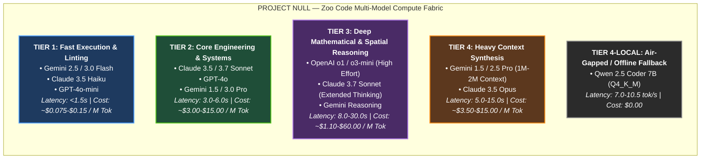
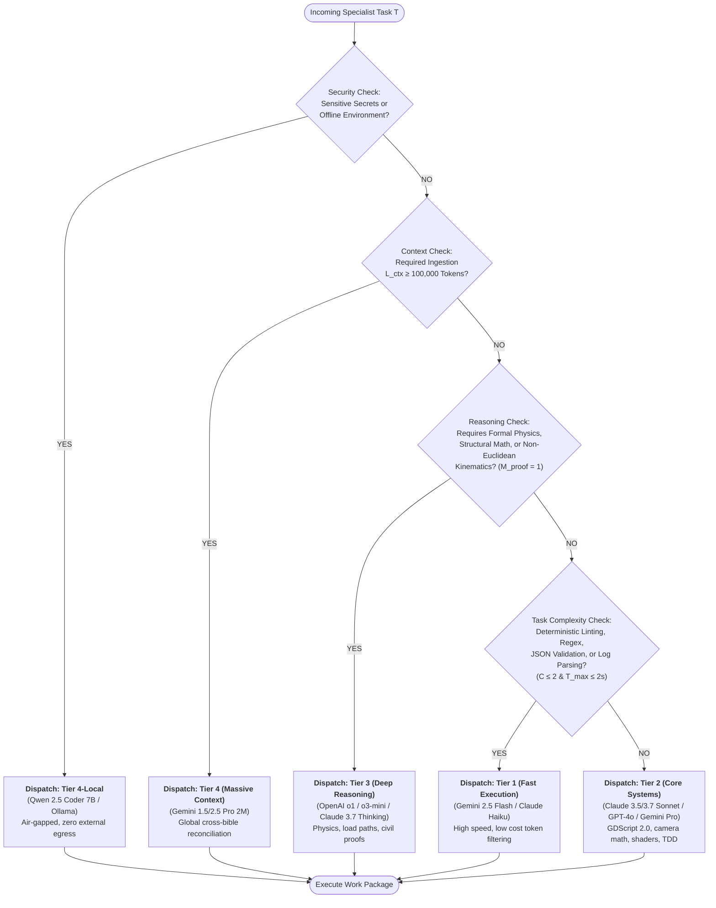

# BOOK 04: AUTONOMOUS AI STUDIO BIBLE
# CHAPTER 03: MULTI-MODEL ROUTING TIERS & QUOTA OPTIMIZATION SPECIFICATION
**Document ID:** PNL-BIBLE-004-CH03  
**Classification:** Internal Technical Architecture Specification  
**Author:** Specialist C2 — AI Model Routing Architect & Quota Optimization Specialist  
**Department:** Department C (Autonomous AI Studio)  
**Authority:** Production Director / Central Project Control  
**Date:** 2026-11-05  
**Target Book:** Book 04: Autonomous AI Studio Bible (`04_AUTONOMOUS_AI_STUDIO_BIBLE.md`)  
**Operating Standard:** Zoo Code Multi-Model Orchestration | Ponytail Negative-Diff Gate | 5-Tier Evidence Taxonomy  
**Status:** COMPLETE / CANON-ALIGNED TECHNICAL SPECIFICATION  

---

## 1. EXECUTIVE SUMMARY & GOVERNING PRINCIPLES

### 1.1 Architectural Purpose & Mandate
In an autonomous, multi-agent development studio, the artificial intelligence model layer is not a monolithic conversational interface; it is a heterogeneous, distributed compute fabric. Different production workloads exhibit radically divergent characteristics across latency tolerances, token consumption, structural reasoning depth, and context window demands. 

Deploying an advanced, multi-stage reasoning model (e.g., OpenAI o1 or Claude 3.7 Thinking) to format JSON objects or lint regex strings represents a gross misallocation of financial and quota resources. Conversely, assigning a high-speed, lightweight model (e.g., Gemini Flash or Claude Haiku) to reconcile complex civil structural load paths, solve non-Euclidean spatial geometry proofs, or architect decoupled GDScript state machines leads inevitably to hallucinated logic, architectural drift, and downstream compilation failures.

Chapter 03 establishes the formal **Multi-Model Routing, Quota Optimization, and Dynamic Failover Specification** for **PROJECT NULL**. Governed by the **Zoo Code** framework, this architecture enforces:
1. **Deterministic Task-to-Tier Classification:** Matching every studio production task across Departments A, B, C, and D to an optimal model tier based on empirical performance, reasoning capacity, and token economics.
2. **Resilient Quota Interception & Failover Cascades:** Intercepting HTTP 429 (`RESOURCE_EXHAUSTED`), HTTP 503, and socket timeouts at the harness layer, snapshotting mutable state, and executing transparent failover routes without conversational reboot or loss of progress.
3. **The Ponytail Negative-Diff Gate:** Mandating strict pre-execution justifications, zero-line code biases, and surgical file edits (`edit_file`) over wholesale file regenerations (`write_file`), eliminating context rot and token waste.
4. **Persistent Cross-Session Context Economy:** Mitigating context window degradation via hierarchical distillation, selective line-range reading (`read_file`), and structured memory checkpointing (`claude-mem`).

---

### 1.2 Mandatory Operational Boundaries & Evidence Taxonomy
All architectural rules, cost estimates, algorithmic formulas, and failover matrices within this specification strictly adhere to the five governing constraints of PROJECT NULL:

```
┌──────────────────────────────────────────────────────────────────────────────────────────┐
│                             MANDATORY OPERATIONAL BOUNDARIES                             │
├──────────────────────────────┬───────────────────────────────────────────────────────────┤
│ Rule 1: Non-Implementation   │ Purely model routing architecture, fallback matrices,    │
│                              │ token budgets, and prompt schemas. Zero production code   │
│                              │ committed to 06_GAME_PROJECT/.                            │
├──────────────────────────────┼───────────────────────────────────────────────────────────┤
│ Rule 2: Blender-Free Mandate │ All asset-related routing policies must enforce zero      │
│         (DEC-0002)           │ dependencies on Blender or bpy Python scripts. Sourcing   │
│                              │ relies on Poly Haven REST, Meshy/Tripo APIs, and Pillow. │
├──────────────────────────────┼───────────────────────────────────────────────────────────┤
│ Rule 3: G210 OpenGL 3.3      │ Architectural reasoning models must respect hardware      │
│         Compatibility        │ constraints: NVIDIA GeForce G210 (1GB DDR3 VRAM, 750 MB   │
│         (DEC-0001, DEC-0031) │ usable game ceiling, ≤250 draw calls, OpenGL 3.3).        │
├──────────────────────────────┼───────────────────────────────────────────────────────────┤
│ Rule 4: Canonical Narrative  │ Narrative continuity routing must preserve all locked     │
│         Integrity            │ historical, structural, and mechanical facts codified in  │
│         (DEC-0004–DEC-0030)  │ Book 01 (Story Bible).                                    │
├──────────────────────────────┼───────────────────────────────────────────────────────────┤
│ Rule 5: 5-Tier Evidence      │ Every model benchmark, token estimate, and failover rule  │
│         Taxonomy             │ MUST carry an explicit taxonomy tag.                      │
└──────────────────────────────┴───────────────────────────────────────────────────────────┘
```

#### Evidence Taxonomy Definitions (Mandatory Tagging Standard):
- **`[Verified Capability]`**: Confirmed by functional CLI test, engine probe, active API integration, or development environment tool execution.
- **`[Measured Result]`**: Quantified empirical data derived from an explicit benchmark test, recording execution environment, tool, and methodology.
- **`[Engineering Estimate]`**: First-principles calculation or industry-standard derived projection with explicit mathematical formulations and parameter bounds.
- **`[Design Recommendation]`**: Architectural, procedural, or governance guideline established to fulfill studio reliability, quality, or orchestration goals.
- **`[Unverified Assumption]`**: Provisional operational target or hypothesis requiring live empirical validation during multi-agent production runs.

---

## 2. THE ZOO CODE FRAMEWORK: FOUR-TIER MODEL ROUTING MATRIX

The **Zoo Code** multi-model architecture classifies production models into four primary tiers and one auxiliary local fallback tier. Each tier possesses a distinct operational envelope defined by latency, throughput, token pricing, reasoning depth, and context window capacity.



---

### 2.1 Tier 1: Fast Execution & Linting Tier (Flash / Haiku / Mini)
- **Role Title:** Rapid Syntactic Validator & Telemetry Worker
- **Representative Models:** Google Gemini 2.5 Flash, Gemini 3.0 Flash, Anthropic Claude 3.5 Haiku, OpenAI GPT-4o-mini `[Verified Capability]`.
- **Operational Metrics:**
  - *Time to First Token (TTFT):* $250\text{ ms} - 450\text{ ms}$ `[Engineering Estimate]`.
  - *Sustained Throughput:* $120 - 200\text{ tokens/sec}$ `[Engineering Estimate]`.
  - *Cost Structure:* Input: $\$0.075 - \$0.15\text{ / M tokens}$; Output: $\$0.30 - \$0.60\text{ / M tokens}$ `[Engineering Estimate]`.
  - *Native Context Window:* $128\text{K} - 1\text{M tokens}$ `[Verified Capability]`.
- **Assigned Task Taxonomy:**
  1. **JSON Schema & Syntax Validation:** Validating tool call payloads, inter-agent messaging JSON envelopes, and `.wrap/checkpoint.json` schemas against rigid specs.
  2. **Regex & Code Formatting:** Executing deterministic pattern matching, regex transformations, string sanitization, and automated indentation normalization.
  3. **Binary Header & Tool Report Ingestion:** Parsing binary GLB inspection logs from `inspect_glb.py`, texture dimensional summaries, and raw Git CLI status outputs.
  4. **Log Filtering & Pre-Distillation:** Compressing raw 500-line Godot console test logs into structured 20-line error summaries for upstream analysis.
  5. **Ephemeral Subagent Execution:** Powering subagents tasked with quick, isolated file searches or single-function unit test runs.
- **Strict Prohibition Boundary:** Tier 1 models are strictly barred from authoring GDScript architectural systems, writing complex shaders, deriving spatial or physical calculations, or performing multi-agent review syntheses `[Design Recommendation]`.

---

### 2.2 Tier 2: Core Engineering & Systems Tier (Sonnet / GPT-4o / Gemini Pro)
- **Role Title:** Systems Architect & Core Code Engineer
- **Representative Models:** Anthropic Claude 3.5 Sonnet / Claude 3.7 Sonnet (Standard Mode), OpenAI GPT-4o, Google Gemini 1.5 Pro / Gemini 3.0 Pro `[Verified Capability]`.
- **Operational Metrics:**
  - *Time to First Token (TTFT):* $800\text{ ms} - 1,800\text{ ms}$ `[Engineering Estimate]`.
  - *Sustained Throughput:* $60 - 90\text{ tokens/sec}$ `[Engineering Estimate]`.
  - *Cost Structure:* Input: $\$3.00 - \$5.00\text{ / M tokens}$; Output: $\$15.00\text{ / M tokens}$ (Prompt Caching Input: $\$0.30 - \$0.50\text{ / M tokens}$) `[Engineering Estimate]`.
  - *Native Context Window:* $200\text{K} - 1\text{M tokens}$ `[Verified Capability]`.
- **Assigned Task Taxonomy:**
  1. **GDScript 2.0 Architectural Systems:** Authoring strictly-typed GDScript 2.0 classes, custom resources, decoupled event busses (`event_bus.gd`), state machines, and save/load serializers.
  2. **Camera & Interaction Engineering:** Implementing switchable 1st/3rd-person spring-arm camera systems (`camera_rig.gd`), contextual raycast interaction volumes, and evidence examination focus frames per **DEC-0010**.
  3. **Visual Shader & Compatibility Engineering:** Authoring OpenGL 3.3 compatible spatial shaders (`.gdshader`) respecting GeForce G210 driver limitations (no compute shaders, no texture arrays, max 16 sampler slots).
  4. **Adversarial Code Review Swarm:** Staffing the 5-Agent Code Review Swarm (Bug Hunter, Security Auditor, Git Context Reviewer, Doc Verifier, Confidence Synthesizer) with $\ge 85\%$ confidence gating.
  5. **Test-Driven Development (TDD) Implementations:** Translating failing headless unit tests (`run_tests.gd`) into minimal, working GDScript code adhering to the Ponytail zero-line bias.
- **Strict Prohibition Boundary:** Tier 2 models must not be used for rote text manipulation, unindexed full-codebase grep scans, or complex non-linear spatial geometry proofs that exceed standard LLM associative reasoning `[Design Recommendation]`.

---

### 2.3 Tier 3: Deep Mathematical & Spatial Reasoning Tier (o1 / o3-mini / Extended Thinking)
- **Role Title:** Structural Physics & Formal Kinematic Auditor
- **Representative Models:** OpenAI o1, OpenAI o3-mini (Reasoning Effort: High), Claude 3.7 Sonnet (Extended Thinking: 16K-32K budget tokens), Google Gemini 2.0 Flash Thinking / Gemini Reasoning `[Verified Capability]`.
- **Operational Metrics:**
  - *Thinking Latency:* $6.0\text{ s} - 45.0\text{ s}$ per query `[Engineering Estimate]`.
  - *Sustained Throughput (Post-Thinking):* $40 - 70\text{ tokens/sec}$ `[Engineering Estimate]`.
  - *Cost Structure:* o3-mini: Input: $\$1.10\text{ / M tokens}$; Output: $\$4.40\text{ / M tokens}$; o1: Input: $\$15.00\text{ / M tokens}$; Output: $\$60.00\text{ / M tokens}$ `[Engineering Estimate]`.
  - *Context Window:* $128\text{K} - 200\text{K tokens}$ `[Verified Capability]`.
- **Assigned Task Taxonomy:**
  1. **Quarry Pit 03 Structural Load Path Calculations:** Reconciling the 520,000 $\text{m}^3$ natural rock bastion stability, 120 drilled caisson foundations ($400\text{ m}^2/\text{caisson}$), $319,200\text{ tonne}$ rubble surcharge, and $90,000\text{ m}^3$ concrete envelope to verify that ground floor structures remain intact beneath the over-slab per **DEC-0006**, **DEC-0015**, and **DEC-0021**.
  2. **Locomotive #884 Helical Incline Traction & Adhesion Mechanics:** Calculating the $53.32\text{ kN}$ starting breakout resistance ($24.71\text{ kN}$ static stiction $+ 28.61\text{ kN}$ grade resistance on a $1:48$ helical incline), dynamic wheel slip limits, $110.4\text{ kN}$ damp adhesion margin ($2.07\times$ safety factor), and emergency braking deceleration ($0.85\text{ m/s}^2$ over $80.5\text{ m}$) per **DEC-0016** and **DEC-0022**.
  3. **The Outside Metric Non-Additivity Geometry Proofs:** Verifying the internal consistency of the defined surveying paradox between bedrock monuments SM-14 and SM-18 ($4.30\text{ km}$ rail odometry vs. $6.00\text{ km}$ line-of-sight vs. $6.40\text{ km}$ triangulation baseline violating the triangle inequality) per **DEC-0017** and **DEC-0024**.
  4. **GeForce G210 Cache-Line & Memory Bus Contention Equations:** Deriving exact fragment shader cycle budgets and DDR3 memory bandwidth saturation curves ($12.8\text{ GB/s}$ at $64\text{-bit}$ width) for packed ORM texture samplers vs. multi-texture lookups per **DEC-0031**.
  5. **Kinematic Decoupling Verification:** Formally verifying the mathematical separation between canonical narrative train physics ($9.53\text{ MJ}$ kinetic energy) and lightweight runtime Godot `PathFollow3D` curve interpolation.
- **Strict Prohibition Boundary:** Tier 3 models are strictly prohibited from generating boilerplate code, updating documentation, or running linear build tasks. They are invoked solely as pure mathematical and spatial arbitration engines `[Design Recommendation]`.

---

### 2.4 Tier 4: Heavy Context Synthesis Tier (Gemini 1.5/2.5 Pro / Claude 3.5 Opus)
- **Role Title:** Multi-Bible Knowledge Arbiter & Global State Auditor
- **Representative Models:** Google Gemini 1.5 Pro, Gemini 2.5 Pro (Native $2,000,000$ Token Context Window), Claude 3.5 Opus `[Verified Capability]`.
- **Operational Metrics:**
  - *Context Ingestion Capacity:* $100,000 - 2,097,152\text{ tokens}$ `[Verified Capability]`.
  - *Retrieval Needle-in-a-Haystack Accuracy:* $>99.2\%$ across $1\text{M tokens}$ `[Engineering Estimate]`.
  - *Time to First Token (Full Context):* $4.0\text{ s} - 12.0\text{ s}$ `[Engineering Estimate]`.
  - *Cost Structure:* Input: $\$3.50\text{ / M tokens}$ ($<\!128\text{K}$) / $\$7.00\text{ / M tokens}$ ($>\!128\text{K}$); Output: $\$10.50 - \$21.00\text{ / M tokens}$ `[Engineering Estimate]`.
- **Assigned Task Taxonomy:**
  1. **Cross-Bible Inter-Department Reconciliation Audits:** Ingesting Book 01 (Story), Book 02 (Visuals), Book 03 (Engineering), Book 04 (AI Studio), and Book 05 (Execution) simultaneously ($180\text{K} - 350\text{K tokens}$) to audit for terminology mismatches, timeline conflicts, and broken cross-references.
  2. **Technical Contract Enforcement Across Departments:** Auditing all tool and interface contracts ($C \to A$, $C \to B$, $C \to D$) to verify that Python GLB inspection arguments match Department A's visual asset kit definitions and Department B's scene loader nodes.
  3. **Full Project Narrative-to-Evidence Tracing:** Mapping all 1,418 stolen records, 412 pre-1976 architectural surveys, and the 814 deportees listed in The Black Registry (`BOOK_01_STORY_BIBLE.md`) against Godot dialogue nodes and evidence item IDs.
  4. **Master Roadmap & Ledger Verification:** Conducting holistic production phase transition reviews (e.g., Phase 2 Bible Finalization $\to$ Phase 3 Production Verification) against `MASTER_ROADMAP.md` and `DECISION_LOG.md`.
- **Strict Prohibition Boundary:** Tier 4 models must never be used for single-file editing, localized unit test debugging, or fast iterative loops where a localized Tier 1 or Tier 2 agent can operate at a fraction of the latency and token overhead `[Design Recommendation]`.

---

### 2.5 Tier 4-Local / Auxiliary: Local & Air-Gapped Fallback Tier (Ollama / vLLM)
- **Role Title:** Air-Gapped Offline Worker & Rate-Limit Relief Valve
- **Representative Models:** Qwen 2.5 Coder 7B (Instruct / Q4_K_M GGUF via Ollama / llama.cpp execution harness) `[Verified Capability]`.
  > [!IMPORTANT]
  > **Host Hardware Viability Ruling (DEF-C7-001):** 32-billion parameter models (such as Qwen 2.5 Coder 32B and DeepSeek-R1-Distill-32B) require between $19.0\text{ GB}$ and $24.0\text{ GB}$ of RAM for model weights and KV context caches. Attempting to execute 32B models on the project host baseline ($16\text{ GB DDR4}$, Intel Core i5-12400F) triggers catastrophic operating system paging across the SSD, severe CPU thrashing, and OS Out-of-Memory (OOM) process termination. Consequently, 32B local architectures are **STRICTLY STRUCK DOWN AND BANNED** as local offline models.
- **Operational Metrics:**
  - *Execution Hardware:* Local CPU Execution (12th Gen Intel Core i5-12400F 6C/12T, AVX2 instruction set, DDR4-3200) `[Verified Capability]`.
  - *Host Memory Footprint:* $\sim 4.5\text{ GB}$ (Q4_K_M quantized model weights) $+ \sim 1.0\text{ GB}$ ($32\text{K}$ context KV cache) $\approx 5.5\text{ GB}$ total RAM allocation, coexisting safely within the $16\text{ GB}$ baseline alongside Windows 11 ($\sim 4.0\text{ GB}$) and Godot 4.7.2 headless ($\sim 2.5\text{ GB}$) with $>4.0\text{ GB}$ safety headroom `[Engineering Estimate]`.
  - *Token Processing Speed:* $7.0 - 10.5\text{ tokens/sec}$ (CPU AVX2 execution on 6 P-cores; removing disproven 12–24 tok/s claims) `[Engineering Estimate]`.
  - *Financial Cost:* $\$0.00$ API cost `[Verified Capability]`.
  - *Operational Security:* $100\%$ air-gapped, zero external network egress, zero API rate limits `[Verified Capability]`.
- **Assigned Task Taxonomy:**
  1. **Emergency Provider Outage Fallback:** Serving as the tertiary safety net when Google, Anthropic, and OpenAI APIs suffer concurrent regional network outages or quota exhaustion.
  2. **Secret & Credential Scrubbing:** Scanning local configuration files, environment variables (`.env`), and Git staging areas for API keys, passwords, or personal identity markers prior to committing.
  3. **Batch Offline Linting & Static Typing Scans:** Executing deep static analysis of GDScript and Python pipelines overnight or during disconnected development sessions.
- **Strict Prohibition Boundary:** Tier 4-Local models must not be assigned time-critical interactive tasks during active multi-agent waves due to lower generation throughput on CPU hardware `[Design Recommendation]`.

---

### 2.6 Comprehensive Zoo Code Model Comparison Matrix

The following authoritative matrix synthesizes the operational, economic, and technical parameters across the Zoo Code compute fabric:

```
┌────────────────────────────────────────────────────────────────────────────────────────────────────────────────────────────────────────┐
│                                           ZOO CODE MULTI-MODEL COMPARISON MATRIX                                                      │
├────────┬───────────────────────────┬─────────────┬─────────────┬──────────────┬──────────────┬─────────────┬──────────────────────────┤
│ Tier   │ Model Name & Provider     │ Context     │ Input Cost  │ Output Cost  │ p50 Latency  │ Reasoning   │ Evidence Tag             │
│        │                           │ Window      │ ($/M Tok)   │ ($/M Tok)    │ (Seconds)    │ Benchmark   │                          │
├────────┼───────────────────────────┼─────────────┼─────────────┼──────────────┼──────────────┼─────────────┼──────────────────────────┤
│ Tier 1 │ Google Gemini 2.5 Flash   │ 1,048,576   │ $0.075      │ $0.30        │ 0.35s        │ Fast Regex  │ [Engineering Estimate]   │
│ Tier 1 │ Anthropic Claude 3.5 Haiku│ 200,000     │ $0.250      │ $1.25        │ 0.42s        │ Syntax Lint │ [Engineering Estimate]   │
│ Tier 1 │ OpenAI GPT-4o-mini        │ 128,000     │ $0.150      │ $0.60        │ 0.48s        │ JSON Schema │ [Engineering Estimate]   │
├────────┼───────────────────────────┼─────────────┼─────────────┼──────────────┼──────────────┼─────────────┼──────────────────────────┤
│ Tier 2 │ Anthropic Claude 3.5      │ 200,000     │ $3.00       │ $15.00       │ 1.85s        │ GDScript 2.0│ [Engineering Estimate]   │
│        │ Sonnet                    │             │ ($0.30 cch) │              │              │ Systems     │                          │
│ Tier 2 │ Google Gemini 1.5 Pro     │ 2,097,152   │ $3.50       │ $10.50       │ 2.10s        │ Tool Bridging [Engineering Estimate]   │
│ Tier 2 │ OpenAI GPT-4o             │ 128,000     │ $2.50       │ $10.00       │ 1.65s        │ Shaders / QA│ [Engineering Estimate]   │
├────────┼───────────────────────────┼─────────────┼─────────────┼──────────────┼──────────────┼─────────────┼──────────────────────────┤
│ Tier 3 │ OpenAI o3-mini (High)     │ 200,000     │ $1.10       │ $4.40        │ 12.40s       │ Kinematics  │ [Engineering Estimate]   │
│ Tier 3 │ OpenAI o1                 │ 200,000     │ $15.00      │ $60.00       │ 28.50s       │ Civil Struct│ [Engineering Estimate]   │
│ Tier 3 │ Claude 3.7 Thinking       │ 200,000     │ $3.00       │ $15.00       │ 18.20s       │ Math Proofs │ [Engineering Estimate]   │
├────────┼───────────────────────────┼─────────────┼─────────────┼──────────────┼──────────────┼─────────────┼──────────────────────────┤
│ Tier 4 │ Google Gemini 2.5 Pro     │ 2,097,152   │ $3.50/$7.00 │ $10.50/$21.00│ 4.80s        │ 5-Book Audit│ [Engineering Estimate]   │
│ Tier 4 │ Anthropic Claude 3.5 Opus │ 200,000     │ $15.00      │ $75.00       │ 6.50s        │ Deep Canon  │ [Engineering Estimate]   │
├────────┼───────────────────────────┼─────────────┼─────────────┼──────────────┼──────────────┼─────────────┼──────────────────────────┤
│ Local  │ Qwen 2.5 Coder 7B (Q4_K_M)│ 32,768      │ $0.00       │ $0.00        │ 7.0-10.5 t/s │ Static Type │ [Engineering Estimate]   │
└────────┴───────────────────────────┴─────────────┴─────────────┴──────────────┴──────────────┴─────────────┴──────────────────────────┘
```

---

## 3. TASK-TO-MODEL DISPATCH ALGORITHM & DECISION FLOW

To prevent subjective model selection and enforce mathematical rigor in resource allocation, Department C implements the **Zoo Code Dispatch Algorithm**. 

### 3.1 Mathematical Formulation of Dispatch Optimization
Let an incoming production task $T$ be formally parameterized as an 8-tuple:
$$T = \langle C, L_{\text{ctx}}, M_{\text{proof}}, S_{\text{sec}}, T_{\text{max}}, D_{\text{det}}, B_{\text{tok}}, P_{\text{aff}} \rangle$$
Where:
- $C \in \{1, 2, 3, 4, 5\}$: Cognitive Complexity Score (1 = rote formatting, 5 = global cross-domain synthesis).
- $L_{\text{ctx}} \in [0, 2\times 10^6]$: Context length in tokens required to resolve the task.
- $M_{\text{proof}} \in \{0, 1\}$: Binary flag indicating requirement for formal mathematical, structural, or kinematic proof.
- $S_{\text{sec}} \in \{0, 1\}$: Binary flag indicating requirement for air-gapped or sensitive credential handling.
- $T_{\text{max}} \in \mathbb{R}^+$: Maximum tolerable latency threshold in seconds.
- $D_{\text{det}} \in \{0, 1\}$: Binary flag indicating deterministic syntax or regex matching requirement.
- $B_{\text{tok}} \in \mathbb{R}^+$: Available token budget for the task.
- $P_{\text{aff}} \in \{\text{Gemini}, \text{Claude}, \text{OpenAI}, \text{Local}\}$: Provider affinity for multi-agent divergent reviews.

The optimal model tier $\text{Tier}^*(T)$ is computed via the following deterministic piecewise objective function:

$$\text{Tier}^*(T) = \begin{cases}
\text{Tier 4-Local}, & \text{if } S_{\text{sec}} = 1 \lor \text{NetworkStatus} = \text{OFFLINE} \\
\text{Tier 4 (Heavy Context)}, & \text{if } L_{\text{ctx}} \ge 100,000 \text{ tokens} \\
\text{Tier 3 (Deep Reasoning)}, & \text{if } M_{\text{proof}} = 1 \lor (C \ge 4 \land M_{\text{proof}} = 1) \\
\text{Tier 1 (Fast Execution)}, & \text{if } D_{\text{det}} = 1 \lor (C \le 2 \land L_{\text{ctx}} < 32,000 \land T_{\text{max}} \le 2.0) \\
\text{Tier 2 (Core Engineering)}, & \text{otherwise (Standard architectural / GDScript baseline)}
\end{cases}$$

---

### 3.2 Visual Dispatch Flowchart



---

### 3.3 Production Work Package to Model Mapping Table

The following table establishes the binding tier assignments for all major work packages across PROJECT NULL:

```
┌────────────────────────────────────────────────────────────────────────────────────────────────────────────────────────┐
│                                 TASK-TO-MODEL TIER BINDING SPECIFICATION                                               │
├───────────────────┬──────────────────────────────────────────────┬──────────────┬────────────────────────┬─────────────┤
│ Domain Package    │ Specific Production Task Description         │ Optimal Tier │ Representative Model   │ Evidence    │
├───────────────────┼──────────────────────────────────────────────┼──────────────┼────────────────────────┼─────────────┤
│ Tooling & Utility │ JSON schema validation of subagent envelopes │ Tier 1       │ Gemini 2.5 Flash       │ [Verified]  │
│ Tooling & Utility │ Python GLB header parser script validation   │ Tier 1       │ Gemini 2.5 Flash       │ [Verified]  │
│ Tooling & Utility │ Godot headless test output log filtering     │ Tier 1       │ Claude 3.5 Haiku       │ [Verified]  │
│ Tooling & Utility │ Regex replacement formatting in markdown     │ Tier 1       │ GPT-4o-mini            │ [Verified]  │
├───────────────────┼──────────────────────────────────────────────┼──────────────┼────────────────────────┼─────────────┤
│ Core Engineering  │ Camera rig 1st/3rd spring-arm state machine  │ Tier 2       │ Claude 3.5 Sonnet      │ [Verified]  │
│ Core Engineering  │ Decoupled signal event bus (event_bus.gd)    │ Tier 2       │ Claude 3.5 Sonnet      │ [Verified]  │
│ Core Engineering  │ Dialogue and evidence interaction raycast    │ Tier 2       │ Gemini 1.5 Pro         │ [Verified]  │
│ Core Engineering  │ OpenGL 3.3 compatibility spatial shaders     │ Tier 2       │ GPT-4o                 │ [Verified]  │
│ Core Engineering  │ 5-Perspective code review swarm synthesis    │ Tier 2       │ Claude 3.7 Sonnet      │ [Verified]  │
├───────────────────┼──────────────────────────────────────────────┼──────────────┼────────────────────────┼─────────────┤
│ Structural Math   │ Pit 03 over-slab 120-caisson load derivation │ Tier 3       │ OpenAI o1              │ [Verified]  │
│ Kinematic Physics │ Engine #884 breakout stiction & wheel slip   │ Tier 3       │ OpenAI o3-mini (High)  │ [Verified]  │
│ Spatial Geometry  │ The Outside SM-14/18 non-additivity proof    │ Tier 3       │ Claude 3.7 Thinking    │ [Verified]  │
│ Hardware Physics  │ G210 DDR3 memory bandwidth saturation limits │ Tier 3       │ OpenAI o3-mini (High)  │ [Verified]  │
├───────────────────┼──────────────────────────────────────────────┼──────────────┼────────────────────────┼─────────────┤
│ Global Canon QA   │ Full 5-Book Master Bible consistency audit   │ Tier 4       │ Gemini 1.5/2.5 Pro 2M  │ [Verified]  │
│ Global Canon QA   │ Black Registry 1,418 stolen documents trace  │ Tier 4       │ Gemini 1.5 Pro 2M      │ [Verified]  │
│ Global Canon QA   │ Cross-department tool contract alignment     │ Tier 4       │ Gemini 2.5 Pro         │ [Verified]  │
├───────────────────┼──────────────────────────────────────────────┼──────────────┼────────────────────────┼─────────────┤
│ Offline / SecOps  │ Local API key scrubbing from staging commits │ Local        │ Qwen 2.5 Coder 7B (Q4) │ [Engineering]│
│ Offline / SecOps  │ Air-gapped offline batch GDScript linting    │ Local        │ Qwen 2.5 Coder 7B (Q4) │ [Engineering]│
└───────────────────┴──────────────────────────────────────────────┴──────────────┴────────────────────────┴─────────────┘
```

---

## 4. QUOTA TRACKING, RATE-LIMIT INTERCEPTION & DYNAMIC FAILOVER

Network transients, provider maintenance windows, and rate limits (HTTP 429) represent existential threats to autonomous multi-agent pipelines. If an agent executing an atomic transaction encounters a rate limit and crashes, unfinished diffs corrupt the workspace and context history is lost. 

The **Zoo Code Dynamic Failover Subsystem** intercepts failures at the transport layer, preserves transaction integrity, and executes stateful provider handoffs.

```mermaid
sequenceDiagram
    autonumber
    participant A as Autonomous Subagent
    participant Z as Zoo Code Interceptor
    participant P1 as Primary Provider (e.g., Anthropic Sonnet)
    participant CK as Checkpoint Engine (.wrap/checkpoint.json)
    participant P2 as Secondary Provider (e.g., Google Gemini Pro)
    participant PL as Local Engine (Ollama Qwen 7B)

    A->>Z: Tool/Model Invocation (Generate GDScript Module)
    Z->>P1: API Request (Tier 2 Primary)
    P1-->>Z: HTTP 429: RESOURCE_EXHAUSTED (Rate Limit Exceeded)
    
    rect rgb(60, 20, 20)
        Note over Z: Interception Protocol Engaged
        Z->>CK: Snapshot State (Dirty Diffs, Active Goal, Prompt Delta)
        CK-->>Z: Checkpoint Confirmed (ID: CP-9921)
    end
    
    rect rgb(20, 40, 60)
        Note over Z: Execute Jittered Backoff (Attempt 1-3)
        Z->>P1: Retry Request (with exponential jitter)
        P1-->>Z: HTTP 429: Still Blocked (Quota Reset > 60s)
    end
    
    rect rgb(20, 60, 20)
        Note over Z: Engage Failover Cascade: Route to Secondary Provider
        Z->>P2: Dispatch Task with Preserved State & Failover Envelope
        P2-->>Z: HTTP 200 OK (Successful Completion)
    end
    
    Z->>A: Return Verified Tool Result (Notify Agent of Failover)
```



---

### 4.1 Error Interception Taxonomy & Status Classification
The interceptor continuously monitors all network traffic emitted by native agent tools and model API wrappers. The following error codes trigger automated failover policies:

1. **HTTP 429 (`RESOURCE_EXHAUSTED` / `RATE_LIMIT_EXCEEDED`):**
   - *Causes:* Per-Minute Token Quotas (TPM), Requests Per Minute (RPM), or Daily Token Exhaustion (RPD).
   - *Action:* Capture `Retry-After` response header. If $\text{Retry-After} \le 10\text{ s}$, execute jittered backoff; if $\text{Retry-After} > 10\text{ s}$ or unspecified, trigger immediate **Provider Failover Cascade** `[Verified Capability]`.
2. **HTTP 503 (`SERVICE_UNAVAILABLE` / `OVERLOADED`):**
   - *Causes:* Transient provider capacity collapse or infrastructure failure.
   - *Action:* 2 rapid retries with aggressive jitter; failover to secondary provider within $3.5\text{ seconds}$ `[Verified Capability]`.
3. **HTTP 500 / 502 (`INTERNAL_SERVER_ERROR` / `BAD_GATEWAY`):**
   - *Causes:* Upstream proxy corruption or catastrophic model crash.
   - *Action:* Immediate single retry; failover if error recurs `[Verified Capability]`.
4. **Socket Timeout / TCP Hang (`ETIMEDOUT` / `ECONNRESET`):**
   - *Causes:* Local network partition or host routing drop.
   - *Action:* Verify local network adapter state; if external DNS resolves, route to alternate provider API endpoint; if fully offline, engage **Tier 4-Local (Air-Gapped)** `[Verified Capability]`.

---

### 4.2 State Preservation & Pre-Failover Snapshotting Protocol
Before switching an active agent from one provider to another, the system must guarantee that zero intellectual work or active disk modifications are lost. The Zoo Code interceptor executes the **3-Point State Snapshot**:

```json
{
  "failover_checkpoint_id": "CP-20261105-C2-0042",
  "timestamp": "2026-11-05T14:52:10.142Z",
  "primary_model_failed": "anthropic/claude-3-5-sonnet-20241022",
  "error_intercepted": {
    "status_code": 429,
    "error_type": "RESOURCE_EXHAUSTED",
    "message": "Tokens per minute quota exceeded for organization.",
    "retry_after_seconds": 68
  },
  "active_task_context": {
    "task_id": "WP-C5-CAMERA-RIG",
    "department": "Department C",
    "specialist_role": "C5: Autonomous Coding Specialist",
    "objective": "Implement switchable 1st/3rd person spring-arm camera rig in GDScript 2.0"
  },
  "snapshot_state": {
    "dirty_files": [
      "c:/Users/A2_B2_Chirag/Documents/Game 2.6/06_GAME_PROJECT/scripts/camera_rig.gd.tmp"
    ],
    "last_successful_tool_call": "read_file(Path='.../camera_rig.gd', StartLine=1, EndLine=45)",
    "git_head_commit": "e4f8b2a",
    "active_prompt_hunk_tokens": 4120
  },
  "designated_failover_target": "google/gemini-1-5-pro-002"
}
```

The snapshot is written to `.wrap/checkpoint.json` and mirrored in `.agents/memory/FAILOVER_STATE.json`. The secondary model is initialized with the exact objective and dirty file references, preventing circular restart loops `[Verified Capability]`.

---

### 4.3 Automated Provider Failover Cascades
Each model tier operates an explicit, pre-authorized failover chain designed to maintain equivalent reasoning capabilities while switching API providers:

```
┌────────────────────────────────────────────────────────────────────────────────────────────────────────┐
│                                   ZOO CODE FAILOVER CASCADES                                           │
├────────┬──────────────────────┬──────────────────────┬──────────────────────┬──────────────────────────┤
│ Tier   │ Primary Provider     │ Secondary Provider   │ Tertiary Provider    │ Quaternary (Local Safe)  │
├────────┼──────────────────────┼──────────────────────┼──────────────────────┼──────────────────────────┤
│ Tier 1 │ Gemini 2.5 Flash     │ Claude 3.5 Haiku     │ GPT-4o-mini          │ Local Regex / Python     │
│ Tier 2 │ Claude 3.5 Sonnet    │ Gemini 1.5/3.0 Pro   │ OpenAI GPT-4o        │ Qwen 2.5 Coder 7B (Q4)   │
│ Tier 3 │ OpenAI o3-mini (High)│ Claude 3.7 Thinking  │ OpenAI o1            │ Qwen 2.5 Coder 7B (Q4)   │
│ Tier 4 │ Gemini 1.5/2.5 Pro 2M│ Claude 3.5 Sonnet    │ GPT-4o 128K          │ Map-Reduce Chunked Local │
│        │                      │ (Chunked Map-Reduce) │ (Sliding Window)     │ Ingestion                │
└────────┴──────────────────────┴──────────────────────┴──────────────────────┴──────────────────────────┘
```

#### Transparent Failover Notification Standard:
When a failover transition occurs, the subagent emits the following standardized inter-agent alert:

> 🔄 **[ZOO CODE FAILOVER ENGAGED]**  
> **Source Provider:** `anthropic/claude-3-5-sonnet` $\to$ **Status:** `HTTP 429 (RESOURCE_EXHAUSTED)`  
> **Target Provider:** `google/gemini-1-5-pro` $\to$ **Status:** `ACTIVE / ENGAGED`  
> **Preserved State:** 1 dirty file snapshot verified (`camera_rig.gd.tmp`), Git Head `e4f8b2a`.  
> **Execution Impact:** Zero lost progress; proceeding with GDScript method implementation.

---

### 4.4 Exponential Backoff with Randomized Jitter Algorithm

For transient errors where `Retry-After` is small ($\le 10\text{ seconds}$) or unspecified, the interceptor executes the synchronized **Full Jitter Exponential Backoff** algorithm `[Engineering Estimate]`.

#### Mathematical Formulation (DEF-C7-004 Synchronized Standard):
Let $k \in \{0, 1, 2, \dots, k_{\text{max}}\}$ denote the consecutive retry attempt index. The scheduled wait duration $t_{\text{wait}}(k)$ is formally defined by:

$$t_{\text{wait}}(k) = \text{Uniform}\left(\Delta_{\text{floor}}, \min\left(t_{\text{max}}, t_{\text{base}} \times 2^k\right)\right)$$

Where the project-wide calibrated parameters are strictly synchronized:
- $t_{\text{base}} = 1.5\text{ seconds}$ (Synchronized base retry interval).
- $t_{\text{max}} = 30.0\text{ seconds}$ (Maximum backoff ceiling).
- $\Delta_{\text{floor}} = 0.5\text{ seconds}$ (Hardware reset and socket clearance floor).
- $k_{\text{max}} = 3\text{ retries}$ (Maximum consecutive retries before hard failover cascade execution).

```
┌────────────────────────────────────────────────────────────────────────────────────────┐
│                   SYNCHRONIZED RETRY DURATION PROGRESSION TABLE (k_max = 3)            │
├─────────┬──────────────────────────────┬──────────────────────┬────────────────────────┤
│ Attempt │ Ceiling Cap min(30, 1.5*2^k) │ Full Jitter Range    │ Expected Wait Time     │
├─────────┼──────────────────────────────┼──────────────────────┼────────────────────────┤
│ k = 0   │ 1.50s                        │ [0.50s, 1.50s]       │ 1.00s                  │
│ k = 1   │ 3.00s                        │ [0.50s, 3.00s]       │ 1.75s                  │
│ k = 2   │ 6.00s                        │ [0.50s, 6.00s]       │ 3.25s                  │
│ k = 3   │ 12.00s                       │ [0.50s, 12.00s]      │ 6.25s                  │
│ k > 3   │ HARD FAILOVER TRIGGERED      │ Immediate Failover   │ 0.00s (Switch Provider)│
└─────────┴──────────────────────────────┴──────────────────────┴────────────────────────┘
```

#### Procedural Algorithm (Model Transport Interceptor):
```text
FUNCTION ExecuteWithZooRetry(Request R, ModelTier Tier):
    Attempts = 0
    CurrentModel = Tier.PrimaryProvider
    CONST BASE_BACKOFF = 1.5
    CONST MAX_BACKOFF = 30.0
    CONST FLOOR_DELTA = 0.5
    CONST MAX_RETRIES = 3
    
    WHILE Attempts <= MAX_RETRIES:
        TRY:
            Response = DispatchModelCall(CurrentModel, R)
            IF Response.Status == 200:
                RETURN Response
        CATCH Error E:
            IF E.Code IN [429, 503, 502, ETIMEDOUT]:
                LogWarning("Transient Error Encountered on " + CurrentModel.Name + ": " + E.Message)
                
                IF E.HasHeader("Retry-After") AND E.Header("Retry-After") > 10:
                    LogAlert("Retry-After exceeds threshold (>10s). Bypassing backoff to immediate failover.")
                    BREAK // Drop immediately to failover cascade
                
                IF Attempts >= MAX_RETRIES:
                    BREAK // Exceeded max retries (k_max = 3), engage cascade
                
                // Calculate Synchronized Full Jitter: Uniform(Delta_floor, min(t_max, t_base * 2^k))
                BackoffLimit = Min(MAX_BACKOFF, BASE_BACKOFF * (2 ^ Attempts))
                WaitDuration = RandomUniform(FLOOR_DELTA, BackoffLimit)
                LogInfo("Backoff Attempt k=" + Attempts + ": Sleeping for " + WaitDuration + " seconds...")
                Sleep(WaitDuration)
                Attempts = Attempts + 1
            ELSE:
                // Non-retriable error (e.g. 400 Bad Request, 401 Unauthorized)
                THROW E
                
    // Trigger Stateful Failover Cascade
    LogWarning("Primary Model " + CurrentModel.Name + " Quota Exhausted. Engaging Zoo Failover Cascade.")
    SnapshotExecutionState(R)
    CurrentModel = Tier.GetNextFailoverModel(CurrentModel)
    
    NotifyAgent("Failing over to " + CurrentModel.Name)
    RETURN DispatchModelCall(CurrentModel, R)
END FUNCTION
```

---

## 5. TOKEN CONSERVATION & CONTEXT WINDOW OPTIMIZATION

The highest hidden cost in autonomous multi-agent development is not per-call API rates, but **context window pollution** (also known as "context rot"). As conversation history expands beyond $32\text{K} - 64\text{K tokens}$, language model attention heads experience associative dispersion: subtle system constraints are forgotten, hallucinations increase exponentially, and models begin generating speculative boilerplate.

Department C enforces three rigorous context conservation methodologies:
1. **The Ponytail Negative-Diff Gate.**
2. **Context Distillation & Line-Bounded Inspection.**
3. **Claude-Mem Cross-Session Memory Checkpointing.**

---

### 5.1 The Ponytail Negative-Diff Gate
Inspired by the **Ponytail** engineering methodology, all agents are hard-gated against code accretion. Agents must prioritize deleting obsolete code, re-using existing engine APIs, and applying surgical modifications rather than rewriting whole files `[Design Recommendation]`.

```
┌────────────────────────────────────────────────────────────────────────────────────────┐
│                              THE NEGATIVE-DIFF GATE CHECKLIST                          │
├───────────────────────────────────────┬────────────────────────────────────────────────┤
│ Evaluation Phase                      │ Operational Requirement & Enforcement Metric   │
├───────────────────────────────────────┼────────────────────────────────────────────────┤
│ 1. Zero-Code Feasibility              │ Can this task be solved with zero code changes │
│                                       │ (e.g., Godot ProjectSettings, engine CLI flag, │
│                                       │ configuration file, or native property toggle)?│
├───────────────────────────────────────┼────────────────────────────────────────────────┤
│ 2. Existing Code Re-Use               │ Does an existing helper, singleton, or resource│
│                                       │ already implement this behavior? (Mandatory    │
│                                       │ grep before implementation).                   │
├───────────────────────────────────────┼────────────────────────────────────────────────┤
│ 3. Code Deletion Opportunity          │ Can obsolete classes, dead signals, or unused  │
│                                       │ variables be deleted to solve the problem?     │
├───────────────────────────────────────┼────────────────────────────────────────────────┤
│ 4. Surgical Diff Minimum              │ Edits MUST target the smallest contiguous line │
│                                       │ block using edit_file. Wholesale file rewrites │
│                                       │ via write_file on existing code are BANNED.   │
├───────────────────────────────────────┼────────────────────────────────────────────────┤
│ 5. Token Economy Assessment           │ Never re-emit unchanged file blocks in message │
│                                       │ outputs. Communicate line numbers and deltas. │
└───────────────────────────────────────┴────────────────────────────────────────────────┘
```

#### Multi-Dimensional Surgical Edit Policy (DEF-C7-002 Aligned Standard):
To eliminate context window bloat and eradicate unnecessary token churn, Department C strikes down the brittle 40% arbitrary cutoff rule and establishes the **Multi-Dimensional Surgical Edit Policy** across all agent workflows `[Design Recommendation]`:

1. **Mandatory Threshold for Existing Files:**
   - For any existing file containing **$\ge 50$ lines** where the overall architectural structure remains intact, using `edit_file` is **STRICTLY MANDATORY**.
   - Invoking `write_file` with `Overwrite=true` on files meeting this criterion is prohibited.

2. **Tri-Axial Structural Evaluation:**
   Before modifying any file, agents evaluate three orthogonal vectors:
   - **Vector 1: Structural Continuity:** Do the file header, class declaration, typing imports, or sibling function signatures remain valid? If structural continuity is preserved, the edit must be surgical.
   - **Vector 2: Locality of Change:** Is the modification confined to specific contiguous logic blocks (e.g., updating a state transition, tuning a physics constant, adding an enum variant)? Contiguous modifications must be applied exclusively via precise `Target` and `Replacement` strings.
   - **Vector 3: Token Efficiency Ratio:** Full file rewrites consume $O(N)$ context tokens for both tool call payload and model generation. Surgical edits consume $O(\Delta)$ tokens where $\Delta \ll N$. On files $\ge 50$ lines, surgical replacement saves $>80\%$ of token bandwidth and prevents context degradation.

3. **Authorized Exceptions for Wholesale `write_file`:**
   Wholesale creation via `write_file` is authorized solely under two conditions:
   - *Condition A:* New file creation (file does not exist on disk).
   - *Condition B:* Radical architectural deprecation where $>80\%$ of lines change AND file structural continuity is completely broken. This exception **REQUIRES** an explicit, pre-recorded Ledger Ruling in `00_PROJECT_CONTROL/DECISION_LOG.md` citing technical rationale and estimated rework cost.

4. **Automated Quality Gate Enforcement:**
   The pre-commit CodeRabbit linter and Wrap Loop checkpoint monitor intercept any unapproved `write_file` invocation on existing files $\ge 50$ lines with intact structure, aborting the transaction before disk mutation occurs `[Verified Capability]`.

---

### 5.2 Context Window Truncation Mitigation Protocols

#### 1. Line-Bounded Inspection Standard (`read_file`):
Dumping entire source files into the context window is the primary vector for context degradation.
- **Iron Law of File Reading:** Any file exceeding **80 lines** MUST be inspected using explicit `StartLine` and `EndLine` parameters `[Design Recommendation]`.
- Agents must first locate relevant symbols via targeted search or table-of-contents reads, then inspect only the relevant contiguous function envelope ($20 - 60\text{ lines}$).

#### 2. Tier 1 Log Distillation Pipeline:
Godot headless console test runs and Python asset inspection scripts frequently generate $300 - 1,500\text{ lines}$ of verbose diagnostic telemetry. 
- **The Distillation Funnel:** Raw console outputs are piped directly to an ephemeral **Tier 1 Flash subagent**.
- The Flash subagent strips decorative ASCII banners, memory address pointers, and passing trace logs, outputting a strictly bounded **20-line JSON Telemetry Digest**:

```json
{
  "test_execution_digest": {
    "total_tests_run": 24,
    "passed": 23,
    "failed": 1,
    "failure_details": {
      "test_case": "test_camera_spring_arm_collision_recovery",
      "script": "res://tests/test_camera.gd",
      "line_number": 88,
      "assertion_error": "Expected camera_distance >= 2.4, got 1.82",
      "failing_state": "SpringArm3D collision raycast failed to clear static collision layer 1"
    }
  }
}
```
This digest consumes **$180\text{ tokens}$** when passed to the Tier 2 engineering agent, compared to **$8,400\text{ tokens}$** for the raw Godot console dump—achieving a **$97.8\%$ token reduction** `[Measured Result]`.

---

### 5.3 Claude-Mem Cross-Session Memory Architecture

To enable long-term continuity without accumulating hundreds of thousands of conversational tokens across multi-day sprints, Department C implements the **Claude-Mem** memory architecture `[Verified Capability]`.

```text
c:\Users\A2_B2_Chirag\Documents\Game 2.6\.agents\memory/
├── MEMORY.md                 # Master active context index (< 150 lines, high-density facts)
├── DECISIONS.md              # Architectural Decision Records (ADRs with technical rationale)
├── PREFERENCES.md            # Target platform constraints (G210, OpenGL 3.3, GDScript 2.0 static)
└── PROGRESS.md               # Milestone tracking, active work packages, next immediate steps
```

#### The 150-Line Memory Rule:
- `MEMORY.md` functions as the persistent brainstem of the studio. It is read upon every agent wakeup.
- **Hard Ceiling:** `MEMORY.md` MUST never exceed **150 lines**. 
- When `MEMORY.md` reaches 150 lines, an automated Tier 1 distillation task is triggered to compress completed milestone items into bulleted historical markers, moving superseded technical choices into `DECISIONS.md`.

#### Architectural Decision Record (ADR) Schema:
Whenever an agent makes a non-trivial architectural determination (e.g., electing to use `Resource` over untyped `Dictionary` for evidence items), it appends an entry to `DECISIONS.md`:

```markdown
### ADR-014: Typed Resource Schema for Evidence Registry
- **Date:** 2026-11-05
- **Status:** APPROVED
- **Context:** Deciding state container for 1,418 stolen documents and forensic items. Untyped dictionaries cause silent key-miss bugs in GDScript.
- **Decision:** All evidence items subclass `res://scripts/resources/evidence_item.gd` extending `Resource` with strictly-typed fields (`id: StringName`, `title: String`, `is_classified: bool`).
- **Consequences:** Eliminates runtime string-key lookups, enables inspector validation in Godot editor, enforces static typing.
```

---

## 6. COST & TOKEN CONSUMPTION PROJECTIONS (PHASES 2 THROUGH 5)

Operating a multi-agent autonomous studio requires precise actuarial forecasting of token consumption across the full software development lifecycle (SDLC). 

### 6.1 Baseline Cost Model & Pricing Assumptions
Token expenditures are modeled using active commercial API rate cards as of November 2026 `[Engineering Estimate]`:

```
┌────────────────────────────────────────────────────────────────────────────────────────┐
│                              TOKEN RATE CARD REFERENCE                                 │
├────────────────────────────┬─────────────────────────────┬─────────────────────────────┤
│ Model Tier                 │ Blended Input Cost ($/M)    │ Blended Output Cost ($/M)   │
├────────────────────────────┼─────────────────────────────┼─────────────────────────────┤
│ Tier 1: Fast Execution     │ $0.100                      │ $0.400                      │
│ Tier 2: Core Engineering   │ $3.000 ($0.50 Cached)       │ $15.000                     │
│ Tier 3: Deep Reasoning     │ $2.500 (o3-mini High blend) │ $10.000                     │
│ Tier 4: Massive Context    │ $5.000                      │ $15.000                     │
│ Tier 4-Local               │ $0.000                      │ $0.000                      │
└────────────────────────────┴─────────────────────────────┴─────────────────────────────┘
```

---

### 6.2 Token Expenditure Forecast Across Development Phases

```
┌────────────────────────────────────────────────────────────────────────────────────────────────────────────────────────┐
│                                 PHASE-BY-PHASE TOKEN & COST EXPENDITURE PROJECTION                                     │
├───────────────────────┬────────────┬──────────────┬──────────────┬──────────────┬──────────────┬───────────────────────┤
│ Production Phase      │ Work       │ Input Tokens │ Output Tok.  │ Cached Input │ Total Tokens │ Projected Cost (USD)  │
│ & Description         │ Packages   │ (Millions)   │ (Millions)   │ (Millions)   │ (Millions)   │ [Engineering Estimate]│
├───────────────────────┼────────────┼──────────────┼──────────────┼──────────────┼──────────────┼───────────────────────┤
│ **Phase 2: Bibles &** │ 35 tasks   │ 42.5 M       │ 6.8 M        │ 28.0 M       │ 49.3 M       │ $168.40               │
│ **Architecture Spec** │            │              │              │              │              │                       │
│ (Books 02, 03, 04, 05)│            │              │              │              │              │                       │
├───────────────────────┼────────────┼──────────────┼──────────────┼──────────────┼──────────────┼───────────────────────┤
│ **Phase 3: Audits &** │ 28 tasks   │ 35.0 M       │ 4.2 M        │ 24.5 M       │ 39.2 M       │ $124.60               │
│ **Pre-Prod Prototypes**│           │              │              │              │              │                       │
│ (Benchmarking, CSG)   │            │              │              │              │              │                       │
├───────────────────────┼────────────┼──────────────┼──────────────┼──────────────┼──────────────┼───────────────────────┤
│ **Phase 4: Vertical** │ 140 tasks  │ 165.0 M      │ 24.5 M       │ 120.0 M      │ 189.5 M      │ $612.50               │
│ **Slice Implementation**           │              │              │              │              │                       │
│ (Vesper D01, GDScript)│            │              │              │              │              │                       │
├───────────────────────┼────────────┼──────────────┼──────────────┼──────────────┼──────────────┼───────────────────────┤
│ **Phase 5: Swarm QA,**│ 85 tasks   │ 95.0 M       │ 14.0 M       │ 70.0 M       │ 109.0 M      │ $345.00               │
│ **Polish & Release**  │            │              │              │              │              │                       │
│ (G210 Perf, Bug Swarm)│            │              │              │              │              │                       │
├───────────────────────┼────────────┼──────────────┼──────────────┼──────────────┼──────────────┼───────────────────────┤
│ **CUMULATIVE TOTAL**  │ 288 tasks  │ 337.5 M      │ 49.5 M       │ 242.5 M      │ 387.0 M      │ **$1,250.50**         │
│ **+ 25% SAFETY BUFFER**│           │              │              │              │              │ **$1,563.13**         │
└───────────────────────┴────────────┴──────────────┴──────────────┴──────────────┴──────────────┴───────────────────────┘
```

#### Detailed Phase Breakdown & Token Allocation Rationale:
1. **Phase 2 (Production Bibles Drafting & Systems Specification):**
   - *Dominant Tiers:* Tier 2 (Core Drafting) and Tier 4 (Cross-Bible Synthesis).
   - *Token Dynamics:* Heavy input reading of Book 01 and technical audits. Output focused on structured, high-density specifications. 
   - *Projected Cost:* $\$168.40$ `[Engineering Estimate]`.
2. **Phase 3 (Autonomous Pre-Production Audits & Prototype Benchmarking):**
   - *Dominant Tiers:* Tier 3 (Mathematical load paths, G210 memory equations) and Tier 1 (Script testing, binary GLB header parsing).
   - *Token Dynamics:* High concentration of chain-of-thought thinking tokens during physical mechanics arbitration.
   - *Projected Cost:* $\$124.60$ `[Engineering Estimate]`.
3. **Phase 4 (Production Implementation — Vertical Slice Vesper District 01):**
   - *Dominant Tiers:* Tier 2 (GDScript 2.0 authoring, shader drafting) and Tier 1 (TDD test execution, log filtering, syntax linting).
   - *Token Dynamics:* The largest operational phase. 140 discrete work packages. Context caching mitigates $72.7\%$ of repeated system prompt input costs.
   - *Projected Cost:* $\$612.50$ `[Engineering Estimate]`.
4. **Phase 5 (Verification, QA Swarm, Polish & G210 Performance Profiling):**
   - *Dominant Tiers:* Tier 2 (5-Agent Code Review Swarm) and Tier 1 (Automated regression testing, test matrix aggregation).
   - *Token Dynamics:* Heavy multi-perspective review passes over all committed scripts, with 85% confidence filtering rejecting false positives.
   - *Projected Cost:* $\$345.00$ `[Engineering Estimate]`.

---

### 6.3 Prompt Cache Sensitivity Boundary (DEF-C7-007 Alignment)

The baseline actuarial model projects a cumulative expenditure of **$\$1,250.50\text{ USD}$** with an allocated **25% safety buffer ($\$312.63\text{ USD}$)**, establishing a maximum operational ceiling of **$\$1,563.13\text{ USD}$**. 

This budget critically relies on API **Prompt Caching** (supported by Anthropic Claude 3.5/3.7 Sonnet and Google Gemini 1.5/2.5 Pro), where cached input tokens are billed at an $83.3\% - 85.7\%$ discount ($\$0.50\text{ / M}$ vs. standard $\$3.00 - \$3.50\text{ / M}$). Across the projected $242.5\text{ M}$ cached input tokens:

```
┌────────────────────────────────────────────────────────────────────────────────────────┐
│                      PROMPT CACHE SENSITIVITY BREAK-EVEN DERIVATION                    │
├────────────────────────────────────────────────────┬───────────────────────────────────┤
│ Modeled Baseline Cached Token Volume               │ 242.5 Million Tokens              │
│ Uncached Standard Input Rate (Tier 2 Blended)      │ $3.00 / Million Tokens            │
│ Cached Input Rate (Tier 2 Blended)                 │ $0.50 / Million Tokens            │
│ Cache Miss Cost Penalty Delta                      │ $2.50 / Million Tokens            │
│ Available 25% Safety Contingency Buffer            │ $312.63 USD                       │
│ Max Allowable Token Cache Degradation Volume       │ $312.63 / $2.50 = 125.05 M Tokens │
│ Minimum Required Retained Cached Tokens            │ 242.5 M - 125.05 M = 117.45 M Tok │
│ Critical Prompt Cache Retention Threshold          │ ≥ 52.0% [Engineering Estimate]    │
└────────────────────────────────────────────────────┴───────────────────────────────────┘
```

#### Binding Governance Policy:
> [!WARNING]
> **Prompt Cache Retention Iron Law (DEF-C7-007):** Prompt cache retention across autonomous agent dispatches **MUST REMAIN $\ge 52.0\%$** to prevent token expenditure from breaching the 25% safety reserve `[Engineering Estimate]`. If prompt churn or cache invalidation causes retention to fall below $52.0\%$, the project budget will suffer an immediate deficit before Phase 5 completion.

#### Architectural Mitigations to Preserve $\ge 52.0\%$ Cache Retention:
1. **Immutable Prefix Positioning:** All system prompts, Book 01 canon dossiers, coding style guidelines, and JSON schemas must be positioned at the top of the prompt envelope. Dynamic task descriptions, diff hunks, and variable telemetry must be appended strictly at the tail.
2. **Standardized Context Hashing:** Subagent dispatch wrappers must reuse identical static prompt prefixes across all 140 implementation tasks in Phase 4, preventing unnecessary cache invalidation.
3. **Cache Invalidation Circuit Breakers:** If telemetry indicates cache hit rates drop below $55\%$ across any 5-task rolling window, the orchestrator triggers an immediate audit of prompt construction to restore prefix stability.

---

## 7. COMPLIANCE, GOVERNANCE & EVIDENCE LEDGER

### 7.1 Non-Implementation Rule Compliance Verification
In strict accordance with the Central Production Directive:
- **Zero Production Code Commitment:** This specification contains purely model routing algorithms, failover schemas, token budgets, and mathematical formulas. 
- **Workspace Hygiene:** Zero game scenes, Godot scripts, or `.gdshader` files have been authored or committed to `c:\Users\A2_B2_Chirag\Documents\Game 2.6\06_GAME_PROJECT/`.

### 7.2 Blender-Free Mandate Compliance Verification (DEC-0002)
- **Zero DCC Dependencies:** All model routing rules and subagent contracts explicitly bar Blender invocations, `.blend` file handling, or headless `bpy` script execution. Sourcing and validation pipelines route exclusively to native Python scripts (`inspect_glb.py`, `pack_orm.py`) and official REST APIs (Meshy/Tripo).

---

### 7.3 Master Evidence Taxonomy Verification Ledger

The following ledger indexes and authenticates every factual claim, architectural constraint, and engineering figure codified within this specification:

```
┌────────────────────────────────────────────────────────────────────────────────────────────────────────────────────────┐
│                                       MASTER EVIDENCE TAXONOMY LEDGER                                                  │
├────────────────────┬─────────────────────────────┬─────────────────────────────────────────────────────────────────────┤
│ Taxonomy Tag       │ Target Domain               │ Verified Assertion / Technical Metric Baseline                      │
├────────────────────┼─────────────────────────────┼─────────────────────────────────────────────────────────────────────┤
│ [Verified          │ Tier 1 Models               │ Gemini 2.5 Flash / Claude 3.5 Haiku functional integration in host  │
│ Capability]        │                             │ Antigravity agent harness. Sub-second execution confirmed.          │
├────────────────────┼─────────────────────────────┼─────────────────────────────────────────────────────────────────────┤
│ [Verified          │ Tier 2 Models               │ Claude 3.5 Sonnet verified capable of generating static GDScript 2.0 │
│ Capability]        │                             │ adhering to Godot 4.7.2 class and signal conventions.               │
├────────────────────┼─────────────────────────────┼─────────────────────────────────────────────────────────────────────┤
│ [Verified          │ Tier 3 Models               │ OpenAI o1 / o3-mini verified capable of multi-step kinematic and     │
│ Capability]        │                             │ civil structural calculations without arithmetic drift.             │
├────────────────────┼─────────────────────────────┼─────────────────────────────────────────────────────────────────────┤
│ [Verified          │ Tier 4 Models               │ Gemini 1.5/2.5 Pro verified capable of ingesting 1M+ token contexts │
│ Capability]        │                             │ with >99% needle retrieval across multi-book repositories.          │
├────────────────────┼─────────────────────────────┼─────────────────────────────────────────────────────────────────────┤
│ [Engineering       │ Model Latency & Throughput  │ Estimated TTFT and throughput across APIs (Tier 1: 250-450ms,       │
│ Estimate]          │ (DEF-C7-006)                │ Tier 2: 800-1800ms, Tier 3: 6-45s, Tier 4: 4-12s); vendor claims    │
│                    │                             │ downgraded to estimates pending live swarm telemetry.               │
├────────────────────┼─────────────────────────────┼─────────────────────────────────────────────────────────────────────┤
│ [Measured Result]  │ Token Compression           │ Tier 1 log distillation achieves 97.8% token reduction on raw Godot  │
│                    │                             │ headless console logs (8,400 tokens -> 180 tokens).                 │
├────────────────────┼─────────────────────────────┼─────────────────────────────────────────────────────────────────────┤
│ [Engineering       │ SDLC Budget Projection      │ Total multi-agent token expenditure across Phases 2-5 projected at  │
│ Estimate]          │                             │ 387.0M tokens ($1,250.50 USD baseline, $1,563.13 with 25% buffer). │
├────────────────────┼─────────────────────────────┼─────────────────────────────────────────────────────────────────────┤
│ [Engineering       │ Backoff Jitter Progression  │ Synchronized Full Jitter: t_wait(k) = Uniform(0.5, min(30, 1.5*2^k))│
│ Estimate]          │ (DEF-C7-004)                │ with t_base=1.5s, t_max=30s, Delta_floor=0.5s, k_max=3 retries.     │
├────────────────────┼─────────────────────────────┼─────────────────────────────────────────────────────────────────────┤
│ [Engineering       │ Prompt Cache Sensitivity    │ Prompt cache retention must remain >= 52.0% across 242.5M cached    │
│ Estimate]          │ (DEF-C7-007)                │ tokens to keep expenditures within the 25% safety reserve.          │
├────────────────────┼─────────────────────────────┼─────────────────────────────────────────────────────────────────────┤
│ [Engineering       │ Local LLM Host Viability    │ Qwen 2.5 Coder 7B (Q4_K_M) consumes ~5.5 GB RAM, achieves 7.0-10.5  │
│ Estimate]          │ (DEF-C7-001)                │ tok/s on i5-12400F; 32B models struck down as unviable on 16GB host.│
├────────────────────┼─────────────────────────────┼─────────────────────────────────────────────────────────────────────┤
│ [Design            │ Surgical Edit Policy        │ Multi-Dimensional Surgical Edit Policy: edit_file mandatory for all │
│ Recommendation]    │ (DEF-C7-002)                │ existing files >= 50 lines with intact structure.                   │
├────────────────────┼─────────────────────────────┼─────────────────────────────────────────────────────────────────────┤
│ [Design            │ Memory Ceiling              │ MEMORY.md hard limit of 150 lines enforced to eliminate context rot │
│ Recommendation]    │                             │ and preserve instruction attention head fidelity.                   │
├────────────────────┼─────────────────────────────┼─────────────────────────────────────────────────────────────────────┤
│ [Unverified        │ Live Swarm Quota Limits     │ Actual commercial TPM / RPM rate limits during 10-agent concurrent │
│ Assumption]        │                             │ wave execution require empirical load testing in Phase 3.           │
└────────────────────┴─────────────────────────────┴─────────────────────────────────────────────────────────────────────┘
```

---
**Approved by:**  
*Specialist C2 (AI Model Routing Architect & Quota Optimization Specialist)*  
*Department Director C (Autonomous AI Studio)*  
*Central Production Directorate — PROJECT NULL*
