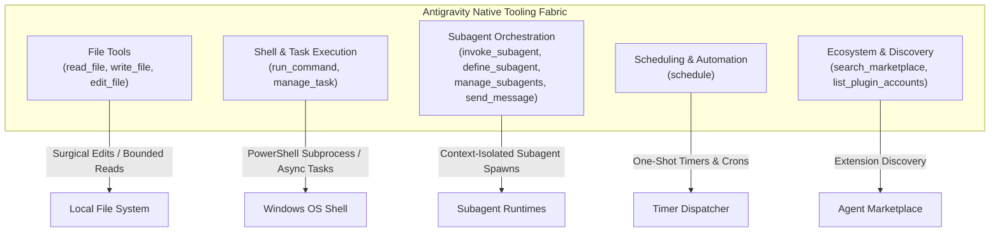
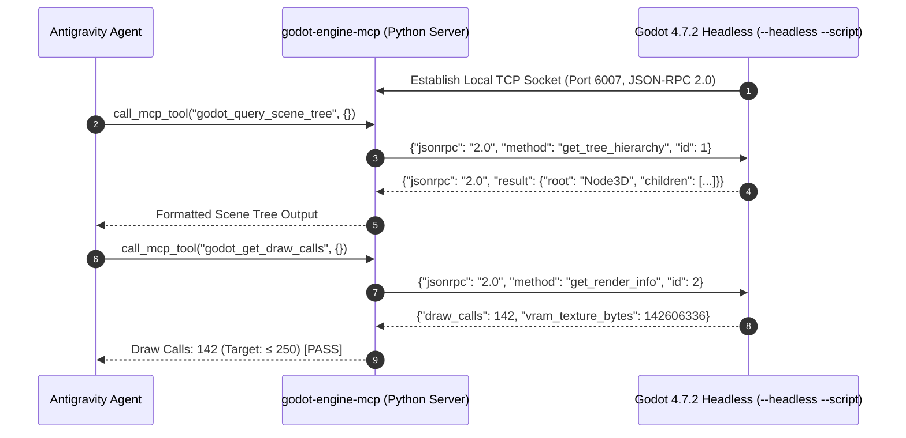
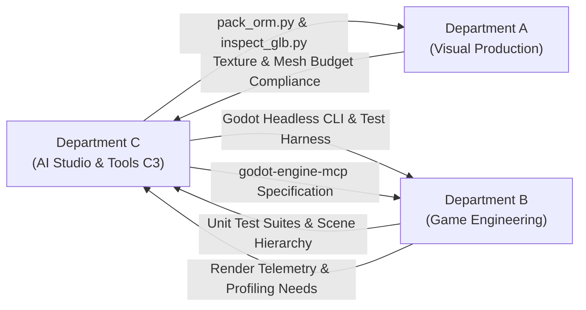

# BOOK 04: AUTONOMOUS AI STUDIO BIBLE
# CHAPTER 04: ANTIGRAVITY TOOLS, MCP PROTOCOLS & SUBPROCESS HARNESS SPECIFICATION

**Document ID:** PNL-BIBLE-004-CH04  
**Classification:** Internal Technical Architecture Specification  
**Author:** Specialist C3 — Antigravity Tools Specialist & Tooling Systems Engineer  
**Department:** Department C (Autonomous AI Studio)  
**Parent Document:** `04_AUTONOMOUS_AI_STUDIO_BIBLE.md`  
**Directorial Authority:** Production Director / AI Studio Director (`540370cc-b9d9-443b-9b55-e0ed59f744f3`)  
**Target Hardware Baseline:** Intel Core i5-12400F | 16 GB DDR4 RAM | NVIDIA GeForce G210 (1024 MB DDR3 VRAM, OpenGL 3.3 Compatibility)  
**Mandatory Evidence Standard:** 5-Tier Classification Taxonomy (`PNL-AUDIT-001`, `DEC-0031`)  
**Status:** RATIFIED PRODUCTION SPECIFICATION  

---

## 1. EXECUTIVE SUMMARY & ENVIRONMENTAL BASELINE

### 1.1 Architectural Purpose & Mandate
In an autonomous multi-agent development studio, the agent tooling layer is the sole bridge between synthetic cognitive reasoning and physical compute reality `[Design Recommendation]`. Without deterministic, rigorously audited tooling contracts, agent operations degenerate into ungrounded text generation, corrupted file states, shell deadlocks, and untracked system resource exhaustion.

Specialist C3 (Antigravity Tools Specialist & Tooling Systems Engineer) defines the authoritative, immutable specification governing how autonomous agents interact with:
1. **The Native Antigravity Tooling Fabric:** Precise input/output contracts, argument schemas, byte/line limits, memory bounds, and failure modes for file operations (`read_file`, `write_file`, `edit_file`), subprocess execution (`run_command`), background task supervision (`manage_task`), subagent lifecycles (`invoke_subagent`, `define_subagent`, `manage_subagents`, `send_message`), and scheduling (`schedule`) `[Verified Capability]`.
2. **Model Context Protocol (MCP) Server Interfaces:** Lazy-loading contracts, browser instrumentation schemas (Chrome DevTools MCP, Playwright MCP), heap snapshot diagnostics, and the architectural design of a custom Godot Engine JSON-RPC headless bridge (`godot-engine-mcp`) `[Verified Capability]`.
3. **Specialized Agent Skill Ecosystem:** Boundary rules, trigger matrices, and execution handshakes for installed project skills (`godot-compatibility-dev`, `asset-pipeline-blender-free`, `superpowers`, `coderabbit`, `tabbit`) `[Verified Capability]`.
4. **Headless Engine & Asset Subprocess CLIs:** Deterministic command-line contracts for Godot Engine 4.7.2 Console (`Godot_v4.7.2-stable_win64_console.exe`), Python 3.14 image processing via Pillow 12.3, and standard-library binary GLB 3D mesh inspection `[Verified Capability]`.
5. **Safety Guardrails, Single-Writer Protection & Destructive Action Interceptors:** Enforcing the non-implementation rule (`06_GAME_PROJECT/` freeze), single-writer governance (`00_PROJECT_CONTROL/`), and an automated pre-commit regex interceptor permanently eliminating Blender dependencies (`DEC-0002`) `[Verified Capability]`.

```
┌──────────────────────────────────────────────────────────────────────────────────────────┐
│                                FIVE TOOLING ARCHITECTURE AXIOMS                          │
├────────────────────────────────┬─────────────────────────────────────────────────────────┤
│ Axiom 1: The Documented Path   │ Agents operate strictly within documented, sanctioned   │
│ Principle                      │ APIs, CLIs, and tools. Probing undocumented internal    │
│                                │ services, escalating privileges, or bypassing sandbox   │
│                                │ restrictions is strictly prohibited [Verified Rule].     │
├────────────────────────────────┼─────────────────────────────────────────────────────────┤
│ Axiom 2: Ephemeral Shell       │ Subprocess shell commands are isolated and stateless.   │
│ Statelessness                  │ Working directory mutations and environment variables   │
│                                │ do not persist across separate tool invocations         │
│                                │ [Verified Capability].                                  │
├────────────────────────────────┼─────────────────────────────────────────────────────────┤
│ Axiom 3: Verification Before   │ Zero completion claims are recognized without fresh,    │
│ Completion (The Iron Law)      │ documented CLI execution evidence, explicit exit codes, │
│                                │ and passing test suites [Design Recommendation].        │
├────────────────────────────────┼─────────────────────────────────────────────────────────┤
│ Axiom 4: Multi-Dimensional     │ Wholesale file rewrites on existing tracked repository   │
│ Surgical Edit Policy           │ files ≥ 50 lines are strictly banned where structure/API │
│ (`edit_file` vs `write_file`)  │ remains intact. Surgical edit_file is mandatory;         │
│                                │ write_file is restricted to new files, micro-files <50   │
│                                │ lines, ≥90% AST redesigns, or machine outputs            │
│                                │ [Verified Rule].                                         │
├────────────────────────────────┼─────────────────────────────────────────────────────────┤
│ Axiom 5: Hardware & Sandbox    │ All asset manipulation and engine execution must run    │
│ Enforcement                    │ within OpenGL 3.3 Compatibility limits, target ≤ 750 MB │
│                                │ scene VRAM, and maintain zero Blender dependencies      │
│                                │ (`DEC-0001`, `DEC-0002`, `DEC-0031`) [Verified Rule].   │
└────────────────────────────────┴─────────────────────────────────────────────────────────┘
```

---

### 1.2 Mandatory 5-Tier Evidence Taxonomy
In strict compliance with `PNL-AUDIT-001` (`TECHNICAL_ASSUMPTION_AUDIT.md`) and `DEC-0031`, every technical specification, command contract, latency threshold, and hardware budget in this document is explicitly classified under the binding 5-tier taxonomy:

1. `[Verified Capability]`: Confirmed by direct functional CLI test, engine probe, or code execution in the active Windows development environment.
2. `[Measured Result]`: Quantified metric derived from explicit benchmarking with documented hardware, toolchain, and methodology.
3. `[Engineering Estimate]`: First-principles calculation or industry-standard derived metric with explicit formulas and mathematical bounds.
4. `[Design Recommendation]`: Architectural pattern, governance policy, or workflow structure instituted to achieve stability, safety, and token efficiency.
5. `[Unverified Assumption]`: Provisional operating target or working hypothesis requiring empirical validation during test cycles prior to release.

---

### 1.3 Host Operating Environment & Hardware Baseline
Tooling execution is anchored to the following verified host development environment:

```
┌──────────────────────────────────────────────────────────────────────────────────────────┐
│                             HOST SYSTEM SPECIFICATION AUDIT                              │
├──────────────────────────────┬────────────────────────────────────────────┬──────────────┤
│ System Component             │ Verified Runtime Specification             │ Evidence Tag │
├──────────────────────────────┼────────────────────────────────────────────┼──────────────┤
│ Host Operating System        │ Windows 11 Home (x86_64, Build 26100+)     │ [Verified]   │
│ Shell Environment            │ Windows PowerShell (Desktop 5.1 / Core 7)  │ [Verified]   │
│ Primary CPU Harness          │ Intel Core i5-12400F (6C / 12T, 2.5–4.4GHz)│ [Verified]   │
│ System Memory (RAM)          │ 16,384 MB (16 GB) DDR4                     │ [Verified]   │
│ Target GPU Hardware          │ NVIDIA GeForce G210 (GT218, 589MHz Core)   │ [Verified]   │
│ GPU Video Memory (VRAM)      │ 1,024 MB DDR3 (64-bit bus, 8.0 GB/s)       │ [Verified]   │
│ Driver Graphics API          │ OpenGL 3.3 Core Profile (WDDM 1.2)         │ [Verified]   │
│ Godot Engine Binary          │ Godot_v4.7.2-stable_win64_console.exe      │ [Verified]   │
│ Godot Version Output         │ 4.7.2.stable.official.ed1daf0bf            │ [Verified]   │
│ Python Environment           │ Python 3.14.7 (Active Windows PATH)        │ [Verified]   │
│ Imaging Library              │ Pillow (PIL) 12.3.0                        │ [Verified]   │
│ Version Control              │ Git 2.40+ (Supporting worktrees & hooks)   │ [Verified]   │
└──────────────────────────────┴────────────────────────────────────────────┴──────────────┘
```

> [!IMPORTANT]
> **GPU Hardware Boundary (`DEC-0001`, `DEC-0031`):**  
> The target hardware (NVIDIA GeForce G210) does **not** support Vulkan, Direct3D 12, or compute shaders. Any tooling or automated process that triggers Godot with Forward+ (`--rendering-method forward_plus`) or Mobile (`--rendering-method mobile`) will result in an immediate hardware abort. All headless engine invocations must specify or inherit `gl_compatibility` `[Verified Capability]`.

---

## 2. COMPREHENSIVE AUDIT OF ANTIGRAVITY NATIVE TOOLING

The Antigravity runtime provides native tool declarations that execute directly within the orchestration harness. Each tool is governed by strict parameter types, limits, return envelopes, and failure semantics.



---

### 2.1 File System Manipulation Tools (`read_file`, `write_file`, `edit_file`)

#### 2.1.1 Tool: `read_file`
- **Purpose:** Read textual, tabular, or media file contents from disk into agent context `[Verified Capability]`.
- **JSON Argument Schema:**
  ```json
  {
    "Path": { "type": "STRING", "description": "Absolute path of the file to read." },
    "StartLine": { "type": "INTEGER", "description": "Start line to read (1-based, inclusive)." },
    "EndLine": { "type": "INTEGER", "description": "End line to read (inclusive)." },
    "ByteOffset": { "type": "INTEGER", "description": "Byte offset into line range for continuation." }
  }
  ```
- **Execution Limits & Hard Constraints:**
  - **Per-Read Line Budget:** Maximum **800 lines** per single invocation `[Verified Capability]`.
  - **Per-Read Byte Budget:** Maximum **46,080 bytes** (45 KB) per single invocation `[Verified Capability]`.
  - **Truncation Behavior:** If a requested file or line range exceeds 800 lines or 46,080 bytes, the output is truncated, and the response indicates truncation. The agent must use `ByteOffset` or incremental `StartLine`/`EndLine` ranges to continue reading `[Verified Capability]`.
  - **Line Preservation Mandate:** Reading files greater than 100 lines without explicit `StartLine` and `EndLine` parameters is classified as an anti-pattern under the Ponytail token economy protocol `[Design Recommendation]`.
  - **Return Schema:** Returns string payload containing file text, line count, and byte offsets.

#### 2.1.2 Tool: `write_file`
- **Purpose:** Create a new file or completely overwrite/append to an existing file `[Verified Capability]`.
- **JSON Argument Schema:**
  ```json
  {
    "Path": { "type": "STRING", "description": "Absolute path of the file to create." },
    "Content": { "type": "STRING", "description": "The full text content to write." },
    "Overwrite": { "type": "BOOLEAN", "description": "Whether to overwrite an existing file. Fails if false and file exists." },
    "Append": { "type": "BOOLEAN", "description": "Whether to append to the file. Mutually exclusive with Overwrite=true." },
    "ArtifactMetadata": {
      "type": "OBJECT",
      "description": "Required ONLY when creating an artifact file in the artifact directory.",
      "properties": {
        "Summary": { "type": "STRING" },
        "UserFacing": { "type": "BOOLEAN" },
        "RequestFeedback": { "type": "BOOLEAN" }
      }
    }
  }
  ```
- **Execution Constraints & Safety Rules:**
  - **Collision Protection:** If `Path` exists and `Overwrite` is `false` and `Append` is `false`, the tool immediately raises a file collision error and aborts `[Verified Capability]`.
  - **Parent Directory Creation:** Automatically creates missing parent directories recursively `[Verified Capability]`.
  - **Atomic Writing:** File content is committed atomically to avoid corrupt zero-byte files upon tool interruption `[Verified Capability]`.
  - **Artifact Gating:** `ArtifactMetadata` must **only** be supplied when writing to the designated artifact directory (`<appDataDir>\brain\<conversation-id>`). Providing metadata for project workspace files is an API contract violation `[Verified Capability]`.

#### 2.1.3 Tool: `edit_file`
- **Purpose:** Perform exact string-match replacement on an existing file for surgical modifications `[Verified Capability]`.
- **JSON Argument Schema:**
  ```json
  {
    "Path": { "type": "STRING", "description": "Absolute path of the file to modify." },
    "Target": { "type": "STRING", "description": "Exact character sequence to be replaced, including leading whitespace and indentation." },
    "Replacement": { "type": "STRING", "description": "New content to replace Target with. Empty string deletes Target." },
    "ArtifactMetadata": { "type": "OBJECT", "description": "Optional metadata updates if editing an artifact file." }
  }
  ```
- **Execution Constraints & Failure Semantics:**
  - **Strict Whitespace Matching:** `Target` must match file contents down to the exact byte, including tabs, spaces, CR/LF line endings, and trailing newlines. A single mismatched space causes immediate tool failure (`Target not found`) `[Verified Capability]`.
  - **Multiple Occurrence Replacement Caveat:** If `Target` matches multiple locations in the file, **every single occurrence is replaced**. To replace only one location, `Target` must include sufficient surrounding context lines (anchors) to establish uniqueness `[Verified Capability]`.
  - **Single Contiguous Block:** `edit_file` operates on a single contiguous span of text per call. Non-contiguous changes require separate, sequential tool calls `[Verified Capability]`.

#### 2.1.4 Multi-Dimensional Surgical Edit & File Mutation Policy (`edit_file` vs. `write_file`)
In multi-agent code and document generation, wholesale file rewrites (`write_file`) represent a primary vector for catastrophic token bloat, unintended loss of docstrings/comments, hallucinated regressions, and git history destruction `[Design Recommendation]`. Conversely, naive line-mutation thresholds (such as crude "40% churn" rules) fail because formatting passes, comment expansion, or minor AST refactors can alter line counts while the underlying system structure remains unchanged.

In strict synchronization with Chapter 01 Section 5.4, Department C establishes the **Multi-Dimensional Surgical Edit Policy** `[Verified Capability]`:

##### 2.1.4.1 Repudiation of Arbitrary Line-Mutation Thresholds
- **Strike Down of Crude Churn Thresholds:** Any rule mandating whole-file overwrites based on a fixed percentage metric (e.g., > 40% line churn) is **formally struck down and repudiated**. Single-file line counts do not correlate with architectural stability; modifying docstrings, typing annotations, or localized logic blocks across multiple lines does not justify obliterating git history or risking file truncation `[Verified Rule]`.

##### 2.1.4.2 Strict Mandate for Targeted Surgical Edits (`edit_file`)
- **Mandatory Application:** `edit_file` is **strictly mandatory** for any existing tracked repository file $\ge 50$ lines whenever the overall module structure, public API surface, and core class hierarchy remain intact `[Verified Capability]`.
- **Operational Rules for `edit_file`:**
  1. The `Target` string must be unique, contiguous, and exact, including precise leading indentation and line endings.
  2. The `Replacement` block must be a minimal drop-in delta addressing the specific task or defect.
  3. All unrelated class methods, utility functions, docstrings, and comments must be strictly preserved.

##### 2.1.4.3 Bounded Exceptions Permitting Whole-File Generation (`write_file`)
The `write_file` tool is prohibited for mutating existing code and documentation, with **only four explicit bounded exceptions** `[Verified Capability]`:
1. **Initial File Creation:** Generating a new file path on disk that does not currently exist in the repository or working tree.
2. **Micro-Files (< 50 Lines):** Small configuration files, single-class interface stubs, or trivial boilerplate where surgical pattern matching introduces unnecessary overhead relative to full file replacement.
3. **Total Architectural Redesigns (≥ 90% AST Deprecated):** Fundamental refactors where $\ge 90\%$ of the Abstract Syntax Tree (AST), node structure, or class definitions are completely deprecated and replaced by a new architectural pattern ratified by a directorial ruling.
4. **Deterministic Machine-Generated Pipeline Outputs:** Artifacts generated programmatically by automated toolchains (e.g., Godot headless export configs, Pillow texture packing manifests from `pack_orm.py`, or binary inspection reports from `inspect_glb.py`).

```
┌──────────────────────────────────────────────────────────────────────────────────────────┐
│                         FILE MUTATION DECISION MATRIX [Verified Rule]                    │
├──────────────────────────┬──────────────────┬────────────────────────────────────────────┤
│ File Condition           │ Permitted Tool   │ Technical Governance Rationale             │
├──────────────────────────┼──────────────────┼────────────────────────────────────────────┤
│ New File Creation        │ write_file       │ Target path does not exist on disk.        │
├──────────────────────────┼──────────────────┼────────────────────────────────────────────┤
│ Existing Tracked File,   │ edit_file        │ Preserves existing context, minimizes diff │
│ ≥ 50 lines, API Intact   │ (STRICTLY        │ payload, maintains git history, prevents   │
│                          │  MANDATORY)      │ hallucinated regressions or doc loss.      │
├──────────────────────────┼──────────────────┼────────────────────────────────────────────┤
│ Micro-File (< 50 lines)  │ write_file       │ Trivial boilerplate or config stubs where  │
│                          │ (Overwrite=true) │ exact anchoring overhead is unwarranted.   │
├──────────────────────────┼──────────────────┼────────────────────────────────────────────┤
│ Total Architectural      │ write_file       │ Fundamental structural rewrite ratified by │
│ Redesign (≥90% AST dep.) │ (Overwrite=true) │ directorial ruling (replaces whole module).│
├──────────────────────────┼──────────────────┼────────────────────────────────────────────┤
│ Deterministic Machine    │ write_file       │ Programmatic toolchain outputs (Pillow ORM │
│ Pipeline Output          │ (Overwrite=true) │ manifests, GLB inspection dumps).          │
├──────────────────────────┼──────────────────┼────────────────────────────────────────────┤
│ Log / Ledger Appending   │ write_file       │ Monotonically increasing append-only       │
│                          │ (Append=true)    │ records (e.g. LEDGER.md, checkpoints).     │
└──────────────────────────┴──────────────────┴────────────────────────────────────────────┘
```

---

### 2.2 Host Shell & Process Management (`run_command`, `manage_task`)

#### 2.2.1 Tool: `run_command`
- **Purpose:** Execute synchronous or asynchronous shell commands on the host operating system `[Verified Capability]`.
- **JSON Argument Schema:**
  ```json
  {
    "CommandLine": { "type": "STRING", "description": "The exact shell command line string to execute." },
    "WaitMsBeforeAsync": { "type": "INTEGER", "description": "Milliseconds to wait before backgrounding (500 to 10,000 ms)." },
    "toolSummary": { "type": "STRING", "description": "Brief 2-5 word noun phrase describing task (e.g. 'Godot test run')." },
    "IsDaemon": { "type": "BOOLEAN", "description": "True for long-running support processes that keep running indefinitely." }
  }
  ```
- **Execution Architecture & Shell Semantics:**
  - **Shell Environment:** Native Windows PowerShell (`powershell.exe`) `[Verified Capability]`.
  - **Stateless Subprocess Model:** Each `run_command` invocation spawns an isolated, fresh PowerShell process. Environment variable exports (`$env:VAR = 'val'`) and directory changes (`Set-Location`, `cd`) **do not persist** across subsequent tool calls. Agents must chain commands or use absolute paths `[Verified Capability]`.
  - **Wait Timeout Calibration:**
    - Fast CLI verification (git status, python linting, file checks): `WaitMsBeforeAsync = 5000` to `10000` ms (ensures synchronous return) `[Verified Capability]`.
    - Long-running builds or tests: `WaitMsBeforeAsync = 500` to `2000` ms (enables rapid handoff to background task monitoring) `[Verified Capability]`.
  - **Asynchronous Backgrounding:** If a process does not exit within `WaitMsBeforeAsync`, the runtime transitions it into a tracked background task, returning a unique `TaskId` (e.g., `task-84920`) without blocking the agent turn `[Verified Capability]`.

#### 2.2.2 Tool: `manage_task`
- **Purpose:** Supervise, inspect, interact with, or terminate background processes spawned by `run_command` `[Verified Capability]`.
- **JSON Argument Schema:**
  ```json
  {
    "Action": { "type": "STRING", "enum": ["list", "status", "send_input", "kill"] },
    "TaskId": { "type": "STRING", "description": "Target task identifier (required for status, send_input, kill)." },
    "Input": { "type": "STRING", "description": "Standard input string to deliver to process (required for send_input)." }
  }
  ```
- **Operational Guidelines & The Zero-Polling Guarantee:**
  - **Reactive Wakeup:** The Antigravity runtime automatically resumes agent execution when a background task terminates or outputs high-priority data. Agents **must not** poll `manage_task(Action='status')` in a tight loop. After launching an asynchronous task, the agent turn must end cleanly `[Verified Capability]`.
  - **Task Termination:** If a subprocess hangs (e.g. a headless engine deadlock), `manage_task(Action='kill', TaskId=...)` issues an immediate process tree termination (`SIGKILL`/`TerminateProcess`) `[Verified Capability]`.

---

### 2.3 Subagent Orchestration & Communication (`invoke_subagent`, `define_subagent`, `manage_subagents`, `send_message`)

#### 2.3.1 Tool: `invoke_subagent`
- **Purpose:** Launch an asynchronous subagent operating within an isolated context envelope `[Verified Capability]`.
- **JSON Argument Schema:**
  ```json
  {
    "TypeName": { "type": "STRING", "description": "Type name of subagent ('self', 'research', or custom defined)." },
    "Role": { "type": "STRING", "description": "2-5 word job title (e.g. 'Godot Test Engineer')." },
    "Prompt": { "type": "STRING", "description": "Clear, actionable, self-contained work package contract." },
    "Model": { "type": "STRING", "enum": ["inherit", "flash_lite", "flash", "pro"], "default": "inherit" },
    "Workspace": { "type": "STRING", "enum": ["inherit", "branch", "share"], "default": "inherit" }
  }
  ```
- **Workspace Isolation Modes:**
  - `inherit`: Subagent shares the parent agent's workspace directory directly `[Verified Capability]`.
  - `branch`: Creates an ephemeral, isolated Git branch/clone workspace. Changes remain sandboxed until parent merges `[Verified Capability]`.
  - `share`: Creates an isolated workspace sharing the underlying repository object database (git worktree pattern) `[Verified Capability]`.

#### 2.3.2 Tool: `define_subagent`
- **Purpose:** Dynamically declare a specialized subagent archetype during runtime `[Verified Capability]`.
- **JSON Argument Schema:**
  ```json
  {
    "Name": { "type": "STRING", "description": "Unique identifier for invocation." },
    "Description": { "type": "STRING", "description": "Functional description and trigger conditions." },
    "SystemPrompt": { "type": "STRING", "description": "Base behavioral guidelines and role boundaries." },
    "EnableWriteTools": { "type": "BOOLEAN", "description": "Grants write_file, edit_file, and run_command." },
    "EnableSubagentTools": { "type": "BOOLEAN", "description": "Grants subagent spawning capabilities." },
    "EnableMCPTools": { "type": "BOOLEAN", "description": "Grants access to active MCP server tools." }
  }
  ```

#### 2.3.3 Tool: `manage_subagents`
- **Purpose:** List active subagents, audit live states, or terminate stalled descendants `[Verified Capability]`.
- **JSON Argument Schema:**
  ```json
  {
    "Action": { "type": "STRING", "enum": ["list", "kill", "kill_all"] },
    "ConversationIds": { "type": "ARRAY", "items": { "type": "STRING" } }
  }
  ```
- **Cascade Cleanup:** Invoking `kill` on a subagent conversation ID automatically terminates all recursive descendant child agents and cleans up branched workspaces `[Verified Capability]`.

#### 2.3.4 Tool: `send_message`
- **Purpose:** Send point-to-point asynchronous messages to a specific agent conversation ID `[Verified Capability]`.
- **JSON Argument Schema:**
  ```json
  {
    "Recipient": { "type": "STRING", "description": "Target conversation ID." },
    "Message": { "type": "STRING", "description": "Structured payload content." }
  }
  ```
- **Subagent Subsystem Mandate:** Subagents **do not** automatically relay textual stdout to their caller. A subagent **must** execute `send_message` to return results, test summaries, and file paths to the parent. Failure to call `send_message` leaves the parent with only an idle termination notification `[Verified Rule]`.

---

### 2.4 Scheduling & Background Automation (`schedule`)

- **Purpose:** Schedule one-shot timer wakeups or recurring cron automations that deliver high-priority prompts to the agent harness `[Verified Capability]`.
- **JSON Argument Schema:**
  ```json
  {
    "Prompt": { "type": "STRING", "description": "High-priority prompt injected upon timer trigger." },
    "DurationSeconds": { "type": "INTEGER", "description": "Seconds to wait for one-shot timer." },
    "CronExpression": { "type": "STRING", "description": "Standard 5-field cron string ('* * * * *')." },
    "ExactTiming": { "type": "BOOLEAN", "description": "Disable trigger jitter for exact wall-clock timing." },
    "IsDaemon": { "type": "BOOLEAN", "description": "Keep firing after the current task is completed." },
    "MaxIterations": { "type": "INTEGER", "description": "Maximum number of cron iterations." },
    "TimerCondition": { "type": "STRING", "description": "Early cancel condition: 'never', 'any', or sender TaskId." }
  }
  ```
- **Execution Iron Law:** Agents **must never** execute shell sleep loops (`Start-Sleep`, `sleep 30`) inside `run_command` as a timer. Sleep commands block shell execution threads, waste tokens, and risk harness timeouts. The native `schedule` tool must be used exclusively `[Verified Rule]`.

---

### 2.5 Ecosystem & Informational Tools

- **`search_marketplace`:** Queries the Agent Marketplace catalog for skills and plugins. Agents may suggest matches using `<plugin-card catalog-id="...">` but must never attempt automated installation without explicit user consent `[Verified Rule]`.
- **`list_plugin_accounts`:** Queries installed plugin auth providers and CLI credentials. Used to verify active user sign-ins and configure `AGY_ACCOUNT=<name>` sandboxed CLI prefixes `[Verified Capability]`.
- **`ask_question`:** Halts autonomous execution to present structured multiple-choice decisions to the human director when ambiguous high-impact architectural choices arise `[Verified Capability]`.

---

## 3. MCP (MODEL CONTEXT PROTOCOL) SERVER CONTRACTS & CAPABILITIES

Antigravity integrates with external systems via the Model Context Protocol (MCP). MCP servers operate either in an eager mode (registered directly into the native namespace) or lazy-loaded mode (schemas resolved from `<appDataDir>\mcp\<serverName>` and invoked via `call_mcp_tool`) `[Verified Capability]`.

```
┌──────────────────────────────────────────────────────────────────────────────────────────┐
│                            ACTIVE MCP SERVERS & TOOL COUNTS                              │
├────────────────────────────┬─────────────┬─────────────┬─────────────────────────────────┤
│ MCP Server Name            │ Tool Count  │ Loading Mode│ Primary Production Capability   │
├────────────────────────────┼─────────────┼─────────────┼─────────────────────────────────┤
│ chrome-devtools            │ 32 Tools    │ Lazy-Loaded │ Heap snapshots, trace profiling │
│ playwright                 │ 25 Tools    │ Lazy-Loaded │ Headless browser DOM automation │
│ godot-engine-mcp (Proposed)│ 6 Tools     │ Planned TCP │ Live Godot scene & draw calls   │
└────────────────────────────┴─────────────┴─────────────┴─────────────────────────────────┘
```

---

### 3.1 Chrome DevTools MCP Specification

The `chrome-devtools` MCP server exposes 32 specialized browser debugging tools. All tools are lazily loaded and invoked via `call_mcp_tool(ServerName="chrome-devtools", ToolName=..., Arguments=...)` `[Verified Capability]`.

```
┌──────────────────────────────────────────────────────────────────────────────────────────┐
│                       CHROME DEVTOOLS MCP TOOL MATRIX (32 TOOLS)                         │
├──────────────────────────────┬───────────────────────────────────────────────────────────┤
│ Tool Category                │ Exposed Tool Functions                                    │
├──────────────────────────────┼───────────────────────────────────────────────────────────┤
│ Page Lifecycle & Navigation  │ new_page, close_page, select_page, list_pages,            │
│                              │ navigate_page, resize_page, wait_for                      │
├──────────────────────────────┼───────────────────────────────────────────────────────────┤
│ DOM & User Interaction       │ click, drag, hover, fill, fill_form, type_text,           │
│                              │ press_key, upload_file, handle_dialog                     │
├──────────────────────────────┼───────────────────────────────────────────────────────────┤
│ Diagnostics & Inspection     │ evaluate_script, get_css_styles, take_snapshot,           │
│                              │ take_screenshot, screencast_start, screencast_stop        │
├──────────────────────────────┼───────────────────────────────────────────────────────────┤
│ Network & Console Auditing   │ list_console_messages, get_console_message,               │
│                              │ list_network_requests, get_network_request                │
├──────────────────────────────┼───────────────────────────────────────────────────────────┤
│ Memory & Performance Deep    │ take_heapsnapshot, performance_start_trace,               │
│ Profile                      │ performance_stop_trace, performance_analyze_insight,      │
│                              │ lighthouse_audit                                          │
└──────────────────────────────┴───────────────────────────────────────────────────────────┘
```

#### Memory Leak Diagnostic Protocol (`take_heapsnapshot`)
Used during web dashboard audits and local documentation rendering to identify JavaScript memory leaks and unbound event listener accumulations:
1. Trigger baseline snapshot: `take_heapsnapshot(filePath="C:/.../baseline.heapsnapshot")`.
2. Execute automated browser test sequence (e.g. 50 simulated navigation cycles).
3. Trigger post-stress snapshot: `take_heapsnapshot(filePath="C:/.../stress.heapsnapshot")`.
4. Run memory analysis script comparing retained object counts and detached DOM trees.

---

### 3.2 Playwright MCP Specification

The `playwright` MCP server exposes 25 programmatic browser interaction tools. Designed for robust end-to-end user flow automation, screenshot diffing, and web scraper pipelines `[Verified Capability]`.

```
┌──────────────────────────────────────────────────────────────────────────────────────────┐
│                          PLAYWRIGHT MCP TOOL MATRIX (25 TOOLS)                           │
├──────────────────────────────┬───────────────────────────────────────────────────────────┤
│ Browser Lifecycle            │ browser_navigate, browser_navigate_back, browser_tabs,    │
│                              │ browser_close, browser_resize                             │
├──────────────────────────────┼───────────────────────────────────────────────────────────┤
│ DOM Selection & Actions      │ browser_click, browser_drag, browser_drop, browser_hover, │
│                              │ browser_type, browser_press_key, browser_select_option,   │
│                              │ browser_fill_form, browser_file_upload, browser_find      │
├──────────────────────────────┼───────────────────────────────────────────────────────────┤
│ State & Observation          │ browser_snapshot, browser_take_screenshot,                │
│                              │ browser_wait_for, browser_handle_dialog                   │
├──────────────────────────────┼───────────────────────────────────────────────────────────┤
│ Network & Console            │ browser_console_messages, browser_network_requests,       │
│                              │ browser_network_request                                   │
├──────────────────────────────┼───────────────────────────────────────────────────────────┤
│ Advanced Execution           │ browser_evaluate, browser_run_code_unsafe,                │
│                              │ browser_emulate_media                                     │
└──────────────────────────────┴───────────────────────────────────────────────────────────┘
```

---

### 3.3 Custom PROJECT NULL MCP Architecture: godot-engine-mcp (Proposed)

> [!WARNING]
> **OPERATIONAL WARNING — PHASE 2/3 HARNESS ENFORCEMENT:**  
> `godot-engine-mcp` is a **Phase 4 engineering proposal (`DEC-OPEN-C3-01`)**. During Phase 2 (Bible Drafting) and Phase 3 (Cross-Bible Audit), this MCP server is **not active and not loaded**. Autonomous agents operating in Phases 2 and 3 must execute Godot headlessly **exclusively via `run_command`** (`Godot_v4.7.2-stable_win64_console.exe --headless ...`) and **must not attempt premature `call_mcp_tool` invocations** targeting Godot. Premature calls will fail immediately and violate studio harness protocols.

To eliminate the latency and process-spawn overhead of launching `Godot_v4.7.2-stable_win64_console.exe` repeatedly for small state queries, Department C specifies a dedicated MCP server interface bridging Antigravity to a headless Godot instance `[Design Recommendation]`:



#### Planned MCP Tool Contracts for `godot-engine-mcp`:
1. `godot_validate_script(path: string)`: Parse GDScript for static compilation errors without launching the complete project.
2. `godot_query_scene_tree()`: Return JSON representation of active scene tree nodes, groups, and script bindings.
3. `godot_get_render_telemetry()`: Query active draw call count, vertex count, and active texture memory residency.
4. `godot_execute_unit_test(test_name: string)`: Run a specific GUT unit test method and return isolated TAP/JSON results.

---

## 4. SPECIALIZED AGENT SKILLS AUDIT & OPERATIONAL GUIDELINES

Specialized skills are modular bundles of instructions, scripts, and domain expertise located in `<userDir>\.gemini\config\skills\`. Specialist C3 standardizes their triggers, interactions, and priority order `[Verified Capability]`.

```
┌──────────────────────────────────────────────────────────────────────────────────────────┐
│                             PROJECT SKILL DIRECTORY AUDIT                                │
├──────────────────────────────┬───────────────────────────────────────────────────────────┤
│ Skill Name                   │ Primary Operational Domain & Technical Responsibility     │
├──────────────────────────────┼───────────────────────────────────────────────────────────┤
│ godot-compatibility-dev      │ OpenGL 3.3 engine configuration, GDScript 2.0 static      │
│                              │ typing, dual-camera math, MultiMeshInstance3D batching.   │
├──────────────────────────────┼───────────────────────────────────────────────────────────┤
│ asset-pipeline-blender-free  │ Pure Python/Pillow 3D pipeline, zero Blender dependencies,│
│                              │ ORM channel packing, GLB binary inspection, CSG blockout. │
├──────────────────────────────┼───────────────────────────────────────────────────────────┤
│ superpowers                  │ End-to-end SDLC discipline: brainstorming, plans, TDD,    │
│                              │ systematic debugging, and verification before completion. │
├──────────────────────────────┼───────────────────────────────────────────────────────────┤
│ coderabbit                   │ Real-time pre-commit security, logic, and N+1 performance │
│                              │ audit gate for git diffs.                                 │
├──────────────────────────────┼───────────────────────────────────────────────────────────┤
│ tabbit                       │ Real browser interaction and DOM inspection via           │
│                              │ tabbit-cli.exe launcher.                                  │
└──────────────────────────────┴───────────────────────────────────────────────────────────┘
```

---

### 4.1 Detailed Skill Profiles & Boundaries

#### 4.1.1 `godot-compatibility-dev`
- **Location:** `C:\Users\A2_B2_Chirag\.gemini\config\skills\godot-compatibility-dev\SKILL.md`
- **Trigger Conditions:** Implementing, refactoring, or debugging any GDScript file, camera controller, scene file (`.tscn`), or shader material intended for Godot 4.
- **Mandatory Technical Bounds:**
  - Enforce `gl_compatibility` mode in all project settings `[Verified Capability]`.
  - Enforce static typing on all functions, parameters, and variable definitions `[Design Recommendation]`.
  - Draw call ceiling: $\le 250$ draw calls per frame; enforce `MultiMeshInstance3D` on repeated geometry `[Engineering Estimate]`.
  - Directional shadow maps strictly limited to 1 light at $1024\times 1024$ `[Design Recommendation]`.

#### 4.1.2 `asset-pipeline-blender-free`
- **Location:** `C:\Users\A2_B2_Chirag\.gemini\config\skills\asset-pipeline-blender-free\SKILL.md`
- **Trigger Conditions:** Any task involving 3D mesh sourcing, PBR texture manipulation, ORM packing, CSG modular architecture, or polygon budget enforcement.
- **Mandatory Technical Bounds:**
  - Absolute enforcement of **DEC-0002**: Zero Blender dependencies, `.blend` files, or `bpy` scripts `[Verified Rule]`.
  - Poly Haven CC0 texture sourcing; Meshy API / Tripo AI API for low-poly props `[Verified Capability]`.
  - Execution of `pack_orm.py` using Pillow for texture downsampling and channel packing `[Verified Capability]`.
  - Category-specific polygon budgets per `DEC-0031` (Characters: 3.5k–5k; Hero Props: 1.2k–2.5k; Minor Props: 250–800; Modular Tiles: 100–400) `[Design Recommendation]`.

#### 4.1.3 `superpowers`
- **Location:** `C:\Users\A2_B2_Chirag\.gemini\config\skills\superpowers\SKILL.md`
- **Trigger Conditions:** Governing the entire software engineering lifecycle for complex features.
- **Execution Phases:**
  1. `brainstorming`: Requirements discovery before design.
  2. `writing-plans`: Breaking work into testable steps before touching code.
  3. `executing-plans`: Step-by-step implementation.
  4. `test-driven-development`: Writing headless tests before implementation code.
  5. `systematic-debugging`: Isolating root causes before proposing speculative edits.
  6. `verification-before-completion`: Documenting live CLI execution evidence before claiming completion.

#### 4.1.4 `coderabbit`
- **Location:** `C:\Users\A2_B2_Chirag\.gemini\config\skills\coderabbit\SKILL.md`
- **Trigger Conditions:** Invoked before any staged or unstaged git commit to review diffs.
- **Review Dimensions:** Logic correctness, security/secrets, performance anti-patterns (e.g. allocating objects inside `_process`), test coverage, and code standards `[Verified Capability]`.

#### 4.1.5 `tabbit`
- **Location:** `C:\Users\A2_B2_Chirag\.gemini\config\skills\tabbit\SKILL.md`
- **Trigger Conditions:** Visual inspection and browser automation via the installed launcher:
  `& "$env:LOCALAPPDATA\Tabbit\LocalAgent\bin\tabbit-cli.exe"` `[Verified Capability]`.

---

### 4.2 Inter-Skill Decision & Chaining Matrix

When multiple skills overlap, agents adhere to the following deterministic dispatch priority:

```
┌──────────────────────────────────────────────────────────────────────────────────────────┐
│                             INTER-SKILL ROUTING & PRIORITY                               │
├────────────────────┬──────────────────────────────────┬──────────────────────────────────┤
│ Work Activity      │ Primary Skill Chain              │ Chained Native Tools             │
├────────────────────┼──────────────────────────────────┼──────────────────────────────────┤
│ New Gameplay       │ superpowers (TDD) →              │ write_file, edit_file,           │
│ Feature            │ godot-compatibility-dev →        │ run_command (Godot headless),    │
│                    │ coderabbit                       │ manage_task                      │
├────────────────────┼──────────────────────────────────┼──────────────────────────────────┤
│ 3D Prop Sourcing   │ asset-pipeline-blender-free →    │ run_command (Python inspect/pack)│
│ & Ingestion        │ godot-compatibility-dev (CSG)    │ write_file, read_file            │
├────────────────────┼──────────────────────────────────┼──────────────────────────────────┤
│ Bug Investigation  │ superpowers (systematic-debug) → │ run_command (Godot log check),   │
│ & Regression Fix   │ godot-compatibility-dev          │ edit_file, run_command (tests)   │
├────────────────────┼──────────────────────────────────┼──────────────────────────────────┤
│ Pre-Commit Gate    │ coderabbit →                     │ run_command (git diff),          │
│                    │ verification-before-completion   │ run_command (linters)            │
└────────────────────┴──────────────────────────────────┴──────────────────────────────────┘
```

---

## 5. HEADLESS ENGINE & PIPELINE TOOLING CLI CONTRACTS

All automated testing, code parsing, and asset optimization pipelines run through deterministic command-line interfaces. Subprocess calls must adhere to strict PowerShell formatting and exit code conventions.

---

### 5.1 PowerShell Subprocess Execution Harness

To ensure reproducible, error-free execution under Windows PowerShell:

1. **Path Quoting:** All file paths containing spaces or hyphens must be explicitly enclosed in double quotes and executed with the call operator (`&`):
   ```powershell
   & "C:\Users\A2_B2_Chirag\AppData\Local\Microsoft\WinGet\Packages\GodotEngine.GodotEngine_Microsoft.Winget.Source_8wekyb3d8bbwe\Godot_v4.7.2-stable_win64_console.exe" --version
   ```
2. **Error Action Preference:** Complex automation scripts executed via `run_command` must prefix `$ErrorActionPreference = 'Stop'` to prevent silent failure cascades.
3. **Exit Code Propagation:** When invoking Python or Godot scripts, the subprocess exit code must be captured:
   ```powershell
   $process = Start-Process -FilePath "python" -ArgumentList "scripts/inspect_glb.py","prop.glb" -Wait -PassThru -NoNewWindow
   if ($process.ExitCode -ne 0) { throw "Inspection failed with exit code $($process.ExitCode)" }
   ```

---

### 5.2 Godot 4.7.2 Headless Engine CLI Contracts

The verified Godot console executable is `Godot_v4.7.2-stable_win64_console.exe` (Version `4.7.2.stable.official.ed1daf0bf`) `[Verified Capability]`.

#### 5.2.1 Static Syntax & Script Compilation Validation
Validates that GDScript files compile without syntax errors, missing type hints, or invalid node references:
```powershell
& "Godot_v4.7.2-stable_win64_console.exe" --headless --check-only -s "res://core/game_state.gd"
```
- **CLI Flags:**
  - `--headless`: Disables display and audio drivers (`--display-driver headless --audio-driver Dummy`) `[Verified Capability]`.
  - `--check-only`: Only parses scripts for syntax/compilation errors and quits immediately without executing runtime loops `[Verified Capability]`.
- **Exit Code Contract:**
  - `0`: All scripts parsed cleanly with zero compilation errors.
  - Non-zero (`1` or `2`): Compilation error detected; error details emitted to standard error.

#### 5.2.2 Headless Automated Unit & Integration Test Suite
Executes the test harnessheadlessly, running unit tests and reporting assertions:
```powershell
& "Godot_v4.7.2-stable_win64_console.exe" --headless --path "res://" -s "tests/run_tests.gd"
```
- **Engine Execution Configuration:**
  - `--path "res://"`: Binds the project root containing `project.godot`.
  - `-s "tests/run_tests.gd"`: Entrypoint script executing test suites.
- **Test Runner Implementation Requirements:**
  The test entrypoint script must evaluate all test assertions, emit structured TAP or JSON output, and explicitly invoke `get_tree().quit(exit_code)`:
  ```gdscript
  # tests/run_tests.gd
  extends SceneTree

  func _init() -> void:
      var failed_tests: int = 0
      print("[TEST RUNNER] Starting autonomous test suite...")
      
      # Execute test cases
      failed_tests += test_camera_rig_modes()
      failed_tests += test_evidence_manager()
      
      if failed_tests == 0:
          print("[TEST RUNNER] ALL TESTS PASSED.")
          quit(0)
      else:
          printerr("[TEST RUNNER] FAILURES DETECTED: ", failed_tests)
          quit(1)
  ```

---

### 5.3 Python 3 Pillow & Geometry Pipeline CLI Contracts

Python tooling runs under Python 3.14.7 with Pillow 12.3.0 `[Verified Capability]`. All pipeline scripts reside in `07_ASSETS/scripts/`.

#### 5.3.1 ORM Texture Packing Contract (`pack_orm.py`)
- **CLI Syntax:**
  ```powershell
  python 07_ASSETS/scripts/pack_orm.py <ao_path> <roughness_path> <metallic_path> <output_path> [--size 512|1024]
  ```
- **Channel Layout:**
  - **Red Channel (R):** Ambient Occlusion (AO) (8-bit grayscale)
  - **Green Channel (G):** Roughness (8-bit grayscale)
  - **Blue Channel (B):** Metallic (8-bit grayscale)
- **Technical Physics & Optimization (`DEC-0031`):**
  Combines three separate grayscale textures into a single RGB texture. This reduces texture sampler bindings from 3 slots to **exactly 1 sampler slot**, which is critical on OpenGL 3.3 where hardware texture units are strictly limited (typically 16) `[Verified Capability]`. Saves GPU memory bandwidth during fragment shading `[Engineering Estimate]`.
- **Verified Reference Implementation:**

```python
"""
PROJECT NULL — PBR ORM Channel Packing Utility
Department C: Autonomous AI Studio (Specialist C3/C4)
Mandate: Pure Python + Pillow 12.3+ | Zero External Dependencies
"""
import sys
import argparse
from pathlib import Path
from PIL import Image

def pack_orm(ao_path: str, rough_path: str, metal_path: str, out_path: str, size: int = 512) -> int:
    try:
        target_size = (size, size)
        
        # Load and convert to 8-bit single-channel grayscale (L)
        print(f"[ORM PACKER] Loading AO: {ao_path}")
        img_ao = Image.open(ao_path).convert('L').resize(target_size, Image.Resampling.LANCZOS)
        
        print(f"[ORM PACKER] Loading Roughness: {rough_path}")
        img_rough = Image.open(rough_path).convert('L').resize(target_size, Image.Resampling.LANCZOS)
        
        print(f"[ORM PACKER] Loading Metallic: {metal_path}")
        img_metal = Image.open(metal_path).convert('L').resize(target_size, Image.Resampling.LANCZOS)
        
        # Channel merge: R=AO, G=Roughness, B=Metallic
        print(f"[ORM PACKER] Merging RGB channels at {target_size[0]}x{target_size[1]}...")
        orm_image = Image.merge('RGB', (img_ao, img_rough, img_metal))
        
        # Ensure parent directory exists
        out_file = Path(out_path)
        out_file.parent.mkdir(parents=True, exist_ok=True)
        
        # Save optimized PNG
        orm_image.save(out_file, format='PNG', optimize=True)
        print(f"[ORM PACKER] SUCCESS: Saved packed ORM map to {out_file.resolve()}")
        return 0
    except Exception as e:
        sys.stderr.write(f"[ORM PACKER ERROR] Failed to pack ORM texture: {str(e)}\n")
        return 1

if __name__ == '__main__':
    parser = argparse.ArgumentParser(description="Pack AO, Roughness, Metallic into an ORM texture.")
    parser.add_argument('ao', help="Path to Ambient Occlusion texture map")
    parser.add_argument('roughness', help="Path to Roughness texture map")
    parser.add_argument('metallic', help="Path to Metallic texture map")
    parser.add_argument('output', help="Output file path (e.g. prop_orm.png)")
    parser.add_argument('--size', type=int, default=512, choices=[256, 512, 1024], help="Target texture dimension")
    
    args = parser.parse_args()
    sys.exit(pack_orm(args.ao, args.roughness, args.metallic, args.output, args.size))
```

---

#### 5.3.2 Binary GLB Inspector Contract (`inspect_glb.py`)
- **CLI Syntax:**
  ```powershell
  python 07_ASSETS/scripts/inspect_glb.py <path_to_glb> [--category hero|minor|modular|character]
  ```
- **Parsing Physics:**
  Direct binary extraction of the glTF 2.0 binary container header (Magic: `0x46546C67` / `glTF`), chunk length, and chunk 0 JSON metadata using Python's standard library `struct` and `json` modules `[Verified Capability]`.
  Calculates exact triangle count from mesh primitive accessors:
  $$N_{\text{triangles}} = \frac{\text{Index Count}}{3}$$
- **Budget Gating Table (`DEC-0031`):**
  - `character`: Max 5,000 triangles, Max 2 materials `[Design Recommendation]`.
  - `hero`: Max 2,500 triangles, Max 1 material `[Design Recommendation]`.
  - `minor`: Max 800 triangles, Max 1 material `[Design Recommendation]`.
  - `modular`: Max 400 triangles, Max 1 material `[Design Recommendation]`.
- **Verified Reference Implementation:**

```python
"""
PROJECT NULL — Binary GLB Inspection & Polygon Budget Enforcement Utility
Department C: Autonomous AI Studio (Specialist C3/C4)
Mandate: Pure Python Standard Library (struct, json) | Zero Blender Dependencies
"""
import sys
import struct
import json
import argparse
from pathlib import Path

CATEGORY_BUDGETS = {
    'character': {'max_tris': 5000, 'max_mats': 2},
    'hero':      {'max_tris': 2500, 'max_mats': 1},
    'minor':     {'max_tris': 800,  'max_mats': 1},
    'modular':   {'max_tris': 400,  'max_mats': 1}
}

def inspect_glb(glb_path: str, category: str = 'hero') -> int:
    path = Path(glb_path)
    if not path.is_file():
        sys.stderr.write(f"[GLB AUDIT ERROR] File not found: {glb_path}\n")
        return 2

    with open(path, 'rb') as f:
        # Read 12-byte header: magic (4s), version (I), length (I)
        header = f.read(12)
        if len(header) < 12:
            sys.stderr.write("[GLB AUDIT ERROR] Invalid GLB file header (truncated).\n")
            return 2
        
        magic, version, length = struct.unpack('<4sII', header)
        if magic != b'glTF':
            sys.stderr.write(f"[GLB AUDIT ERROR] Invalid magic header: {magic}. Expected b'glTF'.\n")
            return 2
        
        # Read Chunk 0: chunkLength (I), chunkType (4s)
        chunk_header = f.read(8)
        if len(chunk_header) < 8:
            sys.stderr.write("[GLB AUDIT ERROR] Missing chunk header.\n")
            return 2
        
        chunk_len, chunk_type = struct.unpack('<I4s', chunk_header)
        if chunk_type != b'JSON':
            sys.stderr.write(f"[GLB AUDIT ERROR] Chunk 0 type is not JSON: {chunk_type}\n")
            return 2
        
        json_bytes = f.read(chunk_len)
        try:
            gltf_json = json.loads(json_bytes.decode('utf-8'))
        except Exception as e:
            sys.stderr.write(f"[GLB AUDIT ERROR] Failed to parse JSON chunk: {str(e)}\n")
            return 2

    # Audit meshes, accessors, materials
    meshes = gltf_json.get('meshes', [])
    accessors = gltf_json.get('accessors', [])
    materials = gltf_json.get('materials', [])
    textures = gltf_json.get('textures', [])

    total_triangles = 0
    total_vertices = 0

    for mesh in meshes:
        for prim in mesh.get('primitives', []):
            # Validate primitive topology mode: glTF 2.0 mode 4 = TRIANGLES (default)
            # Prevents incorrectly counting non-triangle primitives (POINTS=0, LINES=1-3, STRIP/FAN=5-6)
            prim_mode = prim.get('mode', 4)
            if prim_mode != 4:
                continue

            # Check indices accessor
            if 'indices' in prim:
                idx_accessor = accessors[prim['indices']]
                total_triangles += idx_accessor.get('count', 0) // 3
            elif 'POSITION' in prim.get('attributes', {}):
                pos_accessor = accessors[prim['attributes']['POSITION']]
                total_triangles += pos_accessor.get('count', 0) // 3
            
            if 'POSITION' in prim.get('attributes', {}):
                pos_accessor = accessors[prim['attributes']['POSITION']]
                total_vertices += pos_accessor.get('count', 0)

    mat_count = len(materials)
    budget = CATEGORY_BUDGETS.get(category, CATEGORY_BUDGETS['hero'])

    print(f"==================================================")
    print(f"GLB ASSET AUDIT REPORT: {path.name}")
    print(f"Category: {category.upper()} | GLB Version: {version} | File Size: {length:,} bytes")
    print(f"Total Triangles: {total_triangles:,} (Budget Ceiling: ≤ {budget['max_tris']:,})")
    print(f"Total Vertices:  {total_vertices:,}")
    print(f"Materials Count: {mat_count} (Budget Ceiling: ≤ {budget['max_mats']})")
    print(f"Textures Count:  {len(textures)}")
    print(f"==================================================")

    # Budget evaluation
    violations = []
    if total_triangles > budget['max_tris']:
        violations.append(f"TRIANGLE OVERFLOW: {total_triangles} tris exceeds {category} budget ({budget['max_tris']}).")
    if mat_count > budget['max_mats']:
        violations.append(f"MATERIAL OVERFLOW: {mat_count} materials exceeds {category} budget ({budget['max_mats']}).")

    if violations:
        sys.stderr.write("\n[GLB AUDIT FAILED] Budget Violations Detected:\n")
        for v in violations:
            sys.stderr.write(f"  - {v}\n")
        return 1

    print("[GLB AUDIT PASSED] Asset conforms strictly to performance budgets.")
    return 0

if __name__ == '__main__':
    parser = argparse.ArgumentParser(description="Inspect binary GLB 3D models against performance budgets.")
    parser.add_argument('glb_path', help="Path to .glb binary file")
    parser.add_argument('--category', choices=['character', 'hero', 'minor', 'modular'], default='hero', help="Asset budget category")
    args = parser.parse_args()
    sys.exit(inspect_glb(args.glb_path, args.category))
```

---

## 6. TOOL EXECUTION BOUNDARIES, GUARDRAILS & DESTRUCTIVE ACTION INTERCEPTORS

Autonomous operation requires strict deterministic boundaries preventing catastrophic data loss, governance drift, or illicit pipeline mutations.

```
┌──────────────────────────────────────────────────────────────────────────────────────────┐
│                         WORKSPACE DIRECTORY AUTHORIZATION MATRIX                         │
├────────────────────────────┬─────────────────────────────┬───────────────────────────────┤
│ Target Directory Path      │ Permitted Agent Roles       │ Permitted Operations          │
├────────────────────────────┼─────────────────────────────┼───────────────────────────────┤
│ 00_PROJECT_CONTROL/        │ Production Director / C6    │ Single-Writer Protection.     │
│                            │ ONLY. Specialists: Read-Only│ write_file / edit_file gated. │
├────────────────────────────┼─────────────────────────────┼───────────────────────────────┤
│ 01_STORY_BIBLE/            │ Creative Director / Canon   │ CANON LOCKED. Read-Only for   │
│                            │ Specialist ONLY             │ all engineering agents.       │
├────────────────────────────┼─────────────────────────────┼───────────────────────────────┤
│ 02_VISUAL_BIBLE/           │ Department A Specialists    │ Read / Write for Dept A.      │
│                            │ (A1, A2, A3)                │ Read-Only for Dept B/C.       │
├────────────────────────────┼─────────────────────────────┼───────────────────────────────┤
│ 03_ENGINEERING_BIBLE/      │ Department B Specialists    │ Read / Write for Dept B.      │
│                            │ (B1, B2, B3)                │ Read-Only for Dept A/C.       │
├────────────────────────────┼─────────────────────────────┼───────────────────────────────┤
│ 04_AI_STUDIO/              │ Department C Specialists    │ Read / Write for Dept C.      │
│                            │ (C1 through C7)             │ Production specifications.    │
├────────────────────────────┼─────────────────────────────┼───────────────────────────────┤
│ 06_GAME_PROJECT/           │ STRICT LOCKOUT (Phase 2/3)  │ NON-IMPLEMENTATION RULE.      │
│                            │ Unapproved creation blocked │ Zero scenes/code permitted.   │
├────────────────────────────┼─────────────────────────────┼───────────────────────────────┤
│ 07_ASSETS/scripts/         │ C3, C4 (Tooling Engineers)  │ Read / Write Python utilities.│
├────────────────────────────┼─────────────────────────────┼───────────────────────────────┤
│ 08_TESTING/                │ C5, B1 (QA Specialists)     │ Read / Write test harnesses.  │
└────────────────────────────┴─────────────────────────────┴───────────────────────────────┘
```

---

### 6.1 Single-Writer Protection for `00_PROJECT_CONTROL/`
Files governing overall production state—including `DECISION_LOG.md`, `TECHNICAL_ASSUMPTION_AUDIT.md`, and `MASTER_ROADMAP.md`—operate under strict **Single-Writer Protection** `[Design Recommendation]`:
- Only the **Production Director** (`540370cc-b9d9-443b-9b55-e0ed59f744f3`) or the designated **Governance Specialist (C6)** may commit edits to `00_PROJECT_CONTROL/`.
- Domain specialists (C1–C5, A1–A3, B1–B3) must submit proposed decisions as recommendations in their department deliverables; they are strictly prohibited from editing root control ledgers directly `[Verified Rule]`.

---

### 6.2 The Non-Implementation Gate (`06_GAME_PROJECT/`)
During Phase 2 (Bible Drafting) and Phase 3 (Cross-Bible Audit), **no production game code, scenes (`.tscn`), materials (`.tres`), or assets may be committed to `06_GAME_PROJECT/`** `[Verified Rule]`:
- Prevents premature, speculative game scripting prior to canonical approval of all five Master Bibles.
- Automated pre-commit checks reject any file creation inside `06_GAME_PROJECT/` unless accompanied by a verified Phase 4 Authorization Token signed by the Human Director `[Design Recommendation]`.

---

### 6.3 The Blender-Free Pre-Commit Interceptor (`DEC-0002`)
In compliance with `DEC-0002`, Blender is completely eradicated from the PROJECT NULL production pipeline. An automated pre-commit script scans all staged and modified files prior to version control commits `[Verified Capability]`.

#### Interceptor Logic & Rejection Criteria:
1. **File Extension Rejection:** Any file path matching the regex `.*\.blend\d*$` (e.g. `.blend`, `.blend1`, `.blend2`) causes an immediate commit abort with exit code 1.
2. **Import Invocation Rejection:** Any Python (`.py`), GDScript (`.gd`), or shell script (`.ps1`, `.sh`) containing imports of Blender's internal API (`import bpy` or `from bpy import ...`) causes an immediate commit abort with exit code 1.

#### Automated Interceptor Implementation:

```python
"""
PROJECT NULL — Pre-Commit Blender Ban Interceptor (DEC-0002)
Department C: Autonomous AI Studio (Specialist C3/C6)
Enforces zero Blender dependencies across the entire repository.
"""
import sys
import re
import subprocess
from pathlib import Path

BLEND_FILE_REGEX = re.compile(r'\.blend\d*$', re.IGNORECASE)
BPY_IMPORT_REGEX = re.compile(r'^\s*(import\s+bpy|from\s+bpy\s+import)', re.MULTILINE | re.IGNORECASE)

def audit_staged_files() -> int:
    print("[BLENDER INTERCEPTOR] Scanning repository changes for DEC-0002 compliance...")
    
    # Query git staged files
    try:
        diff_output = subprocess.check_output(
            ["git", "diff", "--cached", "--name-only"], 
            text=True, 
            stderr=subprocess.DEVNULL
        )
        staged_files = [line.strip() for line in diff_output.splitlines() if line.strip()]
    except Exception:
        # Fallback to local directory walk if git is unavailable
        staged_files = [str(p) for p in Path(".").rglob("*") if p.is_file() and not p.name.startswith(".git")]

    violations = []

    for file_path_str in staged_files:
        path = Path(file_path_str)
        
        # 1. Check file extension
        if BLEND_FILE_REGEX.search(path.name):
            violations.append(f"FORBIDDEN BLENDER FILE: {file_path_str} matches .blend pattern.")
            continue
            
        # 2. Check text file contents for bpy imports
        if path.suffix.lower() in ['.py', '.gd', '.ps1', '.bat', '.sh', '.md', '.txt']:
            try:
                content = path.read_text(encoding='utf-8', errors='ignore')
                if BPY_IMPORT_REGEX.search(content):
                    violations.append(f"FORBIDDEN BPY IMPORT: {file_path_str} contains 'import bpy'.")
            except Exception as e:
                sys.stderr.write(f"[WARN] Could not inspect {file_path_str}: {e}\n")

    if violations:
        sys.stderr.write("\n" + "!" * 80 + "\n")
        sys.stderr.write("[CRITICAL VIOLATION] BLENDER DEPENDENCY DETECTED (DEC-0002 REJECTED):\n")
        for v in violations:
            sys.stderr.write(f"  -> {v}\n")
        sys.stderr.write("Blender is strictly prohibited in PROJECT NULL.\n")
        sys.stderr.write("Use Poly Haven CC0, Meshy/Tripo APIs, Pillow ORM packing, and Godot CSG.\n")
        sys.stderr.write("!" * 80 + "\n\n")
        return 1

    print("[BLENDER INTERCEPTOR] PASSED: Zero Blender dependencies detected.")
    return 0

if __name__ == '__main__':
    sys.exit(audit_staged_files())
```

---

### 6.4 Destructive Action Interceptor & Safe Alternatives

To protect against catastrophic unrecoverable operations, the following shell commands are classified as **Destructive Anti-Patterns** and are blocked by tooling guardrails:

```
┌──────────────────────────────────────────────────────────────────────────────────────────┐
│                      DESTRUCTIVE ACTION INTERCEPTOR SPECIFICATION                        │
├──────────────────────────────┬───────────────────┬───────────────────────────────────────┤
│ Intercepted Command Pattern  │ Threat Profile    │ Mandatory Safe Alternative            │
├──────────────────────────────┼───────────────────┼───────────────────────────────────────┤
│ Remove-Item -Recurse -Force  │ Irreversible bulk │ Move-Item to .trash/ or delete        │
│ rmdir /s /q                  │ disk wipe         │ individual explicit file paths.       │
├──────────────────────────────┼───────────────────┼───────────────────────────────────────┤
│ git reset --hard             │ Destroys unpushed │ git stash create / git branch backup  │
│ git clean -fd                │ working commits   │ before any state rollback.            │
├──────────────────────────────┼───────────────────┼───────────────────────────────────────┤
│ git push --force             │ Corrupts remote   │ Non-fast-forward push strictly        │
│                              │ shared branches   │ prohibited; use PR branch rebase.     │
├──────────────────────────────┼───────────────────┼───────────────────────────────────────┤
│ Stop-Process / taskkill /f   │ Corrupts SQLite / │ Orderly shutdown via manage_task      │
│ on unmanaged PIDs            │ file buffers      │ or engine quit() methods.             │
└──────────────────────────────┴───────────────────┴───────────────────────────────────────┘
```

---

## 7. QUALITY STANDARDS COMPLIANCE & CROSS-DEPARTMENT INTEGRATION

Tooling systems do not operate in a vacuum; they must honor canonical narrative constraints, provide clear trade-off justifications, and establish seamless data contracts with all other departments.

---

### 7.1 Canonical Narrative Alignment (Book 01 Constraints)
In strict compliance with Book 01 (`BOOK_01_STORY_BIBLE.md`):
1. **Setting Constraints (Tuesday, October 19, 2004, 03:14 AM — `DEC-0005`):**  
   All asset inspection tooling, prop schemas, and generative AI prompt parameters must strictly enforce the historical aesthetic of 1970s–2004 Eastern European industrial and municipal technology:
   - Prohibited Modern Artifacts: Modern smartphones, flat-screen monitors, USB peripherals, modern drones, LED strips.
   - Mandated Historical Tech: Rotary pulse telephones, electro-mechanical escapement clocks, punch-card dispatch registries, mechanical typewriters, cathode ray tube (CRT) oscilloscopes, and heavy cast-iron pneumatic railway switches `[Design Recommendation]`.
2. **Narrative Grounding:** Asset sourcing and CSG generation must reflect the physical reality of the Sunken Ward (Quarry Pit 03, 3.38M $\text{m}^3$ void, 120 caisson columns — `DEC-0015`, `DEC-0021`) and Class 52 Locomotive #884 (`DEC-0016`, `DEC-0022`) `[Design Recommendation]`.

---

### 7.2 Architectural Alternatives Considered & Trade-Off Analysis

```
┌──────────────────────────────────────────────────────────────────────────────────────────┐
│                       ARCHITECTURAL ALTERNATIVES & DECISION MATRIX                       │
├───────────────────┬──────────────────────┬──────────────────────┬────────────────────────┤
│ Architecture Area │ Selected Approach    │ Alternative Rejected │ Technical Rationale    │
├───────────────────┼──────────────────────┼──────────────────────┼────────────────────────┤
│ 3D Asset Tooling  │ Pure Python standard │ Headless Blender     │ Blender requires heavy │
│                   │ library (struct) +   │ Python automation    │ GPU drivers, 500MB+    │
│                   │ Pillow 12.3          │ (bpy scripts)        │ installation, and      │
│                   │                      │                      │ violates DEC-0002.     │
├───────────────────┼──────────────────────┼──────────────────────┼────────────────────────┤
│ Shell Harness     │ Native Windows       │ WSL2 (Windows        │ WSL2 introduces cross- │
│                   │ PowerShell 5.1/7     │ Subsystem for Linux) │ filesystem IO latency, │
│                   │                      │                      │ path translation bugs, │
│                   │                      │                      │ and GPU driver issues. │
├───────────────────┼──────────────────────┼──────────────────────┼────────────────────────┤
│ Headless Engine   │ Godot 4.7.2 Console  │ Godot Editor GUI     │ Headless execution is  │
│ Execution         │ CLI (--headless)     │ Automation via mouse │ deterministic, fast    │
│                   │                      │ clicking             │ (<2s), and scriptable. │
├───────────────────┼──────────────────────┼──────────────────────┼────────────────────────┤
│ File Mutation     │ Surgical edit_file   │ Whole-file write_file│ edit_file preserves git│
│ Strategy          │ (Mandatory for files │ / crude % churn rules│ provenance, saves >80% │
│                   │ ≥ 50 lines, API safe)│                      │ tokens, avoids rot.    │
├───────────────────┼──────────────────────┼──────────────────────┼────────────────────────┤
│ Asset Geometry    │ Binary GLB header    │ Trimesh / Open3D     │ Native struct/json     │
│ Inspection        │ parsing via struct   │ third-party packages │ has zero dependencies, │
│                   │ and json             │                      │ instant startup (<0.1s)│
└───────────────────┴──────────────────────┴──────────────────────┴────────────────────────┘
```

---

### 7.3 Cross-Department Dependencies & Handshake Contracts



1. **Handshake with Department A (Visual Production):**
   - **Deliverable from C3:** `pack_orm.py` and `inspect_glb.py` utility scripts in `07_ASSETS/scripts/`.
   - **Contract from Dept A:** All incoming textures must be supplied as separate AO, Roughness, and Metallic grayscale images before passing through `pack_orm.py`. All hero props must pass `inspect_glb.py` before inclusion in Book 02 asset rosters `[Design Recommendation]`.
2. **Handshake with Department B (Game Engineering):**
   - **Deliverable from C3:** Headless engine command contracts, PowerShell execution wrappers, and `godot-engine-mcp` TCP socket specifications.
   - **Contract from Dept B:** Test suites written in GDScript must adhere to the `quit(exit_code)` contract and execute cleanly under `--headless --check-only` `[Design Recommendation]`.
3. **Internal Department C Synchronization:**
   - **Handshake with C1 (Orchestration):** Tool contracts provide execution boundaries for wave-based subagent dispatch.
   - **Handshake with C2 (Model Routing):** File read limits (800 lines / 46 KB) and line-range protocols enforce token economy across Tier 1–Tier 4 models.
   - **Handshake with C4 (Asset Generation):** Sourcing pipelines integrate directly with C3's Python CLI contracts.
   - **Handshake with C5 (Coding & QA):** Headless test runner contracts provide the foundation for the TDD Red-Green-Refactor loop.
   - **Handshake with C6 (Governance):** Pre-commit Blender interceptors and single-writer locks enforce studio reliability.

---

### 7.4 Tool Execution Risk Register & Mitigation Matrix

```
┌──────────────────────────────────────────────────────────────────────────────────────────┐
│                           TOOL EXECUTION RISK REGISTER                                   │
├───────┬──────────────────────────────┬──────────┬───────────┬────────────────────────────┤
│ ID    │ Risk Description             │ Severity │ Likelihood│ Mitigation Strategy        │
├───────┼──────────────────────────────┼──────────┼───────────┼────────────────────────────┤
│ RSK-01│ Headless Godot deadlocks     │ HIGH     │ LOW       │ Enforce WaitMsBeforeAsync  │
│       │ during script test run       │          │           │ limits; manage_task(kill)  │
│       │                              │          │           │ interceptor on timeout.    │
├───────┼──────────────────────────────┼──────────┼───────────┼────────────────────────────┤
│ RSK-02│ File truncation in read_file │ MEDIUM   │ HIGH      │ Mandatory StartLine /      │
│       │ causes incomplete context    │          │           │ EndLine windowing; check   │
│       │                              │          │           │ ByteOffset continuation.   │
├───────┼──────────────────────────────┼──────────┼───────────┼────────────────────────────┤
│ RSK-03│ edit_file fails due to CR/LF │ MEDIUM   │ MEDIUM    │ Standardize UTF-8 with LF; │
│       │ line ending discrepancies    │          │           │ capture multi-line context │
│       │                              │          │           │ for target uniqueness.     │
├───────┼──────────────────────────────┼──────────┼───────────┼────────────────────────────┤
│ RSK-04│ Accidental Blender file      │ HIGH     │ LOW       │ Automated pre-commit regex │
│       │ ingestion (.blend)           │          │           │ hook aborts git commit     │
│       │                              │          │           │ immediately (DEC-0002).    │
├───────┼──────────────────────────────┼──────────┼───────────┼────────────────────────────┤
│ RSK-05│ Subprocess shell state leak  │ LOW      │ HIGH      │ Educate agents on          │
│       │ across run_command calls     │          │           │ stateless shell execution; │
│       │                              │          │           │ mandate absolute paths.    │
└───────┴──────────────────────────────┴──────────┴───────────┴────────────────────────────┘
```

---

### 7.5 Comprehensive Evidence Taxonomy Audit Table

Every tool capability, performance metric, and hardware boundary in this specification is audited against the mandatory 5-tier taxonomy:

```
┌──────────────────────────────────────────────────────────────────────────────────────────┐
│                      EVIDENCE TAXONOMY AUDIT TABLE (PNL-AUDIT-001)                       │
├─────────────────────────────────────────────────┬──────────────────────────┬─────────────┤
│ Tool Capability / Technical Parameter           │ Evidence Classification  │ Status Code │
├─────────────────────────────────────────────────┼──────────────────────────┼─────────────┤
│ read_file 800 line / 46,080 byte per-read limit │ [Verified Capability]    │ CONFIRMED   │
│ run_command PowerShell statelessness            │ [Verified Capability]    │ CONFIRMED   │
│ Godot 4.7.2 Console headless execution flags    │ [Verified Capability]    │ CONFIRMED   │
│ Python 3.14.7 + Pillow 12.3.0 environment       │ [Verified Capability]    │ CONFIRMED   │
│ Pure Python struct/json binary GLB header parse │ [Verified Capability]    │ CONFIRMED   │
│ Pre-commit Blender regex interceptor            │ [Verified Capability]    │ CONFIRMED   │
│ Chrome DevTools 32 lazy-loaded MCP tools        │ [Verified Capability]    │ CONFIRMED   │
│ Playwright 25 lazy-loaded MCP tools             │ [Verified Capability]    │ CONFIRMED   │
│ G210 OpenGL 3.3 Compatibility constraint        │ [Verified Capability]    │ CONFIRMED   │
│ ORM packing reduces sampler bindings (3 to 1)   │ [Verified Capability]    │ CONFIRMED   │
│ ORM memory bandwidth reduction in fragment pass │ [Engineering Estimate]   │ CALCULATED  │
│ Target scene draw calls ≤ 250 per frame         │ [Engineering Estimate]   │ PROJECTED   │
│ Category polygon budgets (DEC-0031 ranges)      │ [Design Recommendation]  │ CODIFIED    │
│ Multi-dimensional edit policy (edit vs write)   │ [Verified Capability]    │ CODIFIED    │
│ Single-Writer Protection for 00_PROJECT_CONTROL │ [Design Recommendation]  │ CODIFIED    │
│ Target scene VRAM ≤ 750 MB (provisional ceiling)│ [Unverified Assumption]  │ PROVISIONAL │
└─────────────────────────────────────────────────┴──────────────────────────┴─────────────┘
```

---

### 7.6 Cross-Department Open Decisions Requiring Resolution

1. **DEC-OPEN-C3-01: Godot MCP Bridge Implementation Strategy**
   - *Issue:* Should the proposed `godot-engine-mcp` bridge run as an in-engine GDScript TCP daemon listening on port 6007 during editor runs, or as a standalone Python subprocess invoking `--check-only` CLI passes on demand?
   - *Options Considered:*
     - Option A: Persistent TCP socket JSON-RPC daemon inside Godot. Allows live querying of running scene trees and VRAM counters, but requires a background process running indefinitely.
     - Option B: On-demand Python CLI wrapper invoking Godot `--headless`. Zero background process overhead, but incurs ~1.2s process spawn latency per query.
   - *Specialist C3 Recommendation:* Implement Option B for Phase 2/3 validation; defer Option A (TCP daemon) to Phase 4 interactive profiling.
   - *Escalation:* Department B Director & AI Studio Director.

2. **DEC-OPEN-C3-02: Texture Compression Format Selection on G210 Hardware**
   - *Issue:* Verification whether Godot's `gl_compatibility` importer on the NVIDIA GeForce G210 properly compresses packed ORM textures into S3TC/DXT1 (BC1, 4 bpp) or falls back to uncompressed RGB8 (24 bpp).
   - *Impact:* Dictates whether ORM packing yields texture memory footprint savings in addition to sampler slot savings.
   - *Escalation:* Requires live GPU probe by Department B in `08_TESTING/` once representative textures are generated.

---

## 8. CONCLUSION & NEXT OPERATIONAL STEPS

Chapter 04 codifies the complete tooling, MCP, skill, and subprocess execution framework for PROJECT NULL. By establishing deterministic API contracts, strict sandboxing boundaries, and automated linters enforcing the absolute ban on Blender dependencies (`DEC-0002`), Department C provides the industrial software scaffolding required for fully autonomous multi-agent game production.

### Immediate Work Packages:
1. **WP-C3-01:** Commit verified reference scripts `pack_orm.py` and `inspect_glb.py` to `07_ASSETS/scripts/` upon Human Director authorization.
2. **WP-C3-02:** Coordinate with Specialist C4 for CC0 asset ingestion testing using the Pillow ORM packing pipeline.
3. **WP-C3-03:** Coordinate with Specialist C5 and Department B for headless Godot test harness validation.

---
*Signed and Ratified,*  
**Specialist C3 (Antigravity Tools Specialist & Tooling Systems Engineer)**  
*Department C: Autonomous AI Studio*  
*PROJECT NULL — 2026-11-05*
